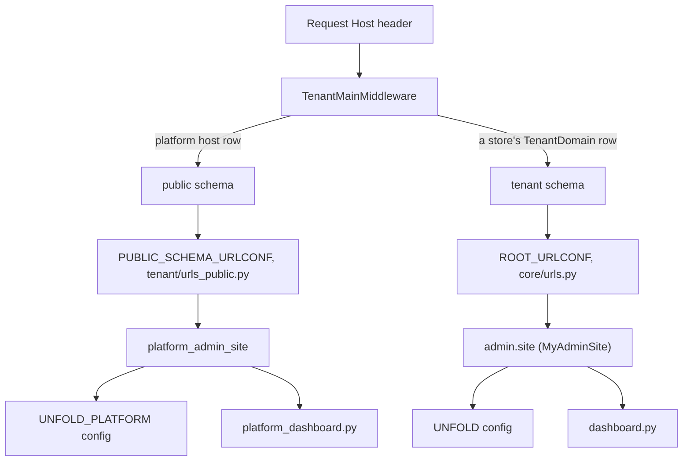

# The control plane

The platform console is a **second Django admin site**, not the store admin
with extra permissions. It is its own `AdminSite` subclass
(`admin/platform_site.py: PlatformAdminSite`), mounted on its own URL conf,
with its own Unfold configuration, sidebar, dashboard and login. It is
served only on the platform host and only ever touches public-schema
tables; a store's admin is served on that store's own hosts and reads that
store's schema. The two share `BaseModelAdmin` and most `ModelAdmin`
classes, and nothing else.

This page is the map of that console. The record it mostly edits is on
[The tenant record](/dev/operator/tenants); the hosts it routes are on
[Domains & certificates](/dev/operator/domains).

## Diagram

## How it works

### Two sites, selected by the host

`settings.py` sets `PUBLIC_SCHEMA_URLCONF` to `tenant/urls_public.py`, and
that module mounts `platform_admin_site.urls` at `admin/` **before**
`public_shared_urlpatterns`, so on the public schema the platform site
shadows the store admin that `core/urls.py` registers at the same path.
A tenant host never loads that module at all.

`PlatformAdminSite` differs from a stock Unfold site in four places
(`admin/platform_site.py`):

| Attribute | Value | Why |
|---|---|---|
| `settings_name` | `"UNFOLD_PLATFORM"` | `unfold.settings.get_config()` resolves `settings.<settings_name>` merged over Unfold's defaults, so this site gets its own branding, sidebar and colours without touching the store admin's `UNFOLD` block |
| `index_template` | `"admin/platform_index.html"` | `AdminSite.index()` otherwise falls back to `admin/index.html`, which this project overrides globally with the **merchant** dashboard — the control plane rendered a store's revenue figures without this |
| `login_form` | `PlatformAdminAuthenticationForm` | Credentials are always checked against the public schema's user table |
| `get_urls()` | prepends `plan-billing/` | `AdminSite.get_urls` ends in an `<app_label>/` catch-all that would 404 the custom page first |

`UNFOLD_PLATFORM` (`settings.py`) declares only the differences from a
stock install: the `Control plane` subheader, the `hub` symbol,
`ENVIRONMENT` pointing at `admin/permissions.py: platform_environment`
(which renders a permanent amber **Control plane** badge, because the two
consoles look alike enough to edit the wrong one), the
`DASHBOARD_CALLBACK`, a `COMMAND` block so the ⌘K palette searches records
rather than only sidebar titles, and the sidebar below. `SITE_DROPDOWN`
carries a single **Help & Guides** link, and only when `ADMIN_DOCS_URL` is
set, so a local checkout renders no link at all.

### Registration is copied, not re-declared

`register_platform_models()` (`admin/platform_site.py`), called from
`MyAdminConfig.ready()` in `admin/apps.py` after `admin.autodiscover()`,
walks the default site's registry and re-registers **the same ModelAdmin
class** on the platform site for every model whose app label is in
`PLATFORM_APP_LABELS` and whose label is not in `PLATFORM_EXCLUDED_MODELS`.
Nothing is declared twice, so the two consoles cannot drift as fields and
inlines change. It is idempotent, which matters because `ready()` can run
more than once under the autoreloader.

`PLATFORM_APP_LABELS` is `tenant`, `user`, `auth`, `sites`, `usersessions`,
`country`, `region`, `django_celery_beat`, `django_celery_results` and
`core`. Two absences are deliberate and documented in the file:

- **`extra_settings`** — every knob in `EXTRA_SETTINGS` is store-scoped and
  read from the tenant's own schema. Nothing running in the public schema
  reads `Setting` at all, so a section here only materialised meaningless
  public rows and invited edits that silently changed nothing for any store.
- **`allauth_idp_oidc`** — `allauth.idp.oidc` is in `TENANT_APPS` only, so
  its tables do not exist in the public schema. The sections rendered and
  then raised `ProgrammingError` the moment they were opened. OIDC agent
  clients and tokens are per-store and belong in the merchant admin.

`PLATFORM_EXCLUDED_MODELS` strips four models that `user` drags in —
`SubscriptionTopic`, `UserSubscription`, `UserAddress`, `UserDataExport` —
because they describe **customers**, who exist only in tenant schemas. The
`user` app itself is registered because platform staff identities *are* the
public-schema rows.

### What each console withholds from the other

Two mirror-image guards, both derived from `tenant/app_labels.py` rather
than enumerated, so a new app is covered without editing a list.

| Guard | Fires when | Withholds | Effect |
|---|---|---|---|
| `admin/base.py: BaseModelAdmin._withheld_on_public` | `request.tenant` is positively the public schema | models whose app is in `tenant_only_app_labels()` (in `TENANT_APPS`, not in `SHARED_APPS`) | The store's own models never appear on the control plane. Without it Django queried the pre-multi-tenant legacy tables still sitting in `public` and raised a column-does-not-exist 500; a 403 is the honest answer |
| `admin/mixins.py: WithheldOnTenantHostModelAdmin` | `request.tenant` is positively a real store | models whose app is in `shared_only_app_labels()` (in `SHARED_APPS`, not in `TENANT_APPS`) | Platform models never appear on a store's admin. `django_site` lists every store's domain; `core_cachepurgelog` records every purge across the estate, actor column included |

Both gate `has_module_permission` (which removes the model from the app
list, closing the navigation) **and** the four object permissions (which
turn a typed URL into a clean 403 rather than a page of someone else's
data). Both only withhold when they *positively* know which side they are
on: keying on `connection.schema_name` instead would fire during tests,
management commands and Celery work, where no tenant is bound.

One exemption, `admin/mixins.py: STORE_SELF_SERVICE_APP_LABELS`: the
`tenant` app is **not** withheld from a store's admin, because
`TenantAdmin.get_queryset` scopes a merchant to their own row and
`get_readonly_fields` allowlists only their own fields. That is the
merchant self-service surface — see
[The tenant record](/dev/operator/tenants).

`role_scopes.PLATFORM_ONLY_APP_LABELS` looks like the tenant-host set and is
not; do not substitute it. It also names `allauth_idp_oidc`, whose tables are
tenant-only, so withholding on it would hide OIDC clients a store genuinely
owns. It also names `auth`, which is dual-listed and therefore absent from
`shared_only_app_labels()`: `Group` is **not** withheld on a store host, only
unlinked from that sidebar and denied to every store role — see
[Platform staff & access](/dev/operator/team). The two sets answer different
questions: `PLATFORM_ONLY_APP_LABELS` is "may a role hold permissions here",
`shared_only_app_labels()` is "does this store have its own copy of the
table".

The tenant-host mixin has to be applied at four places that share no base
class — `BaseModelAdmin`, the five celery-beat admins in `core/admin.py`,
`CachePurgeLogAdmin`, and the `override_third_party_admins()` factory, where
it goes first in the bases so its permission overrides win the MRO. "Did we
miss one" is therefore answered against the live registry rather than by
reading the code:
`tests/integration/admin/test_tenant_host_model_visibility.py` walks
`admin.site._registry` and asserts every shared-only model is refused on a
tenant host, by module permission and by view permission.

### Who can sign in

`PlatformAdminSite.has_permission` requires three things in order:

1. Django's own `AdminSite.has_permission` — authenticated and `is_staff`.
2. `tenant/auth_backends.py: is_platform_staff_session(request)` — the
   session was authenticated by `PlatformStaffBackend` against the public
   schema, not by a customer login in some store's schema.
3. `request.user.is_superuser`.

The third is the one that matters and it is not paranoia. `is_staff` on a
public identity is what admits a **store operator** to their own store's
admin, so every merchant holds it; gating the control plane on `is_staff`
let a merchant load this page, and the dashboard renders the whole estate —
every store's name, domain, plan, order count and revenue. The app list came
back empty for them and no model page opened, but "they cannot click
through" is not a boundary. The platform is operated by superusers;
anything finer needs a real platform-staff concept rather than borrowing
the flag that means "can open some store's admin".

Underneath Django, the host itself is gated: `ingress-platform.yaml` in the
infrastructure repo puts a Traefik `basicAuth` middleware
(`platform-basic-auth`, sealed secret `platform-admin-basic-auth`) in front
of the control plane, so lifecycle actions that drop schemas are kept off
every tenant's cookie and CSP surface. The host is itself data — a
`TenantDomain` row on the public tenant created by
`manage.py bootstrap_platform --domain platform.grooveshop.space` — so
renaming the console is a row change, not a code change.

## The sidebar

Four groups, eighteen links (`UNFOLD_PLATFORM["SIDEBAR"]["navigation"]`).
Every `link` is a `reverse_lazy(..., urlconf=PUBLIC_SCHEMA_URLCONF)`: an
unpinned lazy cannot be cast on a host that does not register the
`platform_admin` namespace, and Django's technical 500 page casts every lazy
in settings, so an unpinned link turns any local error into
`NoReverseMatch`.

### Control plane

| Entry | Model or page | What it is for |
|---|---|---|
| **Dashboard** | `platform_admin:index` | Estate counters and the store table — see below |
| **Tenants** | `tenant.Tenant` | The store record: identity, branding, locales, plan flags, credentials, and the suspend/activate/destroy actions. [The tenant record](/dev/operator/tenants), [Suspend, export & destroy](/dev/operator/lifecycle) |
| **Plan & Billing** | `admin/platform_billing.py: PlanBillingView` | A custom Unfold page mounted only here. Documents how plans actually work and classifies every store with the same `tenant/billing.py: billing_state` the nightly dunning task acts on, so the page can never disagree with the automation. [Plans, billing & dunning](/dev/operator/billing) |
| **Tenant Domains** | `tenant.TenantDomain` | Every hostname the platform serves, and which store it resolves to. [Domains & certificates](/dev/operator/domains) |
| **Memberships** | `tenant.UserTenantMembership` | Staff grants: which public identity may operate which store, and in what role. [Platform staff & access](/dev/operator/team) |

### Identity

| Entry | Model | What it is for |
|---|---|---|
| **Platform Staff** | `user.UserAccount` (public rows) | Platform identities. On this host these are operators and store owners, never a store's shoppers — those live in each tenant's own schema |
| **Groups** | `auth.Group` | Django groups. `auth` is in `role_scopes.PLATFORM_ONLY_APP_LABELS` precisely because a store admin who can mint groups can mint themselves any permission that exists. The store sidebar linked this until 2026-09-12; nothing in the repository creates a `Group`, so the section listed a table nothing reads while offering exactly that escalation |

### Platform

| Entry | Model | What it is for |
|---|---|---|
| **Countries** | `country.Country` | Shared reference data. One merchant editing it changes it for every store, which is why it is here and not in a store's admin |
| **Regions** | `region.Region` | Same |
| **Cache Purge Log** | `core/cache/models.py: CachePurgeLog` | One public-schema row per purge across the whole estate. [Caches & purging](/dev/operations/caches) |
| **Sites** | `sites.Site` | One `django_site` row per store domain, minted by `tenant/provisioning.py: ensure_site`. This is what allauth resolves a per-store `SocialApp` against |

### Background Jobs

Collapsed by default. `django_celery_beat` and `django_celery_results`
tables live in the public schema and drive every store's fan-out tasks, so
they are platform operations and never one store's.

| Entry | Model |
|---|---|
| **Periodic Tasks** | `django_celery_beat.PeriodicTask` |
| **Crontab / Interval / Clocked / Solar Schedules** | the four `django_celery_beat` schedule models |
| **Task Results** | `django_celery_results.TaskResult` |
| **Group Results** | `django_celery_results.GroupResult` |

`CELERY_TASK_IGNORE_RESULT` is on and
`CELERY_TASK_STORE_ERRORS_EVEN_IF_IGNORED` is on, so **only failures** are
written; the result backend is `django-db` and the manifests deliberately
do not override it (`base/backend.yaml`). Task Results is therefore a short
failure log for the whole estate, not a task history. See
[Scheduled work & platform data](/dev/operator/background-jobs) and
[Celery & background jobs](/dev/django/celery).

## The dashboard

`admin/platform_dashboard.py: dashboard_callback` fills
`core/templates/admin/platform_index.html`. Five counter cards, then the
estate table:

| Card | Source | Notes |
|---|---|---|
| **Stores** | `Tenant.objects.exclude(schema_name=public).count()` | Links to the Tenants changelist |
| **Live** | `is_active=True, suspended_at__isnull=True` | |
| **Suspended** | `suspended_at__isnull=False` | |
| **Scheduled tasks** | enabled `PeriodicTask` rows | A stalled beat stops every store's carrier polling at once, which is why it belongs here and not on a merchant's dashboard |
| **Failed tasks (24h)** | `TaskResult` with `status="FAILURE"` and `date_done` within 24 hours | Links straight to the failure-filtered changelist. It used to sit on the store dashboard, where it silently attributed every store's failures to whichever merchant was open |

The table (`_tenants_table`) has one row per store: **Store, Domain,
Schema, Plan, Status, Orders, Revenue**. Orders and revenue are read
*inside* each tenant's schema via `tenant_context`; revenue is
`Sum(paid_amount)` over `payment_status=COMPLETED`, the same shape the
merchant dashboard uses, so only money that landed counts.

Two honesty rules are load-bearing:

- `_schema_exists()` checks `information_schema.schemata` **before**
  counting. `SET search_path` to a missing schema does not error, it
  silently falls through and the count comes back `0`, which would report a
  half-provisioned store as a real store with no sales. Blank (`—`) is the
  answer for "cannot tell", and the same applies to the
  **Failed tasks** card, which shows `—` rather than claiming a clean 24
  hours it did not check.
- Cells are plain strings or `{"content", "class"}` dicts, because Unfold's
  table component escapes `content` — a tenant-supplied store name can never
  inject markup into the control plane.

The header carries two buttons, **New Store** (the `Tenant` add form, which
provisions through `tenant/provisioning.py` — see
[Onboarding a store](/dev/operator/onboarding)) and **Domains**.

## Invariants

- **Per-store models are structurally absent here, not merely forbidden.**
  They are never registered on this site; `_withheld_on_public` is defence
  in depth for the shared site, not the mechanism.
- **Only superusers reach this console**, and a merchant `is_staff` flag is
  not a superuser flag.
- **Every `UNFOLD_PLATFORM` link is pinned with `urlconf=`.**
  `tests/unit/core/test_unfold_links_resolve.py` casts every link in both
  blocks under both URL confs and runs the debug page's own settings dump;
  an unpinned link fails that test.
- **A new public-schema model belongs in `register_platform_models()`**, via
  `PLATFORM_APP_LABELS`, not in a second `@admin.register(..., site=...)`
  declaration.
- **The console reads the estate; it does not enter a store to work in it.**
  Where it must read tenant data (orders, revenue, last activity) it goes
  through `tenant_context` behind the schema-existence guard.

## Failure modes

- **A tenant-only model page opened on this host**: 403 by design
  (`_withheld_on_public`). If it 500s with a missing column instead, the
  guard did not fire — check that `request.tenant` is set.
- **A platform model page opened on a store host**: 403 by design
  (`WithheldOnTenantHostModelAdmin`). Two exceptions: `tenant`, which is the
  merchant's own settings screen, and `auth`, which is dual-listed and so
  never reaches the guard at all.
- **A merchant reports seeing another store's rows on a screen that is not a
  changelist.** The guard is a `ModelAdmin` permission hook, so it covers
  changelists and detail pages and nothing else. A custom admin view that
  queries a `SHARED_APPS`-only model directly still falls through the tenant
  search path into `public` and must scope itself.
- **A sidebar entry 404s**: the model is not registered on this site.
  Check `PLATFORM_APP_LABELS` and `PLATFORM_EXCLUDED_MODELS`.
- **The dashboard shows `—` in Orders or Revenue**: that store's schema
  does not exist or could not be read. Half-provisioned, mid-destroy, or a
  migration that never reached it — not a store with no sales.
- **Login lands on the storefront account page**: `AdminSiteLoginNextMixin`
  adds the `next` parameter because Unfold's login template never emits one;
  both sites carry the mixin.
- **The whole host answers with a browser credentials prompt**: that is the
  ingress basic auth, not Django.

## Source

| File | Role |
|---|---|
| `grooveshop-django-api/admin/platform_site.py` | `PlatformAdminSite`, `PLATFORM_APP_LABELS`, `PLATFORM_EXCLUDED_MODELS`, `register_platform_models` |
| `grooveshop-django-api/admin/platform_dashboard.py` | Estate counters, per-store rows, `_schema_exists`, failed-task count |
| `grooveshop-django-api/core/templates/admin/platform_index.html` | The dashboard cards and estate table |
| `grooveshop-django-api/admin/platform_billing.py` | The Plan & Billing page mounted by `get_urls` |
| `grooveshop-django-api/admin/base.py` | `BaseModelAdmin._withheld_on_public` |
| `grooveshop-django-api/admin/mixins.py` | `WithheldOnTenantHostModelAdmin`, `STORE_SELF_SERVICE_APP_LABELS`, `AdminSiteLoginNextMixin` |
| `grooveshop-django-api/admin/permissions.py` | `platform_environment` badge |
| `grooveshop-django-api/admin/apps.py` | Calls `register_platform_models()` after autodiscovery |
| `grooveshop-django-api/tenant/app_labels.py` | `tenant_only_app_labels`, `shared_only_app_labels` |
| `grooveshop-django-api/tenant/role_scopes.py` | `PLATFORM_ONLY_APP_LABELS` — role scope, not the withhold set |
| `grooveshop-django-api/core/admin.py` | `override_third_party_admins()`, the celery-beat admins and `CachePurgeLogAdmin` — three of the four mixin application points |
| `grooveshop-django-api/tests/integration/admin/test_tenant_host_model_visibility.py` | Registry-walking coverage for the tenant-host guard |
| `grooveshop-django-api/tests/integration/admin/test_platform_console.py` | Pins the store/control-plane sidebar split |
| `grooveshop-django-api/tenant/urls_public.py` | Mounts the site and the platform API on `PUBLIC_SCHEMA_URLCONF` |
| `grooveshop-django-api/tenant/auth_backends.py` | `PlatformStaffBackend`, `is_platform_staff_session` |
| `grooveshop-django-api/tenant/management/commands/bootstrap_platform.py` | The public tenant row and its host |
| `grooveshop-django-api/settings.py` | `UNFOLD_PLATFORM`, `PUBLIC_SCHEMA_URLCONF`, Celery result settings |
| `grooveshop-django-api/core/cache/models.py` | `CachePurgeLog` |
| `grooveshop-infrastructure/manifests/app-constructs/grooveshop/overlays/production/ingress-platform.yaml` | The platform host, its certificate and basic auth |
| `grooveshop-infrastructure/manifests/app-constructs/grooveshop/base/backend.yaml` | Celery result backend, left at the `django-db` default |
