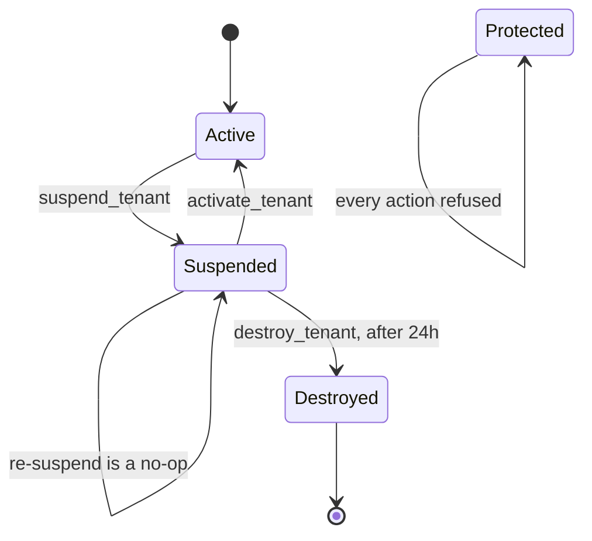

# Suspend, export & destroy

Three operations move a store out of service, and they are not
interchangeable. **Suspension** is reversible and touches no data.
**Export** writes a copy of the store's rows to the private volume and
changes nothing. **Destruction** drops the Postgres schema, erases the
store's files and search indexes, and cannot be undone by anything short
of a database restore.

All three live in `tenant/lifecycle.py` as one implementation, because
they have three callers — the platform admin actions, the platform REST
API and the billing dunning task — and the safety gates must not be
skippable by choosing a different one. The gates run inside
`destroy_tenant` itself, not in its callers.

## Diagram

## Protection comes first

`is_protected_tenant` decides whether any of these may run at all:

- The **public schema is protected by construction** — it is the
  platform, not a store.
- Every other protection is the `Tenant.is_protected` row flag, set by a
  platform superuser in the admin. No store is named in code, so
  shielding a merchant needs no deploy.

A protected tenant is skipped by `suspend_tenant` and `activate_tenant`
(both return `False`), refused by `destroy_refusal` with `protected`, and
rejected by `Tenant.delete()` itself with a `ValidationError`.
`TenantAdmin.has_delete_permission` also withholds the ordinary delete
permission for protected rows, so the red delete button does not render
and the delete view answers 403 — otherwise the `ValidationError` would
surface as a 500 behind a confirmation page.

::: warning The docstring at the top of `tenant/admin.py` is out of date
It says `public` and `webside` are protected. Protection is the row flag
plus the public schema; no merchant schema is named anywhere in the code.
The flag is what to check.
:::

## Who may run these

| Surface | Gate |
|---|---|
| Admin actions **Suspend / Activate / Permanently destroy / Export store data** | Platform operators only. `TenantAdmin.get_actions` strips all four when the request is a merchant administering their own store (`self_service_tenant`), and the platform actions are reached through `PlatformAdminSite` on the platform host |
| `POST /api/v1/tenant/admin/<pk>/suspend/` and `/activate/`, `DELETE /api/v1/tenant/admin/<pk>/` | `IsPlatformOperator`: authenticated **and** superuser **and** a session minted by `PlatformStaffBackend`. The routes are mounted only in `tenant/urls_public.py` (`PUBLIC_SCHEMA_URLCONF`), so they exist only on the control-plane host, and every method re-asserts the public schema — answering 404, not 403, on a tenant host so the endpoint's existence does not leak |
| The billing dunning task | Calls `suspend_tenant` with reason `BILLING`. It never destroys anything |

Django's stock `delete_selected` bulk action is removed from the Tenants
changelist so nobody can bypass the rails through the standard delete
path.

::: info The **Active** field is read-only
`is_active` changes only through the Suspend and Activate actions
(`tenant/lifecycle.py`): it is in `TenantAdmin.readonly_fields`
(`tenant/admin.py`) as it is in `TenantAdminSerializer`. Ticking it in
the form used to take a store offline without stamping `suspended_at`,
without the media flush or the protected-tenant refusal, and left a store
active by one rule and suspended by another.
:::

## Suspend

`suspend_tenant(tenant, reason=...)` returns `True` only when it changed
something:

1. Protected tenant → `False`, nothing happens.
2. Already fully suspended (`is_active` false **and** `suspended_at`
   set) → `False`. This is deliberate: re-suspending must not reset the
   24-hour destroy cooldown, and must not let the billing task relabel an
   operator's abuse suspension.
3. Otherwise: `is_active = False`, `suspended_reason = <reason>`, and
   `suspended_at = now` **only if it was empty** — the first suspension
   sets the anchor and later ones leave it alone.
4. A media flush is queued for after the commit, best-effort (see
   [What the media flush touches](#what-the-media-flush-touches)). No file
   moves: the static host serves no original as uploaded (it redirects to
   media-stream), and media-stream refuses the store's images by its state (see
   [the caches page](../operations/caches.md#layer-4-media-stream-image-cache)).

`suspended_reason` is `SuspendedReason.MANUAL` (operator: abuse, legal,
judgement) or `SuspendedReason.BILLING` (the dunning task acting on a
lapsed term). The distinction is load-bearing: `reactivate_on_renewal`
in `tenant/signals.py` lifts a suspension automatically when `paid_until`
moves to today or later, and it is scoped strictly to `BILLING`. Recording
a payment can never resurrect a store an operator took down on purpose.

No resolve-cache work is needed by hand. The `post_save` receiver on
`Tenant` clears every one of its domains' cached resolve payloads on any
save (`tenant/signals.py: invalidate_tenant_caches`).

### What a suspended store looks like

| Who | What they get |
|---|---|
| A shopper on the storefront | A **404 "Store not found"** page. The Nuxt tenant middleware resolves the host through Django, `tenant_resolve` filters on `tenant__is_active=True` and answers 404, and `server/middleware/0.tenant.ts` throws 404 for a missing config |
| Anything calling the store's API host directly | **503** with `"This store is temporarily unavailable. Please contact the store owner."` — `SuspendedTenantMiddleware`, placed immediately after tenant resolution. 503 rather than 404 because the domain is known and the condition is temporary |
| A WebSocket client | Closed **4004**; `tenant/middleware_ws.py` filters on `tenant__is_active=True` |
| The store's own staff | The store admin lives on the tenant host, so it is behind the same 503. Staff cannot reach their own panel while suspended |
| Platform operators | Unaffected — the control plane runs on the public schema at `platform.grooveshop.space` |
| In-cluster services | The internal tenant feed (`tenant/internal.py: build_domains_payload`) drops the store's domains and lists its schema in `suspendedSchemas`; both follow `SuspendedTenantMiddleware`'s rule, `is_active` |
| Scheduled work | Skipped. `run_for_all_tenants` selects `is_active=True`, so no beat-driven task fans into a suspended schema — no carrier polling, no payout reconciliation, no locker sync burning the merchant's API budget on a frozen store |
| Processed images | Refused by media-stream, **503** `TENANT_SUSPENDED` with `Cache-Control: no-store`, before any cache tier is read; its cached copies are flushed and Cloudflare's purged |

The `SuspendedTenantMiddleware` docstring records why it exists: before
it, `django_tenants` resolved the host with a bare `domain=hostname`
lookup that never consulted `is_active`, so a suspended merchant went
dark on the storefront while their API kept serving in full — catalogue
reads, cart mutations, **order creation** and payment-intent creation
against their own live provider keys.

::: tip Retention sweeps also stop
`run_for_all_tenants` takes an `include_suspended` flag, used by the two
contact-attachment retention sweeps on the argument that deleting data the
platform promised to delete should not pause with billing. As written the
query still requires `is_active=True`, and a suspended store has
`is_active=False`, so those sweeps do not in fact reach it. Expect a long
suspension to accumulate expired uploads.
:::

### What the media flush touches

`_dispatch_media_flush` queues `tenant/tasks.py:
flush_tenant_media_task`, which POSTs media-stream's
`/admin/cache/flush-tenant` with the schema name, guarded by the
`x-internal-secret` header (`tenant/media_flush.py`). On the media-stream
side (`src/MediaStream/Cache/controllers/admin-cache.controller.ts`) it
invalidates the `image:{schema}:*` namespace across every active cache
layer — memory and Redis — and deletes the tenant's objects from the
rendition store (the R2 bucket, prefix `{schema}/`), which the serve path
reads directly and which would otherwise resurrect a flushed resource on the
next request.

Every replica first re-reads Django's tenant feed
(`TenantDomainsService.refresh`), so from that moment it refuses the
suspended store's images, and serves them again after a reactivation. The
original uploads under `MEDIA_ROOT/{schema}` are files, not cache: they stay
where they are, only media-stream reads them, and only a destroy removes
them (see [the caches page](../operations/caches.md#layer-4-media-stream-image-cache)).

Two properties to rely on:

- **It runs after the commit and cannot block a suspension.** The
  task is queued with `dispatch_on_commit(..., robust=True)`
  (`tenant/celery.py`): media-stream re-reads the feed when the flush
  reaches it, so it must never run before the new state is visible, and a
  broker failure is logged rather than raised. The task retries on its
  own; a media-stream outage delays the flush, never the suspension.
- **Reactivation always sends it.** `activate_tenant` queues the same
  flush and purge whether or not media was restored: it is what makes
  media-stream serve the store again at once rather than at its next poll.
- **It fails open by configuration.** With no
  `MEDIA_STREAM_INTERNAL_URL`/`SECRET` set, the flush is skipped and the
  cache expires by TTL — up to 180 days private, 360 days public, per the
  module docstring.

## Activate

`activate_tenant(tenant)` is the reverse: refused for protected tenants
(`False`), otherwise `is_active = True` with `suspended_at` and
`suspended_reason` cleared **together**. An active tenant carries neither,
and clearing `suspended_at` is what removes the destroy cooldown anchor —
a store that is reactivated and later suspended again starts a fresh 24
hours.

Unlike `suspend_tenant` it carries **no already-in-that-state guard**: it
returns `True` for any tenant that is not protected, and writes the row
every time, so it reports "activated" for a store that was already
running. Read its `True` as "not refused", not as "something changed".

## Export

`export_tenant_data(tenant, actor=...)` exists because GDPR art. 28(3)(g)
obliges a processor to delete **or return** personal data at the end of
processing, *at the controller's choice*. The merchant is the controller;
offering only destruction answers half the article.

What it does (`tenant/lifecycle.py`):

- Runs `dumpdata` inside `schema_context(tenant.schema_name)` with
  `--natural-foreign --natural-primary`, excluding `contenttypes`,
  `auth.permission` and `sessions`, indented. Natural keys keep the dump
  portable: primary keys are meaningless once the schema is gone, so a
  re-import elsewhere needs names.
- Writes to
  `{private media root}/_tenant_exports/{schema}/{schema}-{YYYYMMDDTHHMMSSZ}.json`.
  In the cluster the private tree is the `grooveshop-backend-media-private-pvc`
  volume, mounted at `/home/app/web/mediafiles_private` on both the
  `backend` and `celery-worker` Deployments, so a dump written by a worker
  is readable from a backend pod. `export_tenant_data`'s own docstring
  calls it "the only volume both the backend and the celery worker mount";
  it is not — those two Deployments also share the public media and the
  backups PVCs. The private tree is the right destination because nothing
  serves it over HTTP, not because it is the only shared one.
- Logs the schema, the path and the requesting actor, and returns the
  path. The admin action reports the path in a success message.

What the export does **not** contain:

- **Files.** No product images, no editor uploads, no invoice PDFs — the
  dump is database rows only. Those live on the media volumes and are
  erased by the destroy.
- **Public-schema rows.** The `Tenant` row itself, its `TenantDomain`
  rows and the staff `UserTenantMembership` rows are platform data, not
  store data, and are not in the schema being dumped.
- Content types, permissions and sessions, excluded on purpose.

The private tree has no URL by design (`tenant/storage.py` returns
`None` from `base_url` so `url()` raises), so delivering the file to the
merchant is a deliberate operator step: copy it out of the pod, hand it
over through whatever channel the contract requires.

`has_tenant_export(tenant)` answers "does an export directory exist and
is it non-empty" — that is all it checks. It does **not** validate the
dump, its age or its contents, and it is what `destroy_tenant` records on
the archive as `data_exported`. Verify the file yourself; a zero-byte
file from a failed run would still read as `True`.

::: warning The export survives the destroy, forever
`_tenant_exports/{schema}` is a **sibling** of the per-schema private
directory, not a child, so `purge_tenant_files` — which sweeps
`{private}/{schema}` — never reaches it, and no scheduled task purges it
either. A whole-store JSON dump including every customer's personal data
therefore sits on the private volume indefinitely after the store is
gone. Delete it by hand once it has been delivered.
:::

## Destroy

This is the only irreversible action on the platform.

### Every condition under which it is refused

`destroy_refusal(tenant)` returns the first that applies, and
`destroy_tenant` raises `ValueError` on any of them:

| Key | Condition | Message |
|---|---|---|
| `protected` | `is_protected_tenant` — the public schema, or `Tenant.is_protected` set | "it is a protected tenant" |
| `not_suspended` | `tenant.is_active` is true, **or** `suspended_at` is `None` | "it must be suspended first" |
| `cooldown` | Less than `SUSPEND_COOLDOWN` (24 hours) has passed since `suspended_at` | "it was suspended less than 1 day, 0:00:00 ago" |

The cooldown exists for exactly one failure: an accidental suspension
followed by an immediate destroy.

Two more gates sit above these in the admin path:

- **An intermediate confirmation page.** The action renders
  `admin/tenant/destroy_confirmation.html` and only acts on a second POST
  carrying `destroy_confirmed=yes`. The gates above still run in full on
  that second POST — the page adds a step, it does not replace them.
- **The gates are re-evaluated under a row lock.** `destroy_tenant`
  re-reads the tenant with `select_for_update()` inside its transaction
  and calls `destroy_refusal` again on that row, not on the caller's
  snapshot. Between an operator opening the changelist and confirming,
  someone else may have reactivated or protected the store; the lock also
  holds a concurrent activate off until the drop commits.

### What it does, in order

The order is not arbitrary (`tenant/lifecycle.py: destroy_tenant`). Inside
one transaction:

1. Re-read the row under lock and re-run the refusal gates.
2. Read the **last invoice year first**, with
   `offboarding.latest_invoice_year(schema)` — it lives inside the schema
   step 4 destroys. On any read failure it returns the current year rather
   than `None`: of the two possible mistakes, only over-retention is
   recoverable.
3. Write the `TenantArchive` row **before** deleting anything, so a crash
   part-way leaves evidence rather than a silent gap. It records the
   schema and store name, when and by whom, whether an export existed,
   the retained invoice path, the retention expiry and the legal basis.
4. `tenant.delete(force_drop=True)` — drops the Postgres schema, then the
   row. `force_drop` is what makes this different from a bare
   `instance.delete()`: `auto_drop_schema` is `False`, so a plain delete
   would remove the row and orphan the entire schema.

Then, outside the transaction, because each needs only the schema **name**
and so survives the row being gone:

5. `purge_search_indexes` deletes every `{schema}__*` Meilisearch index.
   Scoped by that prefix, so it can never reach another store's indexes
   or the public schema's unprefixed ones. Failures here are logged and
   swallowed — raising would leave a store whose schema is already gone
   with its files still on disk — and the partial list is returned so the
   report says what was actually dropped.
6. `purge_tenant_files` erases the files.
7. A final media flush.

### What is erased and what is kept

| Erased | Where |
|---|---|
| The entire Postgres schema and every row in it | `force_drop=True` |
| The `Tenant` row, its domain rows and staff memberships | Cascade |
| Public uploads | `MEDIA_ROOT/{schema}` |
| GDPR data-subject export bundles | `{private}/_gdpr_exports/{schema}` |
| Every other private artefact | `{private}/{schema}/*` except `invoices/` — an **allowlist**, so a future private artefact is erased by default rather than retained by omission |
| Search indexes | `{schema}__*` |
| Processed images | media-stream cache, all layers plus disk |

| Kept | Why |
|---|---|
| Issued invoices at `{private}/{schema}/invoices` | Greek Tax Procedure Code (N. 4987/2022 art. 13) requires accounting records for the statutory assessment period; GDPR art. 17(3)(b) and 28(3)(g) both yield to a legal obligation |
| The `TenantArchive` row, in the public schema | GDPR art. 5(2) — the controller must be able to demonstrate compliance. Read-only in the admin, with add and delete both refused |
| The operator's data export | Never swept — see the warning above |

Retention is dated, not indefinite: `retention_until` is **31 December**
of the last invoice's tax year plus `TENANT_INVOICE_RETENTION_YEARS`
(default 6) — a year end, not an anniversary, because the statute counts
from the end of a tax year. A store that issued no invoices retains
nothing and gets `retention_until = None`.

`purge_expired_tenant_archives` (`tenant/tasks.py`) is the other half:
once `retention_until` has passed it removes the retained invoice
directory and stamps `purged_at`. Keeping records forever is not the safe
option — it is a storage-limitation breach in its own right, art.
5(1)(e).

### What is not recoverable

Everything in the "Erased" table. There is no soft delete, no tombstone
with the data behind it, and no undo. The only route back is a restore of
the PostgreSQL backup, which is nightly and — see
[Backups](/dev/operations/backups) — currently in-cluster only. Anything
the store wrote since the last dump is gone, and the media files are not
in the database dump at all.

The `TenantArchive` row is the record that it happened. It is not a copy
of anything.

## The safe sequence

1. **Suspend.** Starts the 24-hour clock and freezes the store; it is
   required before a destroy anyway, so it may as well be first. Use the
   Suspend action, not the Active checkbox.
2. **Export**, and check the file. Look at the path the action reported;
   confirm it exists and is not empty, and sanity-check its size against
   what you expect for that store. `has_tenant_export` only checks that a
   directory is non-empty, so a failed run can still make the archive say
   `data_exported = True`.
3. **Deliver the export** to the merchant, and get their acknowledgement.
   This is the "return" half of the art. 28(3)(g) choice; once step 5
   runs there is nothing left to return.
4. **Wait out the cooldown.** The destroy action tells you how many
   minutes remain.
5. **Destroy**, and confirm on the intermediate page. Read the resulting
   messages: the action reports the retention date when invoices were
   kept, and names any tenant it skipped and why.
6. **Clean up afterwards**: remove the tenant's overlay directory from
   `overlays/production/tenants/` so the ApplicationSet prunes its
   ingress objects, delete its `Certificate` objects (cert-manager does
   not prune them), and delete the export file from the private volume
   once it is no longer needed.

## Invariants

- Protected tenants never move. The public schema is protected by
  construction; every other protection is the row flag.
- `suspended_at` is stamped on the **first** suspension only, and cleared
  only by activation. It is the cooldown anchor.
- A `BILLING` suspension can be lifted by recording a payment; a `MANUAL`
  one never is.
- There is exactly one destroy implementation, and it runs the refusal
  gates itself — the admin action, the REST endpoint and any future
  script all pass through it.
- The erasure record is written before the erasure, never after.
- Invoices are the only data deliberately retained, under a recorded
  basis and a dated expiry.
- Every offboarding helper takes a **schema name**, never a `Tenant`: by
  the time cleanup runs the row is gone, so re-deriving from it is
  impossible by construction.

## Failure modes

- **"Refusing to destroy … it must be suspended first"** on a store that
  looks inactive: `is_active` was flipped on the change form, so
  `suspended_at` is empty. Run the Suspend action — it stamps the anchor
  — and wait out the cooldown.
- **Suspension "did nothing"** (returned `False`): the store was already
  fully suspended, or it is protected. Re-suspending is intentionally a
  no-op.
- **A suspended store still serving images**: the media flush is
  best-effort. Check the Celery task and that
  `MEDIA_STREAM_INTERNAL_URL`/`SECRET` are configured; unconfigured, the
  cache expires only by TTL.
- **Destroy reported success but the search index survived**: index
  deletion is swallowed by design so file cleanup can still run. The log
  carries the exception and the partial list. Reusing that schema name
  before cleaning up would hand a new store the previous occupant's
  catalogue.
- **A destroyed store's files are still on disk**: `_remove_tree` never
  raises; look for the `Offboarding: failed to remove …` log line and
  clean up by hand.
- **`purge_expired_tenant_archives` never purges anything**: it only
  considers rows with `purged_at` null and a non-null `retention_until`
  in the past. A store that issued no invoices has no retention and is
  never due.

## Source

| File | Role |
|---|---|
| `grooveshop-django-api/tenant/lifecycle.py` | `is_protected_tenant`, `destroy_refusal`, `suspend_tenant`, `activate_tenant`, `export_tenant_data`, `has_tenant_export`, `destroy_tenant`, `_dispatch_media_flush`, `SUSPEND_COOLDOWN` |
| `grooveshop-django-api/tenant/offboarding.py` | `purge_search_indexes`, `purge_tenant_files`, `latest_invoice_year`, `retention_until`, `INVOICE_RETENTION_BASIS`, the private/public path helpers |
| `grooveshop-django-api/tenant/admin.py` | `suspend_tenants`, `activate_tenants`, `destroy_tenants` + confirmation page, `export_tenant_data_action`, `get_actions`, `has_delete_permission`, `TenantArchiveAdmin` |
| `grooveshop-django-api/core/templates/admin/tenant/destroy_confirmation.html` | The second-click confirmation page |
| `grooveshop-django-api/tenant/views.py` | `TenantAdminViewSet.destroy`/`suspend`/`activate`, `IsPlatformOperator`, `tenant_resolve` |
| `grooveshop-django-api/tenant/urls_public.py` | Lifecycle routes, mounted only on the control-plane host |
| `grooveshop-django-api/tenant/models.py` | `Tenant.is_protected`, `suspended_at`, `suspended_reason`, `SuspendedReason`, `Tenant.delete(force_drop=…)`, `TenantArchive` |
| `grooveshop-django-api/tenant/signals.py` | `reactivate_on_renewal`, resolve-cache invalidation |
| `grooveshop-django-api/tenant/middleware.py` | `SuspendedTenantMiddleware` (503) |
| `grooveshop-django-api/tenant/middleware_ws.py` | WebSocket 4004 for an inactive tenant |
| `grooveshop-django-api/tenant/internal.py` | Internal tenant feed: active stores' domains and `suspendedSchemas` |
| `grooveshop-django-api/tenant/celery.py` | `run_for_all_tenants`, `include_suspended`, `dispatch_on_commit` |
| `grooveshop-django-api/tenant/lifecycle.py`, `grooveshop-django-api/tenant/admin.py` | `suspend_tenant` / `activate_tenant` and the media flush they queue; `is_active` read-only in the admin |
| `grooveshop-media-stream/src/MediaStream/Validation/services/tenant-domains.service.ts`, `grooveshop-media-stream/src/MediaStream/API/controllers/media-stream-image.controller.ts` | The feed poll and the 503 for a suspended store |
| `grooveshop-django-api/tenant/tasks.py` | `flush_tenant_media_task`, `purge_expired_tenant_archives` |
| `grooveshop-django-api/tenant/media_flush.py` | The media-stream flush call and its fail-open behaviour |
| `grooveshop-django-api/tenant/storage.py` | `private_media_root`, why private files have no URL |
| `grooveshop-django-api/settings.py` | `TENANT_INVOICE_RETENTION_YEARS`, middleware order |
| `grooveshop-media-stream/src/MediaStream/Cache/controllers/admin-cache.controller.ts` | `flush-tenant`: namespace invalidation plus the disk sweep |
| `grooveshop-storefront-ui-node-nuxt/server/middleware/0.tenant.ts` | The 404 a shopper sees on a suspended store |
| `grooveshop-infrastructure/manifests/app-constructs/grooveshop/base/backend.yaml` | `grooveshop-backend-media-private-pvc`, mounted on backend and worker |
