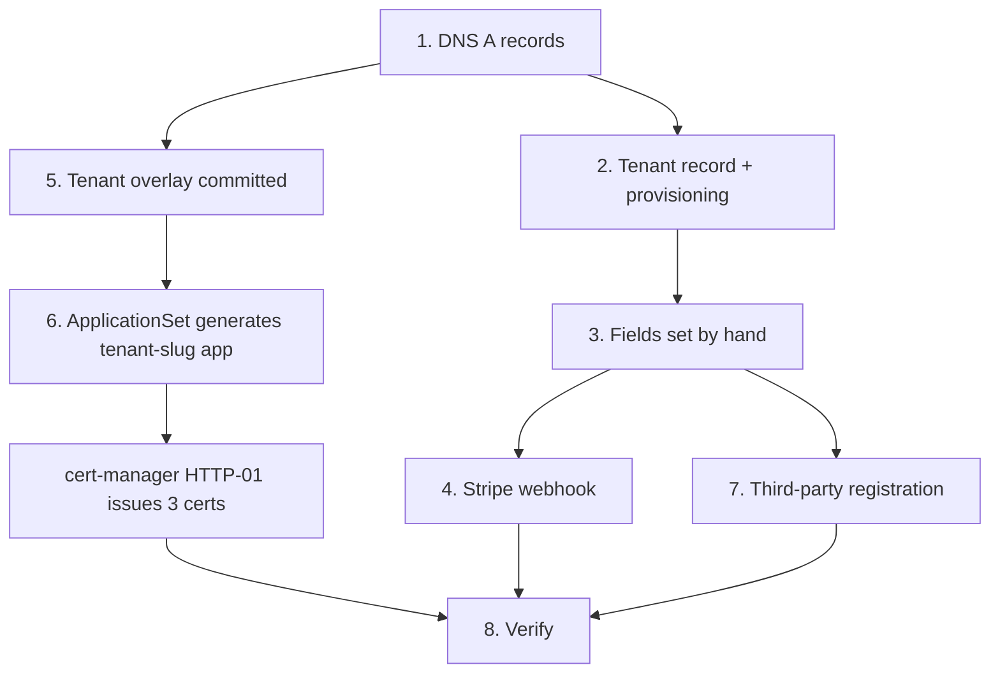

# Onboarding a store

Onboarding touches four systems in a fixed order: DNS, the tenant record
in Django, the ingress overlay in git, and the merchant's own accounts at
third parties. Only the DNS step is outside the platform, and it comes
first for a mechanical reason — certificates are issued over an HTTP-01
challenge, which has no wildcard and no DNS-01 solver configured, so a
certificate for a host that does not yet resolve to the cluster stays
`Ready=False` and retries until it does.

Nothing here is irreversible on its own. A half-onboarded store is an
inert schema, a few ingress objects and a certificate; the destructive
half of the story is [Suspend, export & destroy](/dev/operator/lifecycle).
The costly mistake in this direction is the **silent** one: a store that
serves pages perfectly while a provider it never configured is simply
absent.

## Diagram



## Before you start

Collect every value below before touching anything. Two of them cannot be
changed afterwards without recreating the store.

| Decision | Rule | Changeable later |
|---|---|---|
| Slug | URL-safe, unique (`Tenant.slug`) | Yes |
| Schema name | PostgreSQL identifier, at most 63 chars; rejected if reserved or `pg_`-prefixed (`tenant/validators.py: validate_reserved_schema_name`, `RESERVED_SCHEMA_NAMES`). Convention: the slug with dashes as underscores | **No** — it names the Postgres schema and every media path |
| Primary domain | The storefront host. `api.<domain>` is derived from it | **No, in practice** — it anchors the API host, the Site row and every issued certificate |
| Owner email | Receives the OWNER membership (`tenant/provisioning.py: provision_owner_membership`) | Yes |
| Plan | One of `TenantPlan` — `trial`, `basic`, `pro`, `enterprise` | Yes |
| Trial length | `--trial-days` (default 30) sets `paid_until` so dunning covers the trial from day one; `0` means never expires. It applies **only** when `--plan trial` — a paid plan is created with no term, and staff record `paid_until` when the first payment lands | Yes |
| Vertical | `StoreVertical` — picks the recommendation preset the store starts from | Yes, but see below |
| Locales | `Tenant.available_locales`; empty means single-language on `default_locale` | Yes |

**Set the vertical before the store is provisioned, not after.**
`seed_tenant_defaults` reads `tenant.vertical` at provisioning time to
choose the recommendation preset, and `tenant_create` has no `--vertical`
flag — a store created from the CLI is seeded as `general` whatever you
set afterwards. The admin "New Store" form does carry the field. Fixing
it later means the slot admin's **Reset to preset**
(`recommendation/presets.py: reset_slot_to_preset`), slot by slot.

## Order that must not change

1. **DNS before the ingress commit.** HTTP-01 has no wildcard; the
   challenge cannot be answered until the host resolves to the cluster.
   Commit first and the `Certificate` sits pending, retrying, and every
   retry counts against Let's Encrypt's per-registered-domain weekly
   limit.
2. **Primary domain before provisioning.** `ensure_api_domain` and
   `ensure_site` both return `None` and do nothing when the tenant has no
   primary domain (`tenant/provisioning.py`). On the admin path the
   domain inline must be filled on the same save; on the CLI path
   `--domain` is required, so it cannot go wrong there.
3. **Credentials before the first order.** A blank ACS or BoxNow
   credential does not fail at checkout — it fails at dispatch, after the
   order exists and stock is decremented.
4. **Never create a tenant while an Argo sync is in flight.** The tenant
   creation runs migrations inline and races the PreSync hook's
   `migrate_schemas`; see [Deploying](/dev/operations/deploying).

## 1. DNS first

Point three A records at the cluster's ingress IP — the apex, `www.` and
`api.`. The value is the master node's public address, recorded in
`grooveshop-infrastructure/CLAUDE.md` and repeated in the tenant template
README; Traefik runs as a DaemonSet so either node answers, but pinning to
the master avoids surprises when a node drains.

```
example.com              A  <cluster ingress IP>
www.example.com          A  <cluster ingress IP>
api.example.com          A  <cluster ingress IP>
```

Behind Cloudflare, these records must be **DNS-only** (grey cloud) — a
proxied record answers the HTTP-01 challenge from Cloudflare's edge, not
from Traefik.

Verify before going further:

```bash
dig +short example.com
```

`assets.` and `static.` are **not** part of standard onboarding. Media and
static files are platform infrastructure and tenancy is enforced on the
path (`media/{schema}/…`), so every store shares
`assets.grooveshop.space` / `static.grooveshop.space`. Django's resolver
reports a dedicated `assetsDomain` / `staticDomain` only when an explicit
`assets*` / `static*` `TenantDomain` row exists — that is a white-label
opt-in, and it needs its own DNS, ingress hosts, certificates and domain
rows. See [Domains & certificates](/dev/operator/domains).

An unmapped host that resolves to the cluster but has no tenant ingress
hits `overlays/production/ingress-tenant-catchall.yaml`: HTTP only,
priority 1, redirect to HTTPS, where the handshake then fails for want of
a certificate. That visible TLS error is the intended signal that the
ingress step has not happened yet.

## 2. Create the tenant record

Two entry points, one implementation. Both end in
`tenant/provisioning.py` so they cannot drift.

**CLI** (`tenant/management/commands/tenant_create.py`):

```bash
kubectl exec -n grooveshop deploy/backend -- \
  .venv/bin/python manage.py tenant_create \
    --name "Example Store" \
    --slug example \
    --schema example \
    --domain example.com \
    --owner-email owner@example.com \
    --plan pro \
    --store-name "Example Store"
```

The whole sequence runs in one transaction. Postgres DDL is
transactional, so a failure part-way — a duplicate domain, a typo — rolls
the schema and its migration history back with everything else and leaves
nothing to clean up before you retry.

**Admin**: <span class="sidebar-path">Control plane → Tenants</span> →
add. The add form creates the row (and, through `TenantMixin.save()`, the
schema); provisioning runs from `TenantAdmin.save_related` on
`transaction.on_commit`, which is why the primary domain inline must be
filled on the same save. It is guarded to adds only — editing an existing
tenant never re-derives its API domain or re-grants OWNER membership.

::: warning Prefer the CLI for creation
`schema_name` is in `TenantAdmin.readonly_fields` unconditionally, and
`get_readonly_fields` only widens that list (for merchants), never
narrows it for an add. Django excludes read-only fields from the form on
the add view as well as the change view, so the add form has no
`schema_name` input — the one value that cannot be fixed afterwards.
Create the store with `tenant_create`, which takes `--schema` explicitly
and validates it, and use the admin for everything after that. The
provisioning path itself is shared, so nothing is lost.
:::

### What provisioning does for you

`provision_tenant` runs four things and returns a summary the caller turns
into operator messages (`tenant/provisioning.py`):

| Step | What it does | If it cannot |
|---|---|---|
| `ensure_api_domain` | Creates the `api.<primary>` `TenantDomain` row | Returns `None` with no primary domain. **Not optional**: the resolver derives `apiDomain` as `api.<primary>` and the storefront dials it, but request routing matches domain rows exactly — a derived host with no row is one Django refuses to serve. The storefront looks healthy while WebSocket notifications close 4004 and every social login 404s at the form POST |
| `ensure_site` | Creates the public-schema `django.contrib.sites` Site for the primary domain | Per-tenant `SocialApp` credentials are keyed on that Site; without it the adapter's lookup always misses and allauth silently falls back to the platform's OAuth app |
| `provision_owner_membership` | Grants OWNER `UserTenantMembership`, looked up in the **public** schema | Returns `None` if the owner has no `UserAccount` yet — the caller warns; grant the membership from the admin once they register |
| `seed_tenant_defaults` | Inside the tenant's schema: extra settings, page layouts, content pages, recommendation slots, Meilisearch indexes | Each step is independently best-effort and **returns the names that failed** |

Seeding detail worth knowing:

- **Page layouts** seed **published** (`page_config/defaults.py:
  seed_page_layouts`); **content pages** seed **unpublished**
  (`seed_content_pages`). A new store therefore has a composed homepage
  and a set of legal/marketing pages that nobody can see until the
  merchant publishes them.
- **Meilisearch indexes** are created through `update_meili_settings`,
  not a bare `create_index`, because an index with Meilisearch's default
  empty `filterableAttributes` rejects every storefront query — HTTP 400
  on every search for that store until the nightly sync repairs it.
- **Recommendation slots** come from the vertical's preset and are never
  overwritten once the merchant edits them.

**Read the seeding failures.** Both callers print them; an unqualified
"created successfully" with a failed Meilisearch step is a store whose
search is broken for up to a day.

`provision_stripe` is deliberately **not** part of `provision_tenant` — at
creation time the Stripe key is always empty, so running it there would be
a guaranteed no-op. Its trigger is step 4.

## 3. The fields you must still set

Everything application-level lives on the `Tenant` row and is edited in
the platform admin. Onboarding needs no ConfigMap change and — see step 5
— normally no sealed secret either. The per-field reference is
[The tenant record](/dev/operator/tenants); what matters here is the
**two classes of empty**, because they behave in opposite ways.

**Configuration fields fall back.** `store_name`, `default_locale`,
`contact_email`, the branding fields and similar resolve
`Tenant` row → `settings.<NAME>` → ConfigMap env, through
`tenant/credentials.py: _get_tenant_field` with a `settings_fallback`.

**Third-party credentials do not.** Every Stripe, Viva Wallet, ACS,
BoxNow and Meta CAPI value, plus the analytics ids, the chat key and the
ACP token, is tenant-only: `_get_tenant_field` is called with no
fallback, so empty means *this provider is not available for this store*.
The module docstring states the policy — a merchant's payment, shipping
and ad-tracking secrets must never leak across stores or resurrect a stale
platform env var. Nothing alerts: the pay-way disappears from the
storefront, the carrier refuses dispatch, CAPI events become no-ops.

Public-safe versus secret is the distinction the serializer draws, not a
naming convention:

| Class | Examples | Served where |
|---|---|---|
| Public-safe | `store_name`, `accent_hex`, `favicon_url`, `logo_light_url`/`logo_dark_url`, `default_locale`, `available_locales`, `ga_tracking_id`, `meta_pixel_id`, `tiktok_pixel_id`, `box_now_partner_id`, the `socials_*` fields, `seo_author`, `google_site_verification` | `GET /api/v1/tenant/resolve` — in every browser (`tenant/views.py: tenant_resolve`) |
| Internal-only | `chat_api_key`, `acp_bearer_token` | Only on a resolve response authenticated with the internal token, never cached (`Cache-Control: private, no-store`) |
| Secret | Viva Wallet, Stripe, ACS and BoxNow credentials, `meta_capi_access_token`, webhook secrets | Never serialised to any API response; read server-side through `tenant/credentials.py` |

Two traps:

- `Tenant.from_email` does nothing on its own. It takes effect only once
  the platform ticks `from_email_verified`, which may be done **after**
  the store's sending domain is authenticated on the mail relay — SPF and
  DKIM published and confirmed. Until then
  `tenant/credentials.py: tenant_from_email` builds
  `"{store name}" <DEFAULT_FROM_EMAIL>` and the merchant's own address
  rides in `Reply-To`, which is `contact_email`. Ticking the flag early
  makes every message from that store fail DMARC, so onboarding leaves it
  clear.
- `default_currency` is not merchant-editable and should stay `EUR`: the
  storefront reads it for price formatting while every backend money path
  uses `settings.DEFAULT_CURRENCY`, so a mismatch renders one currency and
  charges another (`tenant/role_scopes.py`).

## 4. Provision the Stripe webhook

The moment a Stripe secret key is saved, the endpoint has to be created on
Stripe — otherwise dj-stripe never receives `payment_intent.succeeded` and
that store's Stripe orders silently never confirm. Either surface works,
and both are idempotent:

- Admin action **Provision Stripe webhook** on the Tenants changelist.
  It is deliberately available to the merchant's own admin too, scoped to
  their own row and their own key.
- `manage.py bootstrap_stripe --schema=<schema>` (or `--all-tenants`,
  `--dry-run`, `--rotate-endpoint`).

It registers the dj-stripe `APIKey` row and creates the endpoint on
Stripe at the tenant's own API host, resolved the way the storefront
resolves it (explicit `api*` domain row first, derived `api.<primary>`
otherwise) — `core/utils/tenant_urls.py: resolve_tenant_api_domain`. An
existing endpoint is reported, not replaced; rotation stays a CLI
operation because the old endpoint must be disabled in the Stripe
dashboard first.

Viva Wallet is registered by hand in the Viva portal, at
`https://api.example.com/viva-wallet/webhook/`. Because the URL is on the
store's own host, the GET verification challenge is answered with that
store's own `viva_wallet_webhook_verification_key`. BoxNow needs no
per-tenant URL: the handler resolves the tenant from the signed parcel id
before verifying the HMAC with that store's `box_now_webhook_secret`.

## 5. Sealed secrets: usually nothing to do

Standard onboarding requires **no kubeseal run**. There is no per-tenant
sealed secret in `overlays/production/` today — per-tenant credentials are
database rows, which is what lets an operator (or the merchant) rotate
them without touching Kubernetes. Reach for a SealedSecret only for
something Django needs at startup, before any request context exists, or
for genuinely shared infrastructure. The workflow, if you do, is
[Secrets](/dev/operations/secrets) — `untracked/secrets/seal.sh <env>`,
never a hand-rolled `kubeseal`.

The consequence of rows-not-secrets is worth stating plainly: **the tenant
database row is a secret store**. Backups of it are backups of live
payment credentials, and a Postgres superuser or a Django platform
superuser can read every store's at once.

## 6. The tenant overlay

Copy the template and substitute two placeholders:

```bash
cp -r manifests/app-constructs/grooveshop/overlays/production/tenants/TEMPLATE \
      manifests/app-constructs/grooveshop/overlays/production/tenants/<store-slug>
# replace TENANT_SLUG -> <store-slug> and TENANT_DOMAIN -> example.com
```

The template renders **five** Ingress objects
(`tenants/TEMPLATE/ingress.yaml`):

| Ingress | Hosts / paths | Middleware chain | TLS secret |
|---|---|---|---|
| `<slug>-ingress-storefront` | apex + `www.`, `web` and `websecure` | redirect-https, security-headers, compress-responses | `<slug>-tls`, `<slug>-www-tls` |
| `<slug>-ingress-api` | `api.`, `web` and `websecure` | redirect-https, rate-limit-api, security-headers, compress-responses | `<slug>-api-tls` |
| `<slug>-ingress-agent` | `/mcp`, `/.well-known/ucp`, `/feeds`, `/acp` on the apex, `websecure` | security-headers, rate-limit-agent, compress-responses | reuses `<slug>-tls` via SNI |
| `<slug>-ingress-agent-chat` | `/chat` on the apex | security-headers, rate-limit-chat, compress-responses | reuses `<slug>-tls` |
| `<slug>-ingress-contact-attachment` | `/api/contact/attachment` on the apex and `/api/v1/contact/attachment` on `api.` | security-headers, rate-limit-api, limit-attachment-body | reuses the certs above |

`/chat` and the attachment upload are isolated into their own Ingress
objects because a middleware chain applies to every router an Ingress
generates — a tighter rate limit or a request-body ceiling has to be
scoped to exactly one path.

Three certificates per store: `<slug>-tls`, `<slug>-www-tls`,
`<slug>-api-tls`.

Two rules that have each cost an incident:

- **Do not add the directory to
  `overlays/production/kustomization.yaml`.** The ApplicationSet already
  generates a `tenant-<slug>` Application from it. Listed in both, the
  same Ingress objects sit under two Applications that each run
  `prune: true` and `selfHeal: true`; each reads the other's tracking
  annotation as drift and they fight over the store's routing.
- **Never delete-and-recreate a live Ingress**, and that includes
  renaming one or letting a prune remove it during a restructure.
  ingress-shim owns each `Certificate` through an `ownerReference` to the
  Ingress that declared it, so a recreated Ingress gets a new uid and
  Kubernetes garbage-collects its Certificates. The Secrets are not
  owned, so TLS keeps serving and the certs simply stop renewing —
  silently, until they expire weeks later.

## 7. Argo sync

`manifests/app-directory/appset-grooveshop-tenants.yaml` watches every
directory under `overlays/production/tenants/` except `TEMPLATE` and
generates a `tenant-<slug>` Application per directory, with
`prune: true`, `selfHeal: true` and a `resources-finalizer`. Pushing the
directory is the whole infra step; deleting it removes the store's
routing. Per-tenant Applications exist so that one store's broken DNS or
certificate parks **its own** Application unhealthy instead of degrading
`app-grooveshop` and masking a real platform incident.

Staging has its own generator,
`appset-grooveshop-staging-tenants.yaml`.

Confirm the Application appeared and the certificates went `Ready`:

```bash
kubectl -n argocd get app | grep "tenant-<store-slug>"
kubectl -n grooveshop get certificate | grep "<store-slug>"
```

## 8. Third-party registration

| Service | What to register | Optional |
|---|---|---|
| Social OAuth providers | The allauth callback on the store's **API** host, `https://api.example.com/accounts/<provider>/login/callback/` (allauth is mounted at `accounts/`, `core/urls.py`). The browser flow POSTs to the tenant's own API origin — `app/composables/useAllAuthAuthentication.ts` — precisely so the OAuth flow runs in that store's schema | No, if the store offers social login |
| Stripe | Nothing by hand; step 4 creates the endpoint on the merchant's own account | — |
| Viva Wallet | The webhook URL on the store's API host (step 4) | No, if Viva is enabled |
| Google Analytics / Meta / TikTok | The merchant's own property or pixel, then the id on the tenant row | Yes |

Two related facts, because the infrastructure runbook still says
otherwise: per-tenant OAuth applications **are** supported — a `SocialApp`
linked to the store's Site row wins over the platform credentials
(`tenant/allauth_adapter.py: TenantSocialAccountAdapter.get_app`), which
is what `ensure_site` exists for — and each store runs its **own** Stripe
account, not Stripe Connect. `Tenant.stripe_connect_account_id` is dormant
and reserved; the model comment explains why dj-stripe's per-schema
`WebhookEndpoint`/`APIKey` design maps onto one-account-per-schema rather
than Connect.

## Verification checklist

Run after the sync completes and the certificates are `Ready=True`.

1. **Certificates.** Three per store, all `Ready=True`:
   `kubectl -n grooveshop get certificate | grep "<store-slug>"`. After
   any ingress change, also confirm every TLS secret still has a
   `Certificate` — compare the two lists, do not assume.
2. **Resolve.** `curl -s "https://api.example.com/api/v1/tenant/resolve?domain=example.com" | jq .`
   returns the config. A 404 here means no `TenantDomain` row, or the
   tenant is inactive.
3. **The API host is routed, not just derived.** The resolve payload
   naming `apiDomain` proves nothing — request routing matches rows
   exactly. Confirm the `api.` host answers at all; if it 404s, the
   `api.<domain>` row is missing.
4. **Storefront renders and www redirects.**
   `curl -sI https://www.example.com/ | grep -i '^location:'` → the apex.
   The 301 is Nuxt's own, not a Traefik middleware.
5. **Isolation.** A customer registered on this store cannot sign in on
   another: customers live in their store's schema, so their credentials
   simply do not exist elsewhere (`tenant/allauth_adapter.py:
   TenantAccountAdapter.pre_login`). Expect a normal invalid-credentials
   failure, not a special message.
6. **Search works.** A search request that returns HTTP 400 is the
   missing-Meilisearch-index failure from step 2; re-run the seeding
   rather than waiting for the nightly sync.
7. **Email.** Trigger a password reset: the link must point at
   `https://example.com/account/password/reset…`, built from the store's
   own primary domain (`core/utils/tenant_urls.py`). The `From:` header
   is the platform sender with the store name as display name — correct
   for any store whose `from_email_verified` is not ticked, which is every
   store at onboarding.
8. **Providers that should be live actually are.** For each of Viva,
   Stripe, ACS and BoxNow the merchant enabled, confirm the credential
   helper reports it configured; an empty field is silent.
9. **Agent surfaces**, if `agent_commerce_enabled` is on: `/mcp`,
   `/.well-known/ucp`, `/feeds`, `/acp` on the apex. With no
   `chat_api_key`, `/chat` answers **404** with a chat-disabled message —
   a per-tenant capability that is off, not a fault
   (`grooveshop-agent-gateway/internal/chat/handler.go`).

## Failure modes

- **Certificate stuck pending.** DNS does not resolve to the cluster, or
  the record is proxied rather than DNS-only. Fix DNS; do not delete and
  recreate the Ingress.
- **Storefront healthy, real-time and social login broken.** The
  `api.<domain>` row is missing. Re-run provisioning (idempotent) or add
  the row.
- **Every search returns HTTP 400.** The Meilisearch index was created
  without settings, or seeding failed. Check the provisioning output.
- **A pay-way is missing from checkout.** The credential is empty for
  this store. Nothing logs an error — an empty credential is a valid
  state meaning "not available here".
- **Dispatch fails after the order is placed.** Same cause on the carrier
  side, discovered later because carrier credentials are read at dispatch.
- **Two Applications fighting over the store's ingress.** The overlay
  directory was also listed in the parent `kustomization.yaml`.
- **Certificates stop renewing after an ingress rename.** ingress-shim
  garbage-collected them with the old Ingress; re-annotate the owning
  Ingress to make cert-manager adopt the existing secret.

## Where the infrastructure runbook is out of date

`grooveshop-infrastructure/docs/tenant-onboarding.md` is the ancestor of
this page and predates the cutover it describes. Verified against the code
and manifests, these parts of it are wrong today:

| It says | Actually |
|---|---|
| Set `defaultFromEmail` so outbound email shows the tenant's address; verify the `From:` header matches | There is no `defaultFromEmail` field. `Tenant.from_email` is honoured only once the platform ticks `from_email_verified` — until then mail goes out as `DEFAULT_FROM_EMAIL` with the store name as display name, for DMARC alignment (`tenant/credentials.py: tenant_from_email`) |
| The ingress template produces four Ingress objects | Five — the contact-attachment body-limit router was added, and every chain now includes `compress-responses` |
| OAuth uses a single platform-level client; per-tenant apps would need a migration | Per-tenant `SocialApp` rows already work, keyed on the Site row `ensure_site` creates |
| Register `https://<domain>/auth/callback/<provider>` | The callback is allauth's, on the **API** host: `https://api.<domain>/accounts/<provider>/login/callback/` |
| Stripe: optionally create a Connect account and set `stripe_connect_account_id`; shared-account mode works | Each store runs its own Stripe account. `stripe_connect_account_id` is dormant and reserved |
| The login gate answers 400 "You do not have access to this store" | No such gate — isolation is the per-schema user table |
| `tenant_create` takes `--name/--slug/--schema/--domain/--owner-email/--plan/--store-name` | Also `--trial-days` and `--extra-domains`, and **no** `--vertical`, which is why the vertical must be set before provisioning |
| Seal per-tenant secrets before creating the ingress overlay | No per-tenant SealedSecret exists; onboarding needs no kubeseal run |
| Rollback: `Tenant.objects.filter(...).update(is_active=False)` and `cleanup_tenant_schema` wipes the schema on the next weekly sweep; or `DROP SCHEMA … CASCADE` in psql | **There is no `cleanup_tenant_schema` command anywhere in the codebase**, and a raw update or a manual `DROP SCHEMA` bypasses every safety gate, the erasure record and the file/index cleanup. Use the lifecycle path — see [Suspend, export & destroy](/dev/operator/lifecycle) |
| `BOXNOW_WEBHOOK_SECRET` has no Tenant field counterpart | `Tenant.box_now_webhook_secret` exists and is tenant-only with no settings fallback; the same document's own field table already lists it |
| The Viva legacy shared webhook path still works on a settings-fallback key, and the BoxNow handler falls back to settings | Neither falls back. `viva_wallet_credentials` and `box_now_credentials` are tenant-only; an empty webhook secret means the BoxNow webhook view answers 503, because it cannot verify a signature it has no secret for |

Its DNS, certificate-ownership and blast-radius sections are still
accurate and are the reason this page repeats them.

One stale comment sits outside that runbook: the header of
`manifests/app-directory/appset-grooveshop-tenants.yaml` still says "Zero
instances render today (only TEMPLATE exists, and it is excluded)". Three
production tenant directories exist under
`overlays/production/tenants/`, so the generator renders three
Applications.

## Source

| File | Role |
|---|---|
| `grooveshop-django-api/tenant/provisioning.py` | `provision_tenant`, `ensure_api_domain`, `ensure_site`, `provision_owner_membership`, `provision_stripe`, `seed_tenant_defaults` |
| `grooveshop-django-api/tenant/management/commands/tenant_create.py` | CLI entry point, arguments, single transaction |
| `grooveshop-django-api/tenant/management/commands/bootstrap_stripe.py` | `--schema`, `--all-tenants`, `--dry-run`, `--rotate-endpoint` |
| `grooveshop-django-api/tenant/admin.py` | `TenantAdmin.save_related` provisioning, `provision_stripe_webhook` action |
| `grooveshop-django-api/tenant/models.py` | `Tenant` fields, `TenantPlan`, `StoreVertical`, `TenantDomain`, `available_locales`, `stripe_connect_account_id` |
| `grooveshop-django-api/tenant/validators.py` | `validate_reserved_schema_name`, `RESERVED_SCHEMA_NAMES` |
| `grooveshop-django-api/tenant/credentials.py` | Fallback policy, `tenant_from_email`, `tenant_contact_email` |
| `grooveshop-django-api/tenant/role_scopes.py` | `TENANT_SELF_EDITABLE_FIELDS`, why `default_currency` is platform-only |
| `grooveshop-django-api/tenant/views.py` | `tenant_resolve` payload and the internal-token variant |
| `grooveshop-django-api/tenant/allauth_adapter.py` | `TenantSocialAccountAdapter.get_app`, `pre_login` |
| `grooveshop-django-api/page_config/defaults.py` | `seed_page_layouts` (published), `seed_content_pages` (unpublished) |
| `grooveshop-django-api/recommendation/presets.py` | `seed_recommendation_slots`, `reset_slot_to_preset` |
| `grooveshop-django-api/core/utils/tenant_urls.py` | `resolve_tenant_api_domain`, tenant-scoped link building |
| `grooveshop-django-api/core/urls.py` | allauth mounted at `accounts/` |
| `grooveshop-storefront-ui-node-nuxt/app/composables/useAllAuthAuthentication.ts` | Social login posts to the tenant's own API origin |
| `grooveshop-agent-gateway/internal/chat/handler.go` | Chat is off, not broken, when the tenant has no chat key |
| `grooveshop-infrastructure/manifests/app-constructs/grooveshop/overlays/production/tenants/TEMPLATE/` | Ingress template, kustomization, onboarding checklist |
| `grooveshop-infrastructure/manifests/app-directory/appset-grooveshop-tenants.yaml` | Per-tenant Application generator |
| `grooveshop-infrastructure/manifests/app-constructs/grooveshop/overlays/production/ingress-tenant-catchall.yaml` | Unmapped-host behaviour |
| `grooveshop-infrastructure/docs/tenant-onboarding.md` | The runbook this page supersedes; see the staleness table |
