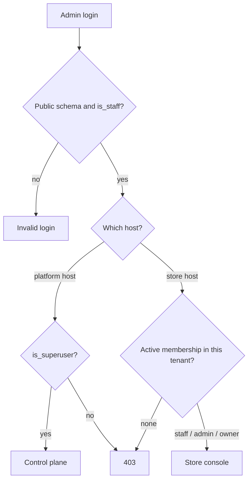

# Platform staff & access

There is exactly one kind of person who can open an admin console on this
platform: a **platform identity** — a `UserAccount` row in the `public`
schema with `is_staff` set. Shoppers are not that. They live in their own
store's schema and can never hold the grant that opens an admin, by
construction rather than by check.

What varies is *which* console that identity reaches, and that is decided
by a second, separate object: a `UserTenantMembership` row naming a store
and a role. Confusing the two is the single most common mistake here, so
the page starts by separating them.

## Two populations

| | Platform identity | Store membership |
|---|---|---|
| Model | `user.UserAccount` in `public` | `tenant.UserTenantMembership` |
| Console screen | <span class="sidebar-path">Identity → Platform Staff</span> | <span class="sidebar-path">Control plane → Memberships</span> |
| Scope | the whole platform | one store |
| Grants | the ability to authenticate into *an* admin at all | which store, and what you may do inside it |
| Who creates it | a platform superuser | a platform superuser, or the store's own admin/owner |

`UserAccount` is in **both** `SHARED_APPS` and `TENANT_APPS`
(`settings.py`), so the same table name exists in `public` and in every
tenant schema, distinguished only by the Postgres search path. That is
why every check on this page is about *provenance*, not about a primary
key or an email address: a tenant-schema customer can share a pk with a
public-schema operator, and can register with an operator's email.

`UserTenantMembership` lives in the `public` schema and its `user` foreign
key targets `public.user_useraccount`. A shopper created inside a tenant
schema therefore *cannot* hold one — a version that tried to create one
raised `ForeignKeyViolation` and made signup 500 (`tenant/membership.py`
module docstring). The table is a staff grant, never a customer roster.

## Who may sign into which console

Both consoles use the same login form. `PlatformAdminAuthenticationForm`
(`admin/forms.py`) bypasses Django's global `authenticate()` dispatch and
calls `PlatformStaffBackend.authenticate_staff()` directly, which resolves
credentials inside `schema_context(public)` and returns the user only when
they are `is_active` **and** `is_staff`. The session is then bound
explicitly to `PlatformStaffBackend`, which is the provenance stamp
everything downstream reads.



### The control plane

`PlatformAdminSite.has_permission` (`admin/platform_site.py`) requires a
platform-staff session **and** `is_superuser` — not merely `is_staff`.
The reason is written into the code: `is_staff` on a public identity is
exactly what lets a *store operator* into their own store's admin, so it
is held by every merchant. Gating the control plane on it let a merchant
load a dashboard that renders the whole estate — every store's name,
domain, plan and order count, which is another merchant's commercial data.

### A store console

`MyAdminSite.has_permission` (`admin/admin.py`) requires, in order:

1. Django's own `is_active and is_staff`.
2. `is_platform_staff_session(request)` — the session must have been minted
   by `PlatformStaffBackend`. Checked before anything else, because it
   closes the pk-collision ambiguity described above.
3. Superusers pass from here.
4. Otherwise: an active `UserTenantMembership` with a staff-capable role
   (`staff`, `admin` or `owner`) in **this** tenant.

Without step 4, `is_staff` being a global flag would mean staff granted
for one store could open every other store's `/admin/`.

Session restore re-checks the flag. `PlatformStaffBackend.get_user()`
refuses a user whose `is_staff` has since been removed — stock
`ModelBackend.get_user` checks only `is_active`, which meant the
documented revocation (untick `is_staff`) closed the admin UI while the
existing session cookie kept working for its remaining life.

## What each store role can do

`TenantMembershipRole` (`tenant/models.py`) has four values; `member` is
retired and issues nothing (the rows it once carried were removed in
`tenant/migrations/0015`). The other three are turned into Django model
permissions at request time by `TenantRolePermissionBackend`
(`tenant/auth_backends.py`), which computes them with
`_permissions_for_role()` rather than storing them.

| Role | Permission set |
|---|---|
| `staff` | `view`, `add`, `change` on every **operational** store app. No `delete` — "it is the irreversible action, and nothing in that description implies it". No store settings. |
| `admin` | The full default permission set (including `delete`) on every store app, plus store settings, plus the narrow platform grants below. |
| `owner` | Identical to `admin` in permissions. The difference is entirely in the guards: an owner row can only be acted on by another owner. |

The app sets come from `tenant/role_scopes.py` and are **derived, not
enumerated**:

- `store_app_labels()` = the `TENANT_APPS`-only labels, plus
  `STORE_SHARED_APP_LABELS` (`user`, `usersessions`, `extra_settings` —
  dual-listed apps whose tenant copy wins on the search path, so on a
  store host those pages show that store's own rows), minus anything in
  `PLATFORM_ONLY_APP_LABELS`.
- `operational_app_labels()` = the above minus `STORE_SETTINGS_APP_LABELS`
  (`extra_settings`). That subtraction is the whole of the
  staff-versus-admin split.

An app added to `TENANT_APPS` later is covered automatically. Only the
platform set is written out by hand, because there "forgetting an entry is
a privilege escalation rather than a missing feature".

**Platform scope is never granted by role — not to staff, not to admin,
not to owner.** The two exceptions are narrow and explicit, added in
`_permissions_for_role` for admin and owner only:

```python
perms |= {
    "tenant.view_tenant",
    "tenant.change_tenant",
    "tenant.view_usertenantmembership",
    "tenant.add_usertenantmembership",
    "tenant.change_usertenantmembership",
    "tenant.delete_usertenantmembership",
}
```

`add_tenant`, `delete_tenant` and everything on `TenantDomain` stay
platform-only. And these permissions only make the *pages* reachable —
confining them to the operator's own row is a separate, object-level job
done in the `ModelAdmin` by `self_service_tenant(request)`
(`tenant/admin.py`), which returns `None` for superusers and on the public
schema, so every caller reads a non-`None` result as "restrict to this one
store". `TenantAdmin.get_queryset` filters to `pk=scope.pk`, and
`get_readonly_fields` reduces the form to the
`TENANT_SELF_EDITABLE_FIELDS` allowlist.

Superusers never touch any of this: `User.has_perm` short-circuits on
`is_superuser`, so the backend is not consulted for them at all.

## The owner guards

All four live in `UserTenantMembershipAdmin` (`tenant/admin.py`) and all
four are scoped to `self_service_tenant(request)` — that is, they apply on
a **store** console and not to a platform superuser working on the control
plane.

| Guard | Method | Effect |
|---|---|---|
| Only an owner may edit an owner | `has_change_permission` → `_may_act_on` | An admin cannot demote the owner and take the store. |
| Only an owner may delete an owner | `has_delete_permission` → `_may_act_on` | Same, for removal. |
| Only an owner may mint an owner | `formfield_for_choice_field` | The `owner` choice is stripped from the role dropdown for a non-owner. |
| You may only grant into your own store | `formfield_for_foreignkey` | The `tenant` queryset is narrowed to `pk=scope.pk`; otherwise the dropdown would list every tenant, "and saving one would hand them a foothold in another merchant's admin". |

Two more, about *which user* can be picked. `UserAccount` is mirrored per
schema, so an unqualified queryset on a store host resolves against that
store's own customer table. The `user` field is therefore rendered through
`PublicSchemaModelChoiceField`, which pins **rendering and validation** to
`public`, and `get_autocomplete_fields` drops the `user` autocomplete on a
store host entirely — the autocomplete AJAX view searches in the request's
schema, so it would surface that store's shoppers and let one be bound
into a public-identity foreign key.

### The rule that is policy, not enforcement

`TenantMembershipRole`'s docstring says a tenant "must always have at least
one owner". **Nothing enforces this.** `UserTenantMembership` has no
`clean()`, no `save()` override and no constraint touching role counts; no
signal receiver guards owner deletion; and the guards above only ask
*who is acting*, never *how many owners remain*.

The practical consequence: an owner can deactivate, demote or delete their
own membership — every guard passes, because an owner may act on an owner
row — and the store is left with no owner. It is then still administrable
(an `admin` retains every permission an owner has) but nobody can mint a
new owner from inside that store console, because
`formfield_for_choice_field` strips the `owner` choice for non-owners. Only
a platform superuser can restore one, from <span class="sidebar-path">Control plane → Memberships</span>.

Treat "at least one owner" as an operator convention to check before
removing an owner, not as something the system will stop you from
breaking.

## Why Django permission groups are not a store-facing tool

`auth` is in `PLATFORM_ONLY_APP_LABELS` (`tenant/role_scopes.py`) with the
reason stated inline: "A store admin who can mint Groups can mint
themselves any permission that exists." So no store role is ever granted
`auth.*`, and since 2026-09-12 the store sidebar does not link the screen
either: <span class="sidebar-path">Identity → Groups</span> is a control-plane entry only.

Be precise about what closes it, because the two mechanisms on this page do
*not*. `auth` sits in **both** `SHARED_APPS` and `TENANT_APPS`, so it is
absent from `shared_only_app_labels()` and `WithheldOnTenantHostModelAdmin`
does **not** withhold it — a platform superuser who types
`/admin/auth/group/` on a store host still gets a page. That is acceptable
rather than overlooked: `auth_group` genuinely exists per tenant, so the page
shows that schema's own (empty) table and no other store's data. The commit
that moved the entry calls this a privilege surface, not a data leak. What
keeps merchants out is the permission set; removing the link is what stops an
operator landing there by accident.

Groups are not used for store roles either, and the reason is structural
rather than stylistic (`TenantRolePermissionBackend` docstring):

- `has_perm` is a plain string check, so **no `auth_permission` row needs
  to exist** for a computed permission to work.
- `auth` is in both `SHARED_APPS` and `TENANT_APPS`. A `Group` row would
  land in whichever schema the connection happened to be pinned to, and the
  lookup would then match by ID across schemas — the same class of bug the
  provenance stamp exists to prevent.
- Computed permissions have nothing to provision, so onboarding a store
  cannot forget them, and nothing drifts as models are added.

Consistent with that, **no code path in this repository creates an
`auth.Group`**. The screen exists; nothing fills it. Do not build a store
role out of one.

This is also the bug the backend was written to fix: `tenant_create`
provisions a membership and only a membership, so before role-derived
permissions existed the membership gate admitted a store operator to
`/admin/` while every model page answered 403 — the store console worked
only for platform superusers. Reported from production 2026-08-21 by
tenant #1's owner.

## Granting and revoking access

### Give someone access to a store

1. <span class="sidebar-path">Identity → Platform Staff</span> — the person needs a `public`-schema
   `UserAccount` with `is_active` and `is_staff`. Create it if it does not
   exist; a shopper account on the store is not this and cannot be
   promoted into it.
2. <span class="sidebar-path">Control plane → Memberships</span>, **Add** — pick the user, pick the tenant,
   pick the role, leave **Active** ticked.
3. That is all. Nothing else is provisioned: the permissions are computed
   from the role on the next request.

The same person may hold different roles in different stores; the unique
constraint is on `(user, tenant)`, so one row per store.

A store's own `admin` or `owner` can do step 2 for their store from their
own console — that is what the narrow `tenant.*_usertenantmembership`
grants are for — but they cannot do step 1, and they cannot mint an owner
unless they are one.

### Revoke access

Prefer **untick `is_active` on the membership**. It is reversible, it
leaves the audit trail intact, and `get_membership()` filters on
`is_active=True`, so the person loses the store console immediately.
Deleting the row works too and is what you want when the grant was a
mistake.

To cut someone off the platform entirely, untick `is_staff` on the
`UserAccount`. Because `PlatformStaffBackend.get_user()` re-checks the flag
on every session restore, an outstanding admin session stops working on the
next request rather than lingering. The same flag gates staff API tokens
(`tenant/api_tokens.py: PlatformStaffTokenAuthentication`).

### Where to do it from

Both **Memberships** and **Platform Staff** are control-plane screens.
`WithheldOnTenantHostModelAdmin` (`admin/mixins.py`) withholds
public-schema-only models from a store host — but `tenant` is listed in
`STORE_SELF_SERVICE_APP_LABELS`, which is the exemption that lets a store
admin reach their own row and their own team without also exposing
`django_site` or the cache purge log.

The two consoles have separate sidebars (`UNFOLD` and `UNFOLD_PLATFORM`
in `settings.py`), so neither needs to hide the other's links;
`admin/permissions.py: platform_environment` paints the **Control plane**
badge in the header — "the two look alike enough
that an operator could otherwise edit the wrong thing". See
[The control plane](/dev/operator/).

## Invariants

- Only a public-schema, `is_staff` identity can authenticate into any
  admin. `authenticate()` on `PlatformStaffBackend` unconditionally
  returns `None`, so the storefront's login dispatch can never resolve a
  platform identity even as a fallback.
- `TenantRolePermissionBackend` grants nothing to a user object that is not
  stamped with `PLATFORM_IDENTITY_ATTR` — provenance, never pk, never
  email.
- Permission answers are cached on the user object **keyed by tenant pk**,
  in both `TenantRolePermissionBackend` and `is_store_staff`, because one
  process serves many tenants and an unkeyed cache would leak one store's
  answer into the next request.
- A store role never receives a permission on a
  `PLATFORM_ONLY_APP_LABELS` app.
- `is_platform_superuser()` (`tenant/membership.py`) honours
  `is_superuser` only when the identity provably came from `public` — the
  flag on a tenant-schema row is customer residue from the id-preserving
  cutover.

## Failure modes

- **Someone can log in but every page 403s.** They have `is_staff` and no
  membership in this tenant, or the membership is `is_active=False`. On
  the control plane, they are `is_staff` but not `is_superuser`.
- **A merchant reports seeing other stores' domains or purge history.**
  That is what `WithheldOnTenantHostModelAdmin` exists to stop; both
  symptoms were real production reports (2026-09-12). Check the model's
  admin class actually carries the mixin.
- **A store admin picked a user and the wrong person was saved.** The
  `user` field was not pinned to `public`. On a store host it must be
  `PublicSchemaModelChoiceField` with no autocomplete.
- **A store has no owner.** Nothing prevented it. Restore one from
  <span class="sidebar-path">Control plane → Memberships</span> as a superuser.
- **Permissions look stale within one request.** They are cached per user
  object per tenant for the life of that object; a role change takes
  effect on the next request.

## Related

- [The control plane](/dev/operator/) — the console itself
- [The tenant record](/dev/operator/tenants) — what a merchant may edit on their own row
- [Admin (Unfold)](/dev/django/admin) — the two `AdminSite` classes
- [Security model](/dev/platform/security)

## Source

| File | Role |
|---|---|
| `grooveshop-django-api/tenant/models.py` | `TenantMembershipRole`, `UserTenantMembership`, `can_manage_tenant`, `is_tenant_staff`, `PlatformStaffToken` |
| `grooveshop-django-api/tenant/auth_backends.py` | `PlatformStaffBackend`, `TenantRolePermissionBackend`, `_permissions_for_role`, `PLATFORM_IDENTITY_ATTR`, `is_platform_staff_session` |
| `grooveshop-django-api/tenant/role_scopes.py` | `PLATFORM_ONLY_APP_LABELS`, `STORE_SHARED_APP_LABELS`, `STORE_SETTINGS_APP_LABELS`, `store_app_labels()`, `operational_app_labels()`, `TENANT_SELF_EDITABLE_FIELDS` |
| `grooveshop-django-api/tenant/membership.py` | `get_membership`, `is_store_staff`, `is_platform_superuser`, `get_current_tenant` |
| `grooveshop-django-api/tenant/api_tokens.py` | `PlatformStaffTokenAuthentication.validate_user` — an outstanding token dies with `is_staff` |
| `grooveshop-django-api/tenant/admin.py` | `UserTenantMembershipAdmin` and its owner guards, `self_service_tenant`, `PublicSchemaModelChoiceField`, `TenantAdmin.get_queryset` / `get_readonly_fields` |
| `grooveshop-django-api/admin/admin.py` | `MyAdminSite.has_permission` |
| `grooveshop-django-api/admin/platform_site.py` | `PlatformAdminSite.has_permission` (superuser-only) |
| `grooveshop-django-api/admin/forms.py` | `PlatformAdminAuthenticationForm` |
| `grooveshop-django-api/admin/permissions.py` | `platform_environment` — the Control plane badge; `is_superuser` for superuser-only sidebar groups |
| `grooveshop-django-api/admin/mixins.py` | `WithheldOnTenantHostModelAdmin`, `STORE_SELF_SERVICE_APP_LABELS`, `IsSuperuserOnlyModelAdmin` |
| `grooveshop-django-api/settings.py` | `AUTHENTICATION_BACKENDS`, `SHARED_APPS` / `TENANT_APPS`, `UNFOLD_PLATFORM["SIDEBAR"]` |
