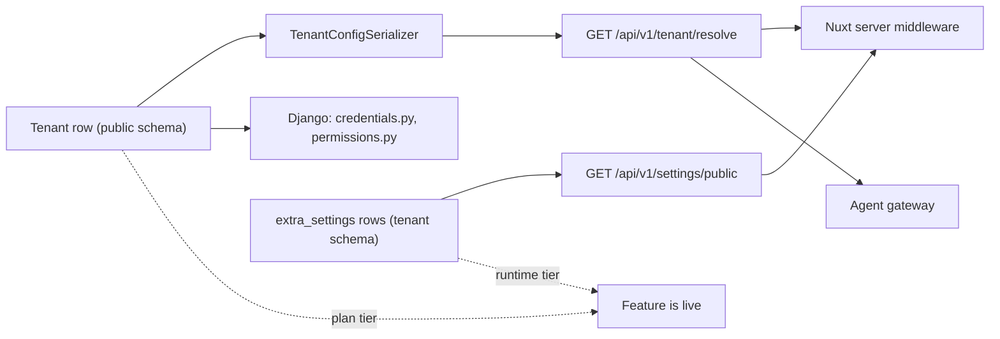

# The tenant record

One row in the public schema is the whole definition of a store:
`tenant/models.py: Tenant` (the class opens just under the choice enums at
the top of the file). It is a `django_tenants.TenantMixin`, so saving a new
row creates the PostgreSQL schema; everything else on it is either
identity, presentation, commercial terms, or that merchant's own
third-party credentials.

Two rules govern the whole record and are worth stating before the fields:

- **Money and secrets never fall back.** An empty credential field means
  "not configured for this store", never "use the platform's".
- **A merchant may edit only an allowlist of it.** Everything else is
  read-only to them, including every commercial term.

The console that edits this row is [The control plane](/dev/operator/);
its hostnames are [Domains & certificates](/dev/operator/domains).

## Diagram

## Field groups

### Identity

| Field | Shape | Notes |
|---|---|---|
| `schema_name` | `CharField(max_length=63)`, unique, indexed | Redeclared over `TenantMixin`'s own field to add `tenant/validators.py: validate_reserved_schema_name` on top of django-tenants' identifier check. `public`, `global`, `information_schema`, anything starting `pg_`, and the media-stream sanitizer's old reserved words are refused; the literal public schema name is carved out because the framework requires exactly one row holding it |
| `slug` | `SlugField(max_length=100)`, unique | Used for the infrastructure overlay directory name, among other things |
| `name` | `CharField(max_length=100)` | The platform's name for the store; `__str__` returns it |
| `owner_email` | `EmailField` | Who `tenant/provisioning.py: provision_owner_membership` grants the OWNER membership to |
| `uuid`, `created_at`, `updated_at` | from `UUIDModel`, `TimeStampMixinModel` | Read-only everywhere |

`auto_create_schema = True`, so creating the row creates the schema and
runs the tenant migrations against it. `bootstrap_platform` sets
`auto_create_schema = False` on the instance before saving the public row,
because that schema already exists.

### Kind-of-row flags

These declare what sort of row this is. They are not feature flags and
gate nothing a shopper sees.

| Field | Default | What it means |
|---|---|---|
| `is_demo` | `False` | A disposable showcase. `manage.py seed_demo_store` refuses any tenant whose domains lack a non-production marker, and this is the explicit per-tenant opt-in that lets it overwrite the catalogue, layouts and navigation without `--force`. Deliberately **not** on `TenantConfigSerializer` — the storefront has no use for it. Never set it on a store that takes real orders |
| `is_protected` | `False` (`db_default=False`) | Suspend, reactivate and destroy refuse this row — in the admin actions, the platform API and automation. `Tenant.delete()` raises `ValidationError` for it via `tenant/lifecycle.py: is_protected_tenant`, and `TenantAdmin.has_delete_permission` withholds the button rather than letting the confirm page 500. A row attribute rather than a list of schema names in code, so shielding a store needs no deploy |
| `is_platform_storefront` | `False` (`db_default=False`) | The platform's own storefront: it renders the brand assets bundled in the storefront image and the platform-only AI discovery surfaces. Enforced by a partial `UniqueConstraint` (`tenant_single_platform_storefront`), so at most one row can carry it. A row flag on purpose — the storefront used to recognise this tenant by comparing its primary domain with an env var, which put the first store's hostname into every tenant's serialised runtime config |

`db_default` as well as `default` on the latter two is load-bearing: Django
drops the column default right after `ADD COLUMN` unless one is declared,
and the PreSync hook migrates **before** the new image rolls, so old pods
inserting history rows would fail for the length of the rollout.

### Lifecycle and plan

`is_active`, `suspended_at`, `suspended_reason`
(`SuspendedReason.MANUAL` / `BILLING`), `plan` (`TenantPlan`: trial, basic,
pro, enterprise), `paid_until`, and the dunning bookkeeping pair
`billing_notice_stage` / `billing_notice_term`. All of these are covered
by [Plans, billing & dunning](/dev/operator/billing) and
[Suspend, export & destroy](/dev/operator/lifecycle); the one thing to know
here is that `suspended_reason` is load-bearing rather than cosmetic —
renewal-driven auto-reactivation (`tenant/signals.py: reactivate_on_renewal`)
is scoped to `BILLING` only, so recording a payment can never resurrect a
store an operator took down on purpose.

`TenantAdmin.readonly_fields` covers `suspended_at`, `suspended_reason`,
`billing_notice_stage` and `billing_notice_term`: those four are written
only by the lifecycle actions and the billing task. `is_active`, `plan` and
`paid_until` stay editable on the form.

### Store presentation

| Field | Shape |
|---|---|
| `store_name` | `CharField(max_length=200)`, blank. The name customers see; falls back to `name` in the console's own displays |
| `store_description` | `TextField`, blank |
| `store_description_i18n` | `JSONField`, `{locale: text}` for the store's other storefront locales (`el`, `en`); never the tenant's `default_locale`, whose text is `store_description`. Served on the resolve payload as `storeDescriptionI18n`; the storefront prints `storeDescriptionI18n[locale]`, else `store_description` |
| `logo_light_url`, `logo_dark_url`, `favicon_url` | `URLField`, blank |
| `primary_color`, `neutral_color` | Tailwind colour **names** from `TailwindColor` (22 choices, Nuxt UI compatible), not hex |
| `accent_hex`, `success_hex`, `warning_hex`, `error_hex`, `info_hex` | `CharField(max_length=7)` validated against `^#[0-9a-fA-F]{6}$` |
| `theme_preset` | `ThemePreset`: `default`, `minimal`, `bold`, `custom` |
| `theme_metadata` | `JSONField`, per-token overrides on top of the preset |
| `socials_*` | Nine `URLField`s (discord, facebook, instagram, pinterest, reddit, tiktok, linkedin, twitter, youtube). `Tenant._validate_social_urls` requires `https://` on every non-empty one; empty hides the footer link |

`theme_metadata` is validated write-side by
`tenant/validators.py: validate_theme_metadata`, a plain-Python mirror of
the storefront's render-time schema (`shared/theme/metadataSchema.ts`).
The validator — not the field's `help_text`, which is out of date — is the
authority. It accepts exactly:

- `radius` from a six-value allowlist;
- `fontSans`, `fontDisplay`, `fontMono` from a named font allowlist;
- `container`: `narrow`, `default`, `wide`;
- `colors` and `darkColors`, each an object of `primaryScale`,
  `neutralScale` or `secondaryScale` mapping Tailwind shade → `#RRGGBB`;
- `likedHex`, `accentDarkHex` as `#RRGGBB`.

Anything else is rejected with a readable error. The Nuxt parse stays the
render-time authority, so historical bad data degrades to preset values
there rather than breaking a page.

### Locales and currency

| Field | Shape |
|---|---|
| `default_locale` | `CharField(max_length=10)`, default `el` |
| `available_locales` | `JSONField(default=list)`, validated by `validate_available_locales` |
| `default_currency` | `CharField(max_length=3)`, default `EUR` |

`available_locales` is an allow-list on top of the platform-wide locale
set. Every entry must be a code in `settings.LANGUAGES`, must not repeat,
and `Tenant._validate_available_locales` adds the cross-field rule the
field validator cannot see: a non-empty list **must contain
`default_locale`**, or the storefront would 404 the store's own default
language. Empty means single-language on `default_locale` — that is the
default, so a tenant predating the field keeps the behaviour it had.

**What happens when a locale is removed.** Nothing is deleted. The
storefront's i18n routes are generated at build time from the
platform-wide list, so the routes still exist and the parler translation
rows are untouched; what changes is *reachability*, in three places that
all read the same helper (`shared/i18n/tenantLocales.ts:
tenantAllowedLocales`):

1. `server/middleware/1.locale.ts` clamps locale **detection** to the
   tenant's set, so no legitimate visitor is routed to the dropped prefix.
2. `app/middleware/locale-available.global.ts` answers 404 for a prefix
   that was typed or crawled. It fails open while the tenant config has
   not resolved, so a resolution hiccup never 404s a legitimate page.
3. The language switcher, the hreflang set and the sitemap stop listing it.

The removal reaches clients only as fast as the caches: the Django resolve
payload is purged immediately by `tenant/signals.py:
invalidate_tenant_caches` on every `Tenant` save, but the Nuxt server keeps
a five-minute in-memory copy (`server/utils/tenant.ts`), and pages already
rendered into the SWR cache keep their old links until purged.

Dropping a locale that has live indexed URLs turns them into 404s, so it is
a content decision as much as a settings change.

### SEO attribution and site verification

`seo_author`, `google_site_verification`, `pinterest_domain_verify`
(all `CharField`, blank, `db_default=""`). Each is emitted as a meta tag by
the storefront only when non-empty. They are per-store data: they used to
be platform env values, which meant every store's pages carried the first
store's author and verification tokens.

### Feature flags and the two-tier gate

Seven booleans on the row are the **plan tier** — what the operator has
sold this store.

| Plan flag | Default | Runtime twin (a store's own **Extra Settings**) | Enforced by |
|---|---|---|---|
| `loyalty_enabled` | `False` | `LOYALTY_ENABLED` | `IsLoyaltyEnabled` |
| `blog_enabled` | `True` | *(none — plan tier only)* | `IsBlogEnabled` |
| `promotions_enabled` | `False` | `PROMOTIONS_ENABLED` | `IsPromotionsEnabled` + `IsPromotionsRuntimeEnabled` |
| `gift_cards_enabled` | `False` | `GIFT_CARDS_ENABLED` | `IsGiftCardsEnabled` |
| `agent_commerce_enabled` | `True` | `AGENT_COMMERCE_ENABLED` | `IsAgentCommerceEnabled` + `IsAgentCommerceRuntimeEnabled` |
| `recommendations_enabled` | `False` | `PRODUCT_SUGGESTIONS_ENABLED` | `IsRecommendationsEnabled` (plan); the runtime half gates the storefront strip |
| `b2b_enabled` | `False` | `B2B_WHOLESALE_ENABLED` | `IsB2BEnabled` + `IsB2BWholesaleEnabled` |

Two more booleans belong to agentic commerce:
`agent_hosted_payment_enabled` (default `True`, runtime twin
`AGENT_HOSTED_PAYMENT_ENABLED`; `TenantConfigSerializer` serves the
**AND** of three — the effective agent-commerce gate, this flag and the
extra-setting — so switching agent commerce off withdraws hosted payment
with it) and `agent_stripe_delegated_enabled` (default `False`, needs the
tenant's Stripe account enrolled in Stripe Agentic Commerce).

How the two tiers combine:

- The plan tier lives on this row and is read by
  `tenant/permissions.py: IsTenantFeatureEnabled` subclasses on the
  viewsets, and by `tenant/membership.py: tenant_plan_allows(flag)` inside
  services the public order-create path reaches without passing a viewset
  permission.
- The runtime tier lives in the store's **own schema** as
  `extra_settings` rows, read by `IsSettingEnabled` subclasses and — for
  the storefront's UI — through `GET /api/v1/settings/public`, whose
  allowlist is `core/api/views.py: PUBLIC_SETTING_KEYS`. A new public
  extra-setting that is not in that frozenset cannot be read by the
  storefront at all.
- **Both must be on.** `agent_commerce_enabled` defaults to `True` and
  `blog_enabled` to `True` because those surfaces predate their flags; the
  rest ship off, so a feature is dark until the operator sells it *and* the
  merchant switches it on.
- A disabled feature answers **404, never 403**, so it is
  indistinguishable from a route that was never registered.
- Public-schema requests are never gated: `IsTenantFeatureEnabled` uses
  `get_current_tenant()` (which returns `None` on the public schema) rather
  than `connection.tenant`, because once `bootstrap_platform` has
  provisioned the public row `connection.tenant` is that row — and its
  flags are all at their defaults.
- Chrome toggles fail open (`default=True`); commercial gates fail closed
  (`IsB2BWholesaleEnabled`, `IsPromotionsRuntimeEnabled`,
  `IsContactAttachmentsEnabled`).

See [Multi-tenancy](/dev/platform/multi-tenancy) for the same gate from the
request's side.

### Vertical

`vertical` (`StoreVertical`: `general`, `fashion`, `plants_garden`,
`electronics`, `food`) is a platform-level fact about the store, set at
onboarding. It selects the recommendation preset
(`recommendation/presets.py`) that seeds the store's recommendation slots at
provisioning and on every deploy — `backfill_recommendation_slots` runs as
one of the PreSync job's steps — and it is what the slot admin's
"Reset to preset" resets to. A merchant still edits every resulting slot.

Note that recommendations have a *third* gate on top of the two tiers:
which strategies may run is a further check against `plan` itself — each
strategy declares a `min_plan` and
`recommendation/strategies/base.py: plan_allows` compares by **rank**, not
equality. So `recommendations_enabled` means
"this store has the feature" and the plan rank means "how smart it is
allowed to be".

### Analytics pixel ids

| Field | Validated as | Empty means |
|---|---|---|
| `meta_pixel_id` | digits only | The browser pixel is off for this store |
| `tiktok_pixel_id` | alphanumeric | TikTok pixel off |
| `openai_pixel_id` | alphanumeric | ChatGPT Ads pixel off, **and its origin is left out of the CSP** |
| `ga_tracking_id` | must start `G-` or `UA-` | GA off |

Each has its own `_validate_*` method on the model. The alphanumeric rule
on `openai_pixel_id` is not cosmetic: the value pasted out of the vendor's
snippet once carried a stray trailing character, and a malformed id stops
conversions being attributed silently rather than failing loudly.

Server-side Meta is separate and secret: `meta_capi_access_token` and
`meta_capi_dataset_id`, with no platform fallback.

### `allowed_csp_sources`

`JSONField(default=list)`: extra origins the storefront's CSP allows on
`connect-src`, `img-src`, `script-src` and `frame-src`. Every entry must be
a string starting `https://`, `http://localhost` or `wss://`
(`Tenant._validate_allowed_csp_sources`). It is **not** merchant-editable:
it is security policy, and a merchant able to append an origin could
whitelist anything. Adding a third-party widget for a store — a locker map,
an embedded player — usually means adding every CDN hop it uses here.

### Email

`contact_email` is the public reply-to and the inbox for contact-form
submissions; empty means the store has no contact address, submissions are
not delivered and outbound mail carries no `Reply-To`.

`from_email` is the store's **proposed** sender address and it is inert on
its own — it takes effect only once `from_email_verified` is ticked.
`tenant/credentials.py: tenant_from_email` reads the pair and produces one
of three `From` headers:

| Condition | `From` |
|---|---|
| `from_email` set **and** `from_email_verified` true | `"<store name>" <from_email>` — the relay holds a DKIM key for that domain, so the message is signed and DMARC-aligned. This is the white-label case |
| Any other tenant | `"<store name>" <DEFAULT_FROM_EMAIL>` — the platform's authenticated envelope with the store's brand in the sender line; the store's own address rides in `Reply-To` |
| No tenant context (public schema, management commands) | a bare `DEFAULT_FROM_EMAIL` |

The flag **is** the safety property, which is why it is platform-only:
`from_email` is in `TENANT_SELF_EDITABLE_FIELDS` and
`from_email_verified` deliberately is not, so a merchant may name an
address but cannot certify a domain the relay has no key for — ticking it
early makes every message from that store fail DMARC. It is absent from
`TenantAdminSerializer` too, so the admin form is the only place it can be
set. `DEFAULT_FROM_EMAIL` must itself be a **platform** address.

`totp_issuer` is the name shown in authenticator apps, falling back to the
store name.

### Per-tenant credentials

`tenant/credentials.py` is the only reader of these fields, and it draws a
hard line through them:

- **Configuration** helpers fall back to a platform setting
  (`_get_tenant_field(name, settings_fallback=...)`): store name, contact
  email, TOTP issuer, branding.
- **Third-party credentials never fall back.** `stripe_credentials`,
  `viva_wallet_credentials`, `acs_credentials`, `box_now_credentials`,
  `mydata_credentials` and the Meta CAPI helpers return empty when the tenant field is empty.
  `PayWayService.is_provider_configured` and the carrier adapters read that
  as *unavailable*, not as *ask settings*. **There is no platform-wide
  fallback for money or secrets.** A merchant's keys must never leak across
  stores, and a stale platform env var must never resurrect as somebody's
  payment account.

| Group | Fields |
|---|---|
| Stripe | `stripe_secret_key` (`sk_live_`/`sk_test_`/`rk_`), `stripe_publishable_key` (`pk_live_`/`pk_test_`), `stripe_connect_account_id` (dormant — the platform runs separate Stripe accounts per tenant, not Connect) |
| Viva Wallet | `viva_wallet_merchant_id`, `viva_wallet_api_key`, `viva_wallet_client_id`, `viva_wallet_client_secret`, `viva_wallet_webhook_verification_key`, `viva_wallet_source_code`, `viva_wallet_live_mode` |
| ACS | `acs_api_key`, `acs_company_id`, `acs_company_password`, `acs_user_id`, `acs_user_password`, `acs_billing_code`, `acs_station_origin` |
| BoxNow | `box_now_partner_id` (public, digits only), `box_now_client_id`, `box_now_client_secret`, `box_now_warehouse_id`, `box_now_notify_phone`, `box_now_webhook_secret` |
| Meta CAPI | `meta_capi_access_token`, `meta_capi_dataset_id` |
| Agentic commerce | `chat_api_key`, `acp_bearer_token` |
| myDATA invoicing | `mydata_user_id`, `mydata_subscription_key` |

Three of these deserve their own warning:

- `stripe_secret_key` is cross-checked against `stripe_publishable_key` at
  save time: a live secret paired with a test publishable key (or the
  reverse) is refused, because it produces confirmations the browser can
  never complete.
- `viva_wallet_live_mode` is a **nullable** boolean with **no settings
  fallback**, and unset reads as *demo*. A live merchant must set it
  explicitly or real payments go to the Viva demo environment.
- `chat_api_key` and `acp_bearer_token` are served only to the agent
  gateway, and only on the internal-token-gated variant of the resolve
  endpoint, which is never cached and is marked
  `Cache-Control: private, no-store`.

Fourteen secret fields (every `EncryptedCharField` on the row) are excluded
from the row's `HistoricalRecords` (`excluded_fields` on `history`), because
every save — including every suspend and activate — would otherwise write
another copy of a merchant's secrets into a table with no retention or
access policy of its own.

Those fields are **encrypted at rest**: each maps onto a `<name>_encrypted`
text column holding a Fernet token, and the attribute reads and writes plain
strings. The keys come from `FIELD_ENCRYPTION_KEYS` (first encrypts, all
decrypt), the empty string is stored empty, and a lookup on a non-empty
value can never match, so filter on a plain column and compare in Python.
Key rotation, the loss of a key and the `rotate_tenant_secrets` command are
in [Encryption of merchant secrets at rest](/dev/django/reference/secret-encryption).
Never print a credential value into a ticket, a log, a shell history or a
document.

## Who may edit what

| Actor | Reach |
|---|---|
| Platform superuser on the control plane | Everything the admin form exposes, plus the domain inline and the lifecycle actions |
| A store's ADMIN or OWNER, in their own store's admin | Their own row only, and only the fields in `tenant/role_scopes.py: TENANT_SELF_EDITABLE_FIELDS` |
| A store's STAFF | Nothing — `TenantRolePermissionBackend` withholds `tenant.change_tenant` from that role |

Three mechanisms combine (`tenant/admin.py`):

1. `TenantAdmin.has_module_permission` returns `True` on the public schema
   and otherwise requires `tenant.change_tenant`, which the role backend
   grants only to ADMIN and OWNER. Without this, "full admin within the
   tenant" was unreachable — a merchant could not edit their own store
   name.
2. `get_queryset` filters to the merchant's own row (`self_service_tenant`
   returns `None` for superusers and on the public schema, so every caller
   can read a non-`None` result as "restrict to this one store").
3. `get_readonly_fields` makes read-only **everything not in the
   allowlist**. It is an allowlist on purpose: a field added to `Tenant`
   later is read-only to merchants until someone decides it is theirs to
   change. A denylist would silently expose it.

The allowlist covers branding, theme, the socials, contact and from
address, `default_locale`, the pixel ids, `totp_issuer`, and **all of the
merchant's own payment and carrier credentials** — those are that
merchant's accounts, and per-tenant credentials exist precisely so a store
can be onboarded without an operator handling somebody else's secrets.

Two of those groups are narrower than the group name suggests, and the
file is the authority rather than the shape of the field names:
`socials_linkedin` is the one social field **not** in the allowlist, and
of the four pixel ids only `meta_pixel_id`, `tiktok_pixel_id` and
`ga_tracking_id` are there — `openai_pixel_id` is platform-only.

Deliberately withheld from merchants (the file names them): `schema_name`,
`slug`, `plan`, `paid_until`, `is_active`, `suspended_at`, `owner_email`,
`allowed_csp_sources`, `agent_stripe_delegated_enabled`, `blog_enabled`,
`loyalty_enabled` — commercial terms, security policy, or identity. Being
an allowlist, it withholds everything else it does not name as well,
`from_email_verified`, `vertical`, `openai_pixel_id`, `is_demo`,
`is_protected` and `is_platform_storefront` among them.
`default_currency` is withheld for a subtler reason: the storefront formats
prices from it while every backend money path uses
`settings.DEFAULT_CURRENCY`, so a merchant setting another currency would
render one symbol while Django charged, invoiced and settled in EUR.

Merchants also lose the domain inline (`get_inlines` returns none, because
domains steer routing and TLS), the add button (`has_add_permission`), the
delete button, and the `suspend`/`activate`/`destroy`/`export` bulk actions
(`get_actions`). **Provision Stripe webhook** is deliberately *kept* for
them — pasting a Stripe secret into the form and then registering the
webhook is exactly the self-service flow the per-tenant keys exist for.

## Surfaces and shapes

The same row is read through three different shapes, and confusing them is
a common bug:

| Shape | Audience | Notes |
|---|---|---|
| `TenantAdmin.fieldsets` | The admin form | Grouped as identity, Plan & Billing, Branding, Theme, Features, Analytics, Social Links, Email, Authentication, Agentic Commerce, Security, Viva, ACS, BoxNow, Stripe, Timestamps. **`available_locales` and `openai_pixel_id` are in no fieldset**, so they cannot be set from the admin form at all — use the platform API or a shell |
| `TenantConfigSerializer` | Anonymous `GET /api/v1/tenant/resolve` | Public-safe only: branding, locales, currency, domains, plan flags, pixel ids, CSP sources. Cached for an hour under a key that fingerprints the serializer's field names, so a release that adds a field never serves the old shape |
| `TenantAdminSerializer` | `api/v1/tenant/admin/…` on the platform host | Everything including secrets. `is_active`, `suspended_at` and `suspended_reason` are read-only here: writing them through the serializer bypassed every gate `tenant/lifecycle.py` enforces, leaving `suspended_at` null so the store could never be destroyed through the gated path. `b2b_enabled`, `is_demo`, `is_protected` and `from_email_verified` are not in this serializer, so a store's sender domain can only be certified on the admin form |

## Invariants

- **No platform-wide fallback for money or secrets** — empty means off.
- **Merchant-editable is an allowlist**, so new fields default to
  read-only for merchants.
- **A non-empty `available_locales` contains `default_locale`**, enforced
  in `Tenant.clean()`.
- **At most one `is_platform_storefront` row**, enforced by a database
  constraint, not only by the form.
- **A protected tenant cannot be suspended, reactivated or destroyed** by
  any path — action, API or automation.
- **Every credential field is excluded from the audit history.**
- **Every `Tenant` save moves the resolve cache on** for all of that
  tenant's domains: `Tenant.save` bumps `cache_generation`, which is part of
  every resolve and domain-set key (`tenant/models.py`, `tenant/cache.py`).
  That is why the console never needs a manual purge for a branding change,
  even across a Redis outage.
- **A new public extra-setting must be added to `PUBLIC_SETTING_KEYS`** or
  the storefront cannot read it.

## Failure modes

- **A feature is on in the console and still missing on the storefront**:
  the runtime tier is off in that store's own Extra Settings, or the key is
  not in `PUBLIC_SETTING_KEYS`. Both tiers must hold.
- **A feature endpoint answers 404 and you expected 403**: that is the
  design. Disabled is indistinguishable from non-existent.
- **Real payments land in the Viva demo environment**: `viva_wallet_live_mode`
  was left unset. There is no fallback; unset reads as demo.
- **Stripe confirmations never complete in the browser**: mixed key modes —
  the save-time cross-check catches this, so a row that predates the check
  is the case to look for.
- **A branding change does not show**: Django purged its cache on save, but
  the Nuxt server holds the config for five minutes and rendered pages sit
  in the SWR cache until purged — see [Caches & purging](/dev/operations/caches).
- **A dropped locale 404s indexed URLs**: expected;
  `locale-available.global.ts` is doing its job. Restore the locale or
  redirect the URLs.
- **A theme token silently has no effect**: the value passed the admin
  validator but the storefront's parse rejected it, or the key is one the
  render path does not consume. The Nuxt schema is the render-time
  authority and degrades to preset values.
- **Editing a store's settings changes nothing for the store**: you edited
  an `extra_settings` row on the *public* schema. Those knobs are read from
  the tenant's own schema, which is why the section is absent from the
  control plane entirely.

## Source

| File | Role |
|---|---|
| `grooveshop-django-api/tenant/models.py` | `Tenant`, `TenantPlan`, `StoreVertical`, `SuspendedReason`, `ThemePreset`, `TailwindColor`, every `_validate_*` method, `history` exclusions, the platform-storefront constraint |
| `grooveshop-django-api/tenant/validators.py` | `validate_theme_metadata`, `validate_available_locales`, `validate_reserved_schema_name`, `RESERVED_SCHEMA_NAMES` |
| `grooveshop-django-api/tenant/credentials.py` | The credential helpers and the no-fallback rule; `tenant_from_email` |
| `grooveshop-django-api/tenant/role_scopes.py` | `TENANT_SELF_EDITABLE_FIELDS`, `PLATFORM_ONLY_APP_LABELS` |
| `grooveshop-django-api/tenant/admin.py` | `TenantAdmin` fieldsets, `get_queryset`, `get_readonly_fields`, `get_inlines`, `get_actions`, `self_service_tenant` |
| `grooveshop-django-api/tenant/permissions.py` | `IsTenantFeatureEnabled` and `IsSettingEnabled` subclasses |
| `grooveshop-django-api/tenant/membership.py` | `get_current_tenant`, `tenant_plan_allows` |
| `grooveshop-django-api/tenant/serializers.py` | `TenantConfigSerializer`, `TenantAdminSerializer` and its read-only lifecycle fields |
| `grooveshop-django-api/tenant/signals.py` | Resolve-cache invalidation, `reactivate_on_renewal` |
| `grooveshop-django-api/tenant/provisioning.py` | What a new row gets after it is saved |
| `grooveshop-django-api/core/api/views.py` | `PUBLIC_SETTING_KEYS`, the public settings endpoints |
| `grooveshop-django-api/recommendation/presets.py`, `recommendation/strategies/base.py` | The per-vertical slot presets; `min_plan` and `plan_allows` |
| `grooveshop-storefront-ui-node-nuxt/shared/i18n/tenantLocales.ts` | `tenantAllowedLocales` |
| `grooveshop-storefront-ui-node-nuxt/app/middleware/locale-available.global.ts` | The 404 for an unlisted locale prefix |
| `grooveshop-storefront-ui-node-nuxt/server/middleware/1.locale.ts` | Locale detection clamped to the tenant's set |
| `grooveshop-storefront-ui-node-nuxt/server/utils/tenant.ts` | The five-minute in-memory config cache |
| `grooveshop-storefront-ui-node-nuxt/shared/theme/metadataSchema.ts` | The render-time theme schema the validator mirrors |
