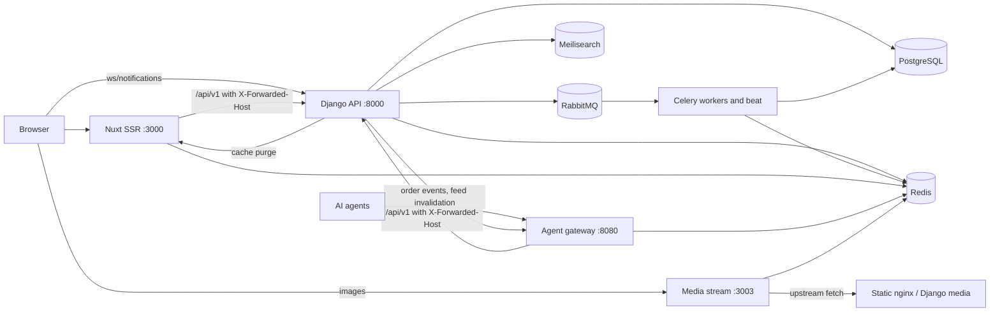
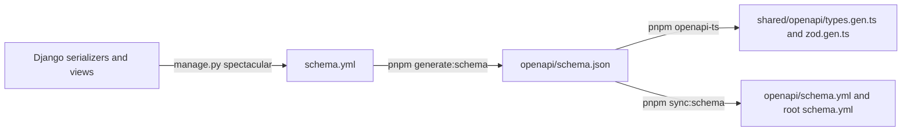

# Architecture

Five services, one database, one Redis. The storefront never talks to the
database and the browser never talks to Django directly for page data: the
Nuxt server proxies every `/api/...` call, validates it, and forwards it to
Django with the tenant's host attached. The agent gateway is a second
front door to the same Django API for machines instead of browsers.

## Service map



- The storefront and the gateway share the tenant's domain: Traefik
  path-routes `/mcp`, `/.well-known/ucp`, `/.well-known/ard.json`,
  `/.well-known/ai-catalog.json`, `/acp`, `/feeds` and `/chat` to
  the gateway and everything else to Nuxt
  (`grooveshop-infrastructure/.../overlays/production/tenants/TEMPLATE/ingress.yaml`).
- The API host (`api.<tenant domain>`) goes straight to Django; the asset
  hosts go to the media stream and the static nginx.
- Redis is one instance with separate logical databases: Django cache,
  the Nuxt Nitro cache (`NUXT_REDIS_DB` in `frontend-config.yaml`), the
  gateway (`agent-gateway.yaml`), the media stream.

## Request paths

### Browser to Django through Nuxt

Client code calls `/api/...` on the Nuxt server. Every server route follows
the same four steps (`grooveshop-storefront-ui-node-nuxt/.claude/rules/server-routes.md`,
example `server/api/products/index.get.ts`):

1. Validate the input with the generated Zod schema
   (`getValidatedQuery(event, zListProductQuery.parse)`).
2. `$fetch` the Django URL built from `runtimeConfig.apiBaseUrl` with
   `createHeaders(sessionToken, accessToken)`.
3. `parseDataAs(response, zListProductResponse)` to validate the response.
4. `handleError(error)` in the catch, which always throws.

`createHeaders` (`server/utils/auth.ts`) adds what Django needs to behave
as if the browser had called it directly:

| Header | Why |
|---|---|
| `X-Forwarded-Proto: https` | `SECURE_PROXY_SSL_HEADER` in `settings.py`; without it `SECURE_SSL_REDIRECT` answers 301 to the public host and the fetch leaves the cluster |
| `X-Forwarded-Host: <request host>` | `USE_X_FORWARDED_HOST` is mandatory in production (`settings.py` raises otherwise); django-tenants resolves the schema from it and DRF builds pagination links from it |
| `X-Real-IP` | The visitor's IP, from Cloudflare's `CF-Connecting-IP`. Django believes it only together with a correct `X-Origin-Verify`, which is relayed alongside (`core/client_ip.py`: `trusted_client_ip`); without it, limits key on the peer Traefik saw (`client_ip_or_peer`) |
| `X-Language` | The page's locale (`event.context.locale`); Django answers in it on `/api/` and `/_allauth/` (`core/middleware/locale.py`) — see Multi-tenancy → Request language |
| `Authorization: Bearer <knox token>` | The customer's API token from the Nuxt session |

Every Django call goes through `useBackendFetch(event)`
(`server/utils/backendFetch.ts`), a `$fetch` instance that resolves these
headers from the request. There is no global `$fetch` patch; it was removed so
the server ports to Nuxt 5's Nitro v3, which has no global `$fetch`. A cached
function has no request, so it uses
`backendFetchFor({ tenantHost, locale })` with the store host and locale it is
keyed by (`server/utils/api.ts: createCachedFetcher`).

Inside the cluster the Nuxt pod dials `http://backend-service` (the
Kubernetes Service), not the public API host (`frontend-config.yaml:
NUXT_API_BASE_URL`).

### Agent to Django through the gateway

The gateway resolves the tenant from the **real** `Host` header only, then
calls Django with `X-Forwarded-Host: <tenant domain>` and
`X-Forwarded-Proto: https` (`grooveshop-agent-gateway/internal/django`,
`internal/tenant/middleware.go`). Catalogue, cart and checkout calls are
anonymous; only `/api/v1/agent/*` forwards the agent's bearer.

### Browser to Django directly

Two things bypass Nuxt: the notifications WebSocket at `ws/notifications/`
(`grooveshop-django-api/asgi/__init__.py`) and the allauth social-login
redirect. Both dial the tenant's own API host (`TenantConfig.apiDomain`),
never the platform host.

### Background work

Celery workers consume the `celery` and `meilisearch` queues from RabbitMQ;
beat schedules the periodic tasks defined in `settings.py:
get_celery_beat_schedule`. Tasks are tenant-aware through `TenantTask`
(`grooveshop-django-api/tenant/celery.py`), which binds the schema the task
was dispatched from. Django pushes order events and feed invalidations to
the gateway's `/internal/*` routes with a shared secret, and purges the
Nuxt SSR cache through `/api/admin/cache/purge` with
`NUXT_CACHE_PURGE_TOKEN` (`grooveshop-django-api/core/cache/nuxt.py`).

## The OpenAPI contract



- drf-spectacular generates the schema with the camel-case post-processing
  hook, so the contract is camelCase like the wire format
  (`settings.py: SPECTACULAR_SETTINGS`).
- `openapi-ts.config.ts` in the Nuxt repo emits TypeScript types and Zod
  schemas (requests, responses, definitions) into `shared/openapi/`. Nothing
  in that directory is hand-edited.
- `pnpm sync:schema` rewrites the two derived YAML copies; CI fails if they
  drift (`scripts/sync-schema-yml.mjs`).
- Always regenerate from a local Django, never from production: a field
  that production has not shipped yet would make the generated Zod schema
  reject every live response.

The full procedure is in [OpenAPI contract](/dev/django/openapi-contract).

## Image URLs

Django stores uploads under `media/{schema}/uploads/...`, so the tenant is
in the path (`grooveshop-django-api` model helpers such as
`image_to_media_path`). The storefront's `mediaStream` image provider
(`app/providers/media-stream.ts`) appends the processing parameters:

```
/{src}/{width}/{height}/{fit}/{position}/{background}/{trimThreshold}/{quality}.{format}
```

The media stream matches that against its `UPLOADED_MEDIA` route
(`grooveshop-media-stream/src/MediaStream/API/config/image-sources.config.ts`),
validates every segment, fetches the original from `BACKEND_URL`, processes
it with Sharp and caches the result. The origin is the platform assets host
unless the tenant has a white-label `assets.<domain>` row, in which case
`TenantConfig.assetsDomain` wins (`app/composables/useMediaStreamImage.ts`).
There is no job queue: every request is processed synchronously, with
admission control and per-resource deduplication.

## Caching layers

| Layer | Store | Key shape | Notes |
|---|---|---|---|
| Django cache | Redis via `core/caches.py: CustomCache` | `{schema}:{prefix}:{version}:{key}` from `tenant/cache.py: make_tenant_key` (registered as `KEY_FUNCTION`) | A `global:` key prefix opts out of schema scoping for families like `tenant_resolve`, which any schema reads |
| Tenant resolve | Django cache, 1 hour | `global:tenant_resolve:{shape}:{tenant pk}.{generation}:{domain}` | The shape fingerprint of `TenantConfigSerializer` is part of the key, so adding a field never serves a stale shape; `Tenant.cache_generation` is bumped by every write the payload depends on, so invalidation never relies on a Redis delete |
| Nuxt tenant config | Process memory, 5 minutes | host | `server/utils/tenant.ts`; negative results are never cached |
| Nuxt route cache | Nitro cache in Redis | `tenantCacheKey(event, ...)` from `server/utils/cacheKey.ts`: `host__locale__key` | Every tenant-specific `defineCachedEventHandler` must use it; the locale keeps an English entry from being served to a Greek page, and the key carries a hash because Nitro strips punctuation |
| Nuxt SWR pages | Nitro cache | `varies: ['host', 'x-device-class']` | Homepage, brand pages, blog and catalogue families (`nuxt.config.ts: routeRules`, `shared/constants/prerender.ts`); cached HTML is rendered anonymously by contract |
| Gateway tenant config | Process memory 5 min, then Redis `ag:tenant:{host}`, then Django | host | Singleflight, negative cache, stale-if-error (`internal/tenant`) |
| Gateway feeds and sessions | Redis | `ag:{schema}:...` | Feeds have fresh and stale TTLs; checkout sessions expire after a day |
| Media stream | Memory, then Redis, then disk `.rsc`/`.rsm` pairs | `image:{schema}:…` from `Cache/utils/cache-namespace.util.ts: imageNamespace` | Per-tenant flush via `POST /admin/cache/flush-tenant` with the internal secret |

Purging procedures are in [Caches & purging](/dev/operations/caches).

## Ports

| Service | Container port | In-cluster Service | Local dev |
|---|---|---|---|
| Django API | 8000 | `backend-service:80` | `uv run python manage.py runserver` |
| Nuxt storefront | 3000 | `frontend-nuxt-service:80` | `pnpm dev` |
| Media stream | 3003 | `media-stream-service:80` | `pnpm run dev` |
| Agent gateway | 8080 | `agent-gateway-service:80` | `go run ./cmd/gateway` |
| Static nginx | 80 | `static-svc:80` | — |
| Meilisearch | 7700 | `app-grooveshop-meilisearch:7700` | compose |
| Flower | 5555 | `celery-flower-service:80` | compose |

## Invariants

- The browser never receives a Django URL for page data; it receives Nuxt
  URLs. The exceptions are the WebSocket and the social-login redirect, and
  both use the tenant's own API host.
- Every Nuxt to Django call carries `X-Forwarded-Host` and
  `X-Forwarded-Proto`; a call without them resolves the wrong schema or
  gets a 301 out of the cluster.
- Generated OpenAPI code is never edited by hand; a contract change is a
  Django change followed by a regeneration.
- Every cache key is tenant-scoped unless the entry is provably identical
  across tenants, and that decision is written down next to the key.

## Failure modes

- Django returns 5xx on tenant resolve: Nuxt answers 503 and does not cache
  the failure. Django returns 404: Nuxt answers "Store not found".
- A response fails Zod validation in a server route: the route throws a
  422 through `handleError`; the fix is regenerating the contract, never a
  local schema override.
- The gateway loses Django: `/readyz` stays green because it gates on Redis
  only, and agents get actionable errors instead of 502s
  (`internal/obs/health.go`).
- The media stream cannot fetch an original: it serves `public/default.png`
  in the requested format and negative-caches the miss for five minutes.

## Source

| File | Role |
|---|---|
| `grooveshop-storefront-ui-node-nuxt/server/utils/auth.ts` | `createHeaders` |
| `grooveshop-storefront-ui-node-nuxt/server/utils/backendFetch.ts` | `useBackendFetch`, `backendFetchFor` |
| `grooveshop-storefront-ui-node-nuxt/server/utils/tenant.ts` | `getTenantConfig`, in-memory tenant cache |
| `grooveshop-storefront-ui-node-nuxt/server/utils/cacheKey.ts` | `tenantCacheKey`, `hashedCacheKey` |
| `grooveshop-storefront-ui-node-nuxt/nuxt.config.ts` | `routeRules`, `runtimeConfig`, Nitro Redis storage |
| `grooveshop-storefront-ui-node-nuxt/app/providers/media-stream.ts` | Image URL builder |
| `grooveshop-storefront-ui-node-nuxt/openapi-ts.config.ts` | Type and Zod generation |
| `grooveshop-django-api/settings.py` | `USE_X_FORWARDED_HOST`, `SECURE_PROXY_SSL_HEADER`, `SPECTACULAR_SETTINGS`, `CACHES` |
| `grooveshop-django-api/tenant/cache.py` | `make_tenant_key`, `tenant_resolve_key` |
| `grooveshop-django-api/core/caches.py` | `CustomCache` |
| `grooveshop-django-api/core/cache/nuxt.py` | SSR cache purge client |
| `grooveshop-django-api/asgi/__init__.py` | HTTP and WebSocket routing |
| `grooveshop-agent-gateway/internal/server/routes.go` | Gateway route table |
| `grooveshop-agent-gateway/internal/obs/health.go` | `/healthz`, `/readyz` |
| `grooveshop-media-stream/src/MediaStream/API/config/image-sources.config.ts` | Route patterns |
| `grooveshop-infrastructure/manifests/app-constructs/grooveshop/base/*.yaml` | Deployments, Services, ConfigMaps |
