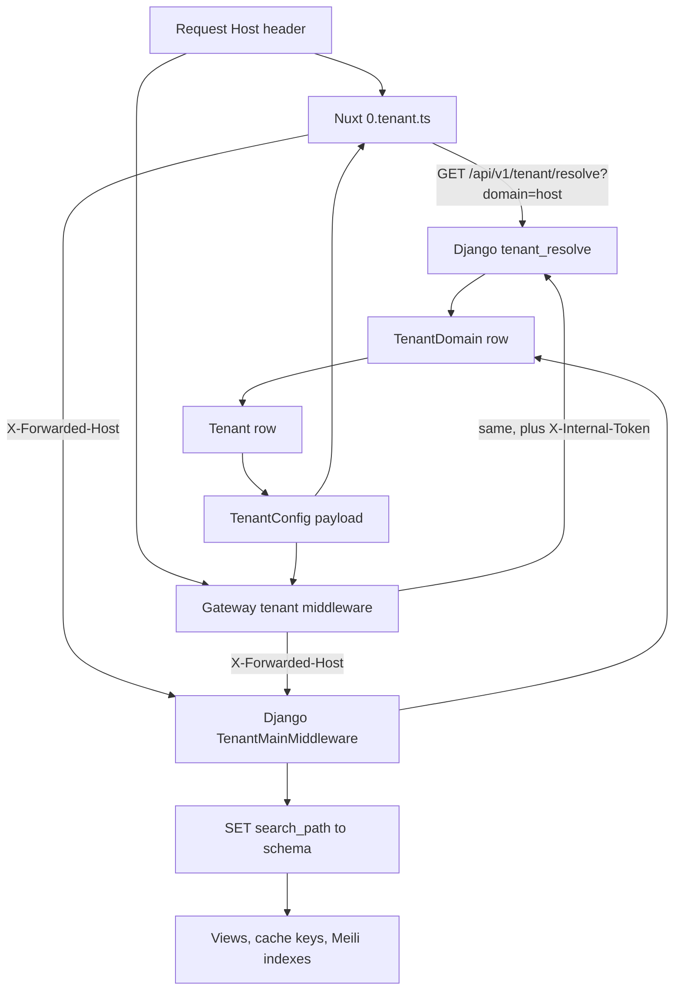

# Multi-tenancy

Every store is a PostgreSQL schema, and every request is bound to exactly
one schema by the hostname it arrived on. That single fact shapes the
whole platform: which tables a query sees, which cache keys it reads,
which Meilisearch indexes it searches, which credentials it uses, and
which identities it trusts. This page is the constraint every change must
respect.

## Diagram

## How it works

### Schemas: public versus tenant

`settings.py` splits apps into `SHARED_APPS` (the public schema) and
`TENANT_APPS` (one copy per store). Apps that appear in both lists exist in
both places, and that duplication is deliberate:

| Lives in | Apps | Why |
|---|---|---|
| Public only | `django_tenants`, `tenant`, `country`, `region`, celery beat and results | Platform control plane and reference data identical for every store |
| Tenant only | `product`, `order`, `cart`, `blog`, `loyalty`, `promotion`, `giftcard`, `b2b`, `page_config`, `agent`, `knox`, `allauth.account`, `allauth.headless`, `allauth.mfa`, `allauth.socialaccount`, `allauth.idp.oidc` | Store data; a Knox token or an OAuth token minted in one schema does not exist in another |
| Both | `user`, `django.contrib.sessions`, `extra_settings`, `allauth.usersessions`, `admin` log | Platform staff are public-schema users; customers are tenant-schema users. Sessions must be per schema because a session id resolves against whatever user table serves the request. `extra_settings` holds platform defaults in public and merchant overrides per store |

The public schema also carries the platform's own `Tenant` row (created by
`bootstrap_platform`), which is why helpers use
`tenant/membership.py: get_current_tenant` rather than
`connection.tenant`: the former returns `None` on the public schema.

Foreign keys that cross the schema boundary are declared with
`db_constraint=False`, because the referenced table lives in a different
schema and Postgres cannot enforce the constraint: the audit actor on
`admin/log_actors.py`, the B2B profile's user link in
`b2b/models/profile.py`, `order/models/stock_log.py: performed_by`, and
the `history_user` on simple-history tables.

### Tenant resolution, service by service

**Django.** `django_tenants.middleware.main.TenantMainMiddleware` looks the
request host up in `TenantDomain` and switches the connection's search
path. It runs third in `MIDDLEWARE`: `core/middleware/health_probe.py`
answers kubelet probes first (their `Host` is a pod IP that no row can
match), and `tenant/internal.py: InternalDomainsMiddleware` answers the
cluster-internal domains feed second. Immediately after resolution
`tenant/middleware.py: SuspendedTenantMiddleware` returns 503 for an
inactive store, and `TenantCookieDomainMiddleware` rewrites the session and
CSRF cookie `Domain` to the request host's registrable scope on the way
out. On the WebSocket path `tenant/middleware_ws.py:
TenantWebsocketMiddleware` does the same lookup and closes with code 4004
when no active tenant matches. The public schema is served only on the
platform host through `PUBLIC_SCHEMA_URLCONF`; an unknown host is a 404
because `SHOW_PUBLIC_IF_NO_TENANT_FOUND` is not set.

**The resolve endpoint.** `GET /api/v1/tenant/resolve?domain=<host>`
(`tenant/views.py: tenant_resolve`) is anonymous, lives in the shared URL
patterns so it works on any host, and returns `TenantConfigSerializer`
(`tenant/serializers.py`): branding, locales, currency, the domain set,
the feature flags, pixel ids and CSP sources. The payload is cached for an
hour under a schema-independent key that includes a fingerprint of the
serializer's field names (`tenant/cache.py: tenant_resolve_key`), so a
release that adds a field never serves the old shape. When the caller
proves it is the gateway with `X-Internal-Token`
(`AGENT_GATEWAY_INTERNAL_SECRET`), the response also carries
`chat_api_key` and `acp_bearer_token`; that variant is never cached and is
marked `Cache-Control: private, no-store` with `Vary: X-Internal-Token`.

**Nuxt.** `server/middleware/0.tenant.ts` runs before every other server
middleware. It reads the host with `getRequestHost(event, { xForwardedHost:
false })` so a forwarded header can never switch tenants, skips a fixed
bypass list (build assets, probes, the sitemap source, `robots.txt`, the
manifest, the AI discovery paths, the cache purge route), and calls
`getTenantConfig(host)` (`server/utils/tenant.ts`), which strips the port,
checks a five-minute in-memory cache, proxies to the resolve endpoint and
validates the answer with the generated `zTenantConfig`. Success sets
`event.context.tenant`; a Django 5xx becomes a 503 that is not cached; a
404 or a Zod failure becomes "Store not found". The `tenant` Nuxt plugin
then hydrates `useTenantStore()` from that context
(`.claude/rules/multi-tenant.md`).

**Gateway.** `internal/tenant/middleware.go` resolves from `req.Host` only
and explicitly ignores `X-Forwarded-Host`. The resolver checks process
memory, then Redis `ag:tenant:{host}`, then Django, with singleflight, a
negative cache and stale-if-error. Routes that authenticate against a
per-tenant credential (`/chat`, `/acp`) use `MiddlewareWithSecrets`, which
tops the cached public config up with the secret fields.

**Media stream.** Tenancy is in the path (`media/:tenantSchema/uploads/…`),
so the service needs no host lookup; it validates the schema segment and
namespaces its cache as `image:{schema}:…`. Its host allowlist for
upstream fetches is refreshed from
`GET /api/v1/tenant/internal/domains`, gated by the same internal token
(`tenant/internal.py`).

### Per-tenant credentials

`tenant/credentials.py` is the only reader of credential fields, and it
distinguishes two classes on purpose:

- **Configuration fields fall back to settings.** Store name, contact
  email, TOTP issuer and branding read the tenant field and then the
  platform setting (`_get_tenant_field(name, settings_fallback=...)`).
- **Third-party credentials never fall back.** `stripe_credentials`,
  `viva_wallet_credentials`, `acs_credentials`, `box_now_credentials` and
  the Meta CAPI helpers return empty when the tenant field is empty. Empty
  means "not configured for this store": `PayWayService.is_provider_configured`
  and the carrier adapters treat it as unavailable rather than asking
  settings. A merchant's keys must never leak across tenants or resurrect a
  stale platform env var.

Outbound mail keeps the platform sender in `From` with the store name as
display name and puts the tenant's address in `Reply-To`, because only the
platform domain is SPF/DKIM-authorised on the relay (`tenant_from_email`).
The ACP bearer and the chat key are served to the gateway only through the
internal-token resolve path, and every secret field is excluded from the
`Tenant` audit history.

### Two-tier feature flags

Every commercial feature has a **plan** tier the operator controls and a
**runtime** tier the merchant controls. Both must be on.

| Tier | Where | Enforced by |
|---|---|---|
| Plan | Boolean fields on `Tenant` (`loyalty_enabled`, `blog_enabled`, `promotions_enabled`, `gift_cards_enabled`, `b2b_enabled`, `recommendations_enabled`, `agent_commerce_enabled`, …) | `tenant/permissions.py: IsTenantFeatureEnabled` subclasses on the viewsets; `tenant/membership.py: tenant_plan_allows(flag)` inside services that the public order-create path reaches without passing a viewset permission |
| Runtime | `extra_settings` rows in the tenant schema (`LOYALTY_ENABLED`, `PROMOTIONS_ENABLED`, `GIFT_CARDS_ENABLED`, `B2B_WHOLESALE_ENABLED`, `PRODUCT_SUGGESTIONS_ENABLED`, `AGENT_COMMERCE_ENABLED`, `PRODUCT_REVIEWS_ENABLED`, …) | `tenant/permissions.py: IsSettingEnabled` subclasses; the storefront reads the keys listed in `core/api/views.py: PUBLIC_SETTING_KEYS` through `GET /api/v1/settings/public` and gates UI with `app/composables/useSettingFlag.ts` and the `app/middleware/*-enabled.ts` route middlewares |

Rules the code encodes:

- A disabled feature answers **404, never 403**, so a disabled endpoint is
  indistinguishable from one that was never registered.
- Public-schema requests are never gated: they are platform-operator
  calls.
- Chrome toggles fail open (`default=True`); commercial gates fail closed
  (`IsB2BWholesaleEnabled`, `IsPromotionsRuntimeEnabled`,
  `IsContactAttachmentsEnabled` set `default=False`).
- The plan flags travel raw on `TenantConfig`; the storefront combines
  them with the runtime setting itself. The gateway-consumed values are
  **folded** in the serializer (`get_agent_commerce_enabled`,
  `get_product_feeds_enabled`, `agent_hosted_payment_enabled`) so the
  gateway reads one authoritative boolean per surface, and a payload
  without the field decodes as off.
- A new public extra-setting must be added to `PUBLIC_SETTING_KEYS` or the
  storefront cannot read it.

### Locales

`Tenant.available_locales` is the per-store allow-list; empty means
single-language on `default_locale`, and `Tenant.clean()` refuses a list
that omits the default. The storefront builds routes for every locale in
`i18n/locales.ts: SUPPORTED_LOCALES` for every tenant at build time, so
reachability is decided at runtime: `server/middleware/1.locale.ts` clamps
locale detection to the tenant's set and
`app/middleware/locale-available.global.ts` answers 404 for a prefix the
tenant does not list. The sitemap, hreflang set and language switcher read
the same list.

### Asset origins

Three hostnames matter per tenant, all derived from `TenantDomain` rows
(`tenant/serializers.py`):

| Field | Source | Consumer |
|---|---|---|
| `primaryDomain` | The row flagged `is_primary` | Canonical URLs, RSS, OAuth metadata |
| `apiDomain` | `api.<primary>`; provisioning creates the row, and Django serves only hosts that have one | WebSocket, social-login redirect, CSP `connect-src`, `.well-known` OAuth metadata |
| `assetsDomain`, `staticDomain` | Only when an explicit `assets.*`/`static.*` row exists (white-label opt-in) | Image and static URLs; otherwise the platform origins `assets.grooveshop.space` and `static.grooveshop.space` are used |

The platform asset hosts are shared by every tenant and belong to none;
isolation comes from the `media/{schema}/` path, not from the host.

### The `tests_mt` lane

`tests/conftest.py` strips multi-tenancy (`DATABASE_ROUTERS = []`, no
`TenantMainMiddleware`) to keep the main suite fast, which makes
schema-binding bugs invisible to it. `tests_mt/` is a sibling directory
that keeps the real router and middleware, provisions one tenant schema per
session and runs smoke tests on top. It is not collected by a bare `uv run
pytest`; run it with `uv run pytest tests_mt -n 0`. Cross-schema foreign
keys, cache-key leaks and seed migrations that stop reaching new tenants
are the bugs it exists to catch.

## Invariants

- **Every cache key is tenant-scoped by default.** Django through
  `KEY_FUNCTION` (`tenant/cache.py`), Nuxt through `tenantCacheKey`, the
  gateway through `ag:{schema}:…`, the media stream through
  `image:{schema}:…`. Opting out (`global:` prefix, a Nuxt route without
  `tenantCacheKey`) is an explicit, commented decision.
- **Meilisearch indexes are per schema**: `{schema}__{index}`
  (`meili/models.py: get_meili_index_name`), with a per-tenant search
  client whose key is restricted to that prefix (`meili/_client.py`).
- **AI discovery surfaces are served only on the platform storefront.**
  `server/middleware/1.ai-ready-gate.ts` answers 404 for `/llms.txt`,
  `/llms-full.txt` and direct `.md` mirrors on every other host, because
  the module's index is a single per-pod store with no host column. The
  platform storefront is the `Tenant` row with `is_platform_storefront`,
  never a hostname comparison.
- **No tenant hostname in code, env or manifests.** `NUXT_PUBLIC_*` values
  are serialised into every tenant's HTML, so none may carry a store's
  hostname, title, logo or token; per-store values come from the resolve
  payload. Platform defaults are `*.grooveshop.space`.
- **Forwarded hosts are trusted from the inside only.** Nuxt and the
  gateway resolve from the real `Host`; Django trusts `X-Forwarded-Host`
  because only in-cluster callers reach it with that header.
- **Identity is per schema.** Knox and OIDC tokens, sessions and customers
  exist only in the schema that minted them; a membership is a staff
  grant on a public identity. `request.user.is_staff` on a tenant-schema
  row is customer residue and never an authorisation signal
  (`core/api/permissions.py: IsPlatformSuperuser`).
- **CORS and CSRF are per tenant.** `tenant/middleware.py:
  origin_belongs_to_tenant` is the one rule both use: a browser on the
  tenant's registered domains may make credentialed requests to the
  tenant's API and nobody else may (`tenant/signals.py:
  allow_tenant_origin`, `TenantCsrfMiddleware`).
- **Money and secrets never fall back** (see credentials above).

## Failure modes

- Resolve returns 404 for a host: the storefront answers "Store not found"
  on every route. Check the `TenantDomain` rows; on staging, remember the
  refresh script re-clones production's rows.
- The tenant's `api.<domain>` row is missing: the storefront looks healthy
  while the WebSocket closes 4004 on every attempt and social login 404s at
  the form POST (`grooveshop-infrastructure/docs/tenant-onboarding.md`).
- A serializer field is added without the shape-keyed cache: solved by
  design now, but it took production down once, which is why
  `tenant_resolve_key` exists.
- A cached Nuxt route omits `tenantCacheKey`: tenant A's data is served to
  tenant B. There is no runtime guard; review catches it.
- A Celery task enters a schema through `schema_context`: it sees a
  `FakeTenant` with no plan fields, and `tenant_plan_allows` fails open on
  purpose; `TenantTask` binds the real row for HTTP-dispatched work.
- A suspended store is hit by a client with a warm config: 503 from
  `SuspendedTenantMiddleware`, and the media stream drops its images.

## Source

| File | Role |
|---|---|
| `grooveshop-django-api/settings.py` | `SHARED_APPS`, `TENANT_APPS`, `MIDDLEWARE`, `DATABASE_ROUTERS`, `PUBLIC_SCHEMA_URLCONF` |
| `grooveshop-django-api/tenant/middleware.py` | Suspension, cookie domain, CSRF origin rule |
| `grooveshop-django-api/tenant/middleware_ws.py` | WebSocket tenant resolution |
| `grooveshop-django-api/tenant/internal.py` | Internal domains feed and token check |
| `grooveshop-django-api/tenant/views.py` | `tenant_resolve` |
| `grooveshop-django-api/tenant/serializers.py` | `TenantConfigSerializer`, folded gates, domain derivation |
| `grooveshop-django-api/tenant/cache.py` | `make_tenant_key`, `tenant_resolve_key` |
| `grooveshop-django-api/tenant/credentials.py` | Credential helpers and the no-fallback rule |
| `grooveshop-django-api/tenant/permissions.py` | Plan and runtime feature gates |
| `grooveshop-django-api/tenant/membership.py` | `get_current_tenant`, `tenant_plan_allows`, `is_store_staff` |
| `grooveshop-django-api/core/api/views.py` | `PUBLIC_SETTING_KEYS`, settings endpoints |
| `grooveshop-django-api/meili/models.py`, `meili/_client.py` | Per-schema index names and search clients |
| `grooveshop-django-api/tests_mt/conftest.py` | The multi-tenant test lane |
| `grooveshop-storefront-ui-node-nuxt/server/middleware/0.tenant.ts` | Host resolution and bypass list |
| `grooveshop-storefront-ui-node-nuxt/server/middleware/1.ai-ready-gate.ts` | Platform-only AI surfaces |
| `grooveshop-storefront-ui-node-nuxt/server/utils/tenant.ts` | `getTenantConfig` |
| `grooveshop-storefront-ui-node-nuxt/server/utils/cacheKey.ts` | `tenantCacheKey` |
| `grooveshop-storefront-ui-node-nuxt/app/middleware/locale-available.global.ts` | Per-tenant locale gate |
| `grooveshop-storefront-ui-node-nuxt/app/composables/useSettingFlag.ts` | Runtime flag reader |
| `grooveshop-storefront-ui-node-nuxt/.claude/rules/multi-tenant.md` | The `event.context.tenant` contract |
| `grooveshop-agent-gateway/internal/tenant/` | Resolver and middleware |
| `grooveshop-media-stream/src/MediaStream/Validation/` | `TenantDomainsService`, schema validation |
| `grooveshop-media-stream/src/MediaStream/Cache/utils/cache-namespace.util.ts` | `image:{schema}` namespace |
