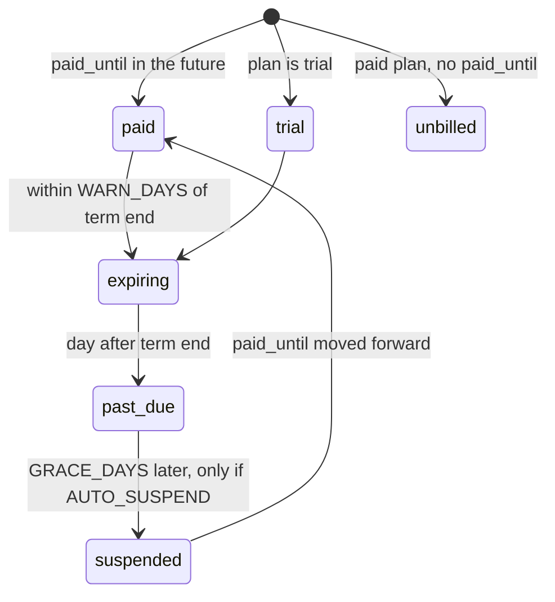

# Platform overview

GrooveShop is a multi-tenant e-commerce platform. One deployment of five
services serves many independent stores; each store is a *tenant* with its
own database schema, its own domains, its own credentials and its own
feature set. The platform operator runs the cluster and the control plane;
tenants run their shops; customers buy; AI agents shop on the customer's
behalf through a dedicated gateway.

## The four parties

| Party | Who | Where they act | Identity |
|---|---|---|---|
| Platform operator | The company running GrooveShop | The control plane on `platform.grooveshop.space` (public schema), the cluster, the repositories | Public-schema `UserAccount` with `is_staff`/`is_superuser`, loaded by `tenant/auth_backends.py: PlatformStaffBackend` |
| Tenant (store) | A merchant and their staff | The Django admin on their own API host, the storefront settings | Public-schema identity plus a `UserTenantMembership` row (role `staff`, `admin` or `owner`) |
| Customer | A shopper | The storefront on the tenant's domain | A `UserAccount` row **inside the tenant's schema** (never a membership) |
| AI agent | An MCP client, an agentic-checkout platform, the storefront chatbot | The agent gateway, path-routed on the storefront host | Anonymous, or an OAuth 2.1 bearer minted by Django's `allauth.idp` |

The distinction between the second and third rows is structural, not a
flag: `UserTenantMembership` lives in the public schema and its `user`
foreign key targets the public user table, so a shopper cannot hold one
(`tenant/models.py`, class docstring). See
[Security model](/dev/platform/security) for what each identity may do.

## What a tenant gets

Everything below is provisioned per tenant and isolated per tenant. The
Django app that owns each capability is named so you can find it.

| Capability | Where it lives | Notes |
|---|---|---|
| Storefront | `grooveshop-storefront-ui-node-nuxt` | SSR on the tenant's own domain; branding, theme colours, logos, locales and currency come from the `Tenant` row via `GET /api/v1/tenant/resolve` |
| Admin panel | `grooveshop-django-api/admin/` (Unfold) | Served on the tenant's API host at `/admin/`; permissions derived from the membership role |
| Catalogue, cart, orders | `product/`, `cart/`, `order/` | Stock reservations, invoices, order state machine — see [Order lifecycle](/dev/flows/order-lifecycle) |
| Payments | `pay_way/`, `tenant/credentials.py` | Viva Wallet primary, Stripe secondary, cash on delivery; credentials are tenant-only fields with no platform fallback |
| Shipping | `shipping/`, `shipping_acs/`, `shipping_boxnow/` | Carrier abstraction plus two Greek carrier integrations |
| Search | `search/`, `meili/` | Meilisearch, one index set per tenant schema, Greeklish transliteration at index time |
| Promotions, coupons, gift cards | `promotion/`, `giftcard/` | Rule-based promotions; stored-value gift cards with a ledger |
| B2B / wholesale | `b2b/` | Business profiles, VIES validation, customer groups and price lists; invoice-at-checkout is a plain merchant setting on every plan |
| Loyalty | `loyalty/` | Points, XP, tiers, rewards; one switch controls both earning and redeeming |
| Blog and CMS | `blog/`, `page_config/` | Blog with categories and comments; merchant-editable page layouts, navigation and content pages |
| Recommendations | `recommendation/` | Typed product relations plus scored strategies; strategies are further gated by plan rank |
| Agentic commerce | `grooveshop-agent-gateway`, `agent/` | MCP tools, UCP and ACP checkout, product feeds, chatbot — see [Agentic commerce](/dev/flows/agentic-commerce) |
| Notifications and email | `notification/`, `core/templates/emails/` | WebSocket notifications and transactional email, branded per tenant |
| Analytics | `meta_capi/`, `Tenant` pixel fields | Meta Conversions API server-side, plus the Meta, TikTok, OpenAI and Google Analytics browser ids (`meta_pixel_id`, `tiktok_pixel_id`, `openai_pixel_id`, `ga_tracking_id`); all tenant-only and consent-gated in the storefront |

Which of these a given store can use is a **two-tier** decision: a
plan-level flag on the `Tenant` row set by the operator, and a runtime
setting the merchant flips in their own admin. Both must be on. The
mechanism is described in [Multi-tenancy](/dev/platform/multi-tenancy).

## The platform control plane

The control plane is the Django public schema, served only on the platform
host. `settings.py` sets `PUBLIC_SCHEMA_URLCONF = "tenant.urls_public"`,
which mounts `admin/platform_site.py: platform_admin_site` at `/admin/`,
the platform staff login (`tenant/staff_api.py`), and the
`TenantAdminViewSet` under `/api/v1/tenant/admin/`. It deliberately omits
every storefront and commerce URL, so the control plane can never expose a
store's data (`tenant/urls_public.py`, module docstring). The ingress adds
HTTP basic auth in front of Django auth for this host
(`grooveshop-infrastructure/.../overlays/production/ingress-platform.yaml`).

### The Tenant row

`tenant/models.py: Tenant` is the single record for a store. The fields
that matter to the business model:

| Group | Fields | Meaning |
|---|---|---|
| Identity | `schema_name`, `name`, `slug`, `owner_email` | The Postgres schema and the human name; `schema_name` is validated against reserved names |
| Lifecycle | `is_active`, `suspended_at`, `suspended_reason`, `is_protected`, `is_demo` | See below |
| Plan and billing | `plan`, `paid_until`, `billing_notice_stage`, `billing_notice_term` | `plan` is `trial`, `basic`, `pro` or `enterprise` (`TenantPlan`); `paid_until` is the inclusive term end for trials and paid plans alike; empty means the term never expires |
| Feature flags | `loyalty_enabled`, `blog_enabled`, `promotions_enabled`, `gift_cards_enabled`, `b2b_enabled`, `recommendations_enabled`, `agent_commerce_enabled`, `agent_hosted_payment_enabled`, `agent_stripe_delegated_enabled` | The plan tier of each two-tier gate |
| Branding and locale | `store_name`, `default_locale`, `available_locales`, `default_currency`, logo and favicon URLs, theme colours, `vertical` | `vertical` selects the recommendation preset a store starts from |
| Platform storefront | `is_platform_storefront` | At most one row may carry this (database constraint `tenant_single_platform_storefront`); it renders the bundled brand and the platform-only AI discovery surfaces |
| Credentials | Stripe, Viva Wallet, ACS, BoxNow, Meta CAPI, `acp_bearer_token`, `chat_api_key` | Tenant-only; excluded from the audit history (`HistoricalRecords(excluded_fields=...)`) |

A tenant's domains are `TenantDomain` rows (`tenant/models.py`, a
django-tenants `DomainMixin`). The primary row is the storefront host;
provisioning also creates `api.<primary>` because the storefront dials the
tenant's own API host for WebSocket, social login and CSP
(`tenant/provisioning.py: ensure_api_domain`).

### Provisioning

`manage.py tenant_create` (`tenant/management/commands/tenant_create.py`)
calls `tenant/provisioning.py: provision_tenant`, which creates the schema
and migrates it, adds the domain rows, seeds extra-settings defaults, page
layouts, recommendation slots and content pages, creates the Meilisearch
indexes, and grants the owner's membership. `bootstrap_platform` creates
the public tenant row and the platform host. The infra half of onboarding
is DNS, a tenant ingress overlay and certificates
(`grooveshop-infrastructure/docs/tenant-onboarding.md`).

### Billing and dunning

`tenant/billing.py` classifies every store from dates alone and drives a
daily cycle (`tenant/tasks.py: process_tenant_billing`):

The stages are numbered 1 (expiry warning), 2 (expired notice) and 3
(suspension). Only the highest newly reached stage is mailed per run, and
the pair `billing_notice_stage` + `billing_notice_term` makes the pipeline
idempotent and self-resetting: moving `paid_until` forward makes the
recorded stage stale. The knobs are `TENANT_BILLING` in `settings.py`
(`WARN_DAYS`, `GRACE_DAYS`, `AUTO_SUSPEND`); `AUTO_SUSPEND` ships **off**,
so stage 3 is capped away and nothing is suspended automatically until an
operator turns it on. The cycle runs on the public schema only.

### Suspension, reactivation, destruction

`tenant/lifecycle.py` owns the state changes:

- `suspend_tenant(tenant, reason=...)` sets `is_active=False`,
  `suspended_at` and `suspended_reason` (`manual` or `billing`,
  `SuspendedReason`), then dispatches a media-cache flush so the media
  stream stops serving the store's images. Renewal-driven auto-reactivation
  applies to `billing` suspensions only, so recording a payment can never
  resurrect a store an operator took down on purpose.
- `tenant/middleware.py: SuspendedTenantMiddleware` answers every request
  for a suspended tenant with 503 immediately after tenant resolution,
  because django-tenants resolves a host without consulting `is_active`.
  The resolve endpoint, the WebSocket middleware, the internal domains
  feed and the Celery fan-out all skip inactive tenants as well.
- `destroy_tenant` refuses protected tenants and enforces a 24-hour
  cooldown after suspension (`SUSPEND_COOLDOWN`); it records a
  `TenantArchive` row with the invoice retention date
  (`tenant/offboarding.py`) and can export the store's data first.
- `is_protected` is a row attribute so the platform's own store and any
  merchant the operators choose are shielded from suspend, activate and
  destroy without a deploy; the public schema is protected by construction
  (`is_protected_tenant`).

## Environments at a glance

| Environment | Where | Sync | Notes |
|---|---|---|---|
| Local | Docker compose in the Django repo, `pnpm dev` for the storefront | — | Your own tenant rows; `localhost` must be a `TenantDomain` |
| Staging | Namespace `grooveshop-staging` on the production cluster | Manual Argo CD sync | Basic auth in front; refreshed from a production clone |
| Production | Namespace `grooveshop` | Automated Argo CD sync | One Application for the platform, one generated Application per tenant overlay |

Details, domain families and configuration conventions are in
[Environments & domains](/dev/platform/environments).

## Invariants

- A tenant is a schema; a customer is a row in that schema. Nothing in the
  platform identifies a customer by membership (`tenant/membership.py`).
- Money and secrets never fall back to a platform value: an empty tenant
  credential means "not configured" (`tenant/credentials.py`).
- No tenant hostname appears in code, env or manifests as a default; the
  platform hosts are `*.grooveshop.space` and belong to no tenant.
- Exactly one tenant can be the platform storefront; the constraint is in
  the database, not only the admin form.
- The control plane never serves storefront or commerce URLs
  (`tenant/urls_public.py`).

## Failure modes

- A merchant on a plan without a feature flips the runtime setting anyway:
  the plan flag is folded into each service's `is_enabled()`
  (`tenant/membership.py: tenant_plan_allows`), so the feature stays off.
- A suspended store keeps being hit by a client with a warm config (the
  gateway, a mobile app): `SuspendedTenantMiddleware` answers 503, so no
  order or payment intent is created.
- The billing task finds a store deep past due: it sends one email for the
  highest newly reached stage, never a catch-up burst.

## Source

| File | Role |
|---|---|
| `grooveshop-django-api/tenant/models.py` | `Tenant`, `TenantDomain`, `TenantPlan`, `SuspendedReason`, `StoreVertical`, `UserTenantMembership`, `TenantArchive` |
| `grooveshop-django-api/tenant/billing.py` | `billing_state`, `target_stage`, `run_billing_cycle` |
| `grooveshop-django-api/tenant/lifecycle.py` | `suspend_tenant`, `activate_tenant`, `destroy_tenant`, `is_protected_tenant` |
| `grooveshop-django-api/tenant/offboarding.py` | Data export, file purge, invoice retention |
| `grooveshop-django-api/tenant/provisioning.py` | `provision_tenant`, `ensure_api_domain`, seed helpers |
| `grooveshop-django-api/tenant/urls_public.py` | Control-plane URL conf |
| `grooveshop-django-api/tenant/middleware.py` | `SuspendedTenantMiddleware`, `TenantCsrfMiddleware`, cookie-domain middleware |
| `grooveshop-django-api/tenant/membership.py` | `get_current_tenant`, `tenant_plan_allows`, `is_store_staff` |
| `grooveshop-django-api/admin/platform_site.py` | `PlatformAdminSite` |
| `grooveshop-django-api/settings.py` | `TENANT_BILLING`, `PUBLIC_SCHEMA_URLCONF`, `SHARED_APPS` / `TENANT_APPS` |
| `grooveshop-infrastructure/docs/tenant-onboarding.md` | Operator playbook for a new store |
