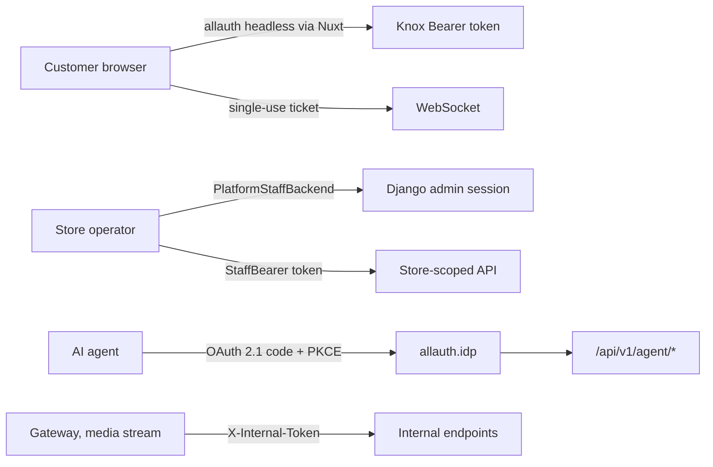

# Security model

The platform has several distinct identities and refuses to let them
blur: a customer is a row in a tenant schema, a store operator is a public
identity with a membership, an AI agent holds an OAuth bearer minted in a
tenant schema, and internal services prove themselves with shared secrets.
Authorisation is derived from those facts, never from a flag on a user
row.

## Authentication surfaces

| Surface | Mechanism | Where |
|---|---|---|
| Customer API | Knox token in `Authorization: Bearer …`. Seven-day TTL, auto-refreshed after a day of age, capped at thirty days from creation regardless of the expiry field; ten tokens per user | `settings.py: REST_KNOX`, `core/api/tokens.py: BoundedTokenAuthentication` |
| Customer login, signup, MFA | django-allauth headless (`/_allauth/app/v1/…`), proxied by Nuxt. Social providers Google, Facebook, GitHub, Discord; TOTP, recovery codes, WebAuthn and passkeys; the session token strategy mints the Knox token | `settings.py: HEADLESS_*`, `MFA_*`, `SOCIALACCOUNT_PROVIDERS`; `core/api/tokens.py: SessionTokenStrategy`; Nuxt `server/api/_allauth/**` |
| Customer session in the storefront | `nuxt-auth-utils` sealed cookie holding the allauth session token and the Knox access token | `nuxt.config.ts: runtimeConfig.session`, `shared/auth.d.ts` |
| WebSocket | A single-use ticket minted by `POST /api/v1/websocket/ticket` (valid sixty seconds, passed as `?ticket=`) and consumed atomically from Redis with GETDEL in the connecting tenant's schema; Knox tokens and cookies are not accepted on the socket, and a user with no live Knox token is refused at both minting and connect | `notification/views/websocket.py`, `core/middleware/channels.py` |
| Admin session | Django session auth. The admin login form calls `PlatformStaffBackend.authenticate_staff`, which resolves against the **public** schema only and requires `is_staff`; the backend's ordinary `authenticate()` returns `None` so the storefront login can never produce a platform identity | `tenant/auth_backends.py`, `admin/forms.py` |
| Store-scoped API for operators | `StaffBearer` tokens (`PlatformStaffToken`, a Knox subclass in the shared-only `tenant` app) minted on the platform host at `/api/v1/platform/auth/login`; the authenticator engages only on its own keyword so it composes with the customer authenticator | `tenant/staff_api.py`, `tenant/api_tokens.py`, `docs/api-staff-identity.md` |
| AI agents | Django is an OAuth 2.1 authorisation server (`allauth.idp`): authorisation code with PKCE at `/identity/o/authorize`, discovery at `/.well-known/openid-configuration` and `/.well-known/oauth-authorization-server`, open dynamic client registration. Resources under `/api/v1/agent/*` accept **only** these bearers (`AgentTokenAuthentication`), never Knox or sessions, and answer 401 with a `Bearer` challenge. The gateway verifies a presented bearer against `/api/v1/agent/me`, answers invalid tokens with the RFC 9728 `WWW-Authenticate` challenge, and lets anonymous requests through | `settings.py: IDP_OIDC_*`, `agent/views.py`, `grooveshop-agent-gateway/internal/identity`, Nuxt `server/routes/.well-known/oauth-protected-resource.get.ts` |
| Internal services | A shared secret compared in constant time. `X-Internal-Token` on tenant resolve (unlocks the ACP token and chat key) and on the domains feed; the gateway's `/internal/*` routes for order events and feed invalidation; `x-internal-secret` on the media stream's admin and metrics endpoints; `NUXT_CACHE_PURGE_TOKEN` on the Nuxt purge route | `tenant/views.py: _is_gateway`, `tenant/internal.py`, `internal/server/internalapi.go`, media `InternalSecretGuard` |

Rate limiting on the auth endpoints is Django-side as well:
`core/middleware/allauth_ratelimit.py` keys on `X-Real-IP`, and allauth's
own limits apply to dynamic client registration.

## Authorisation

### Customers

`DEFAULT_PERMISSION_CLASSES` is `IsAuthenticatedOrReadOnly`: anonymous
reads on the catalogue, authenticated writes everywhere, and any endpoint
that needs anonymous writes (guest checkout, contact form) sets `AllowAny`
explicitly. Tenant scoping is not a permission: a customer authenticated
on a host is by construction a customer of that store, because their user
row and their Knox token exist only in that schema (`settings.py` comment
on the default permissions).

Object ownership uses `core/api/permissions.py: IsOwnerOrAdmin` and
`IsOwnerOrAdminOrGuest`, which check the `user`, `owner` or `created_by`
field. The guest variant additionally accepts a guest order when the
`uuid` query parameter equals the object's UUID, which is how an anonymous
buyer reads their own order.

### Store staff

Roles live on `UserTenantMembership.role` (`tenant/models.py:
TenantMembershipRole`): `staff` sees the operational admin, `admin` also
manages settings and the team, `owner` is an admin who cannot be demoted or
removed by other admins, and a tenant always keeps at least one owner.
`member` is retired and no longer issued.

Two pieces of code turn a role into rights:

- `tenant/auth_backends.py: TenantRolePermissionBackend` computes Django
  model permissions from the role in the **current** tenant. It grants
  nothing unless the user object carries `PLATFORM_IDENTITY_ATTR`, the
  provenance stamp set only by `PlatformStaffBackend` and
  `PlatformStaffTokenAuthentication`. Platform-scope apps are never
  granted at any role (`tenant/role_scopes.py`).
- `tenant/membership.py: is_store_staff` is the API twin: true for a
  platform superuser, or for a stamped identity holding an active
  staff-capable membership in the current tenant. `core/api/permissions.py`
  builds `IsStoreStaff`, `StoreStaffModelPermissions` and the staff bypass
  in the owner permissions on it.

**`request.user.is_staff` is never an authorisation signal on an API
request.** `UserAccount` is mirrored per schema, and the multi-tenant
cutover copied users id-preserving, so a tenant-schema customer row can
carry `is_staff` or `is_superuser` as residue and can even share a primary
key or an email with a platform operator. Only provenance is safe, which is
why `IsPlatformSuperuser` honours `is_superuser` solely on stamped
identities or on the public schema itself.

### Platform operators

The control-plane API (`TenantAdminViewSet`) requires
`IsPlatformOperator` and the public schema; lifecycle moves go through the
dedicated `suspend` and `activate` actions rather than a writable
`is_active`. `is_protected` tenants refuse all of them.

### Feature gates

Plan and runtime feature gates answer 404, not 403, so a disabled feature
does not reveal that it exists. They are described in
[Multi-tenancy](/dev/platform/multi-tenancy).

## CSRF and CORS per tenant

One rule serves both (`tenant/middleware.py: origin_belongs_to_tenant`): an
origin is trusted when its scheme is `https` (plus `http` under `DEBUG`)
and its host is one of the tenant's `TenantDomain` rows. `TenantCsrfMiddleware`
extends Django's origin check with it; `tenant/signals.py:
allow_tenant_origin` feeds it to django-cors-headers, whose static
`CORS_ALLOWED_ORIGINS` holds only the platform origins.
`CORS_ALLOW_ALL_ORIGINS` is never set because credentials are on.
`TenantCookieDomainMiddleware` scopes the session and CSRF cookies to the
request host's registrable domain (`api.example.test` becomes
`.example.test`) so each store's cookies stay inside its own scope; the
static `SESSION_COOKIE_DOMAIN` and `CSRF_COOKIE_DOMAIN` are `None` on
purpose.

## Content Security Policy in the storefront

`shared/utils/csp.ts` is the single builder of the policy; it is a pure
function so `server/middleware/3.csp.ts` (runtime SSR) and
`nuxt.config.ts` (static route-rule headers) produce identical output. In
production every uncached SSR response carries a per-request nonce with
`'strict-dynamic'`, stamped onto the markup by `server/plugins/csp-nonce.ts`.
Cached SWR pages and prerender passes are nonce-free, keeping
`'unsafe-inline'` effective, because a nonce reused for a cache lifetime is
no nonce. Per-tenant inputs come from `event.context.tenant`:
`apiDomain` replaces the platform host in `connect-src`, `assetsDomain` and
`staticDomain` are added to `img-src` and `connect-src`, pixel origins are
emitted only when the tenant provisioned an id, and
`allowedCspSources` from the `Tenant` row extends `script-src`, `img-src`,
`connect-src` and `frame-src`. Locker maps and payment iframes need every
CDN hop in the policy.

## Ingress

Traefik middlewares in `grooveshop-infrastructure/.../base/`:

| Middleware | Applied to |
|---|---|
| `redirect-https`, `security-headers` (HSTS, nosniff, frame deny, referrer and permissions policies) | Every host |
| `rate-limit-api` | API hosts, asset hosts, the control plane, the docs |
| `rate-limit-agent`, `rate-limit-chat` | The gateway paths on storefront hosts; chat is the strictest because it pays per token |
| `limit-attachment-body` | The contact-attachment upload path |
| `platform-basic-auth`, `docs-basic-auth` | The control plane, in front of Django auth, so schema-dropping actions never sit on a tenant's cookie or CSP surface; and `/dev` on the docs host |
| `basic-auth` (`overlays/staging/middleware-basic-auth.yaml`, secret `staging-basic-auth`) | Every staging HTML and API host, with the build-asset prefixes and webhook receivers exempt |

The gateway adds its own per-IP limiter and a stricter one on `/chat`
(`internal/httpmw`); the media stream has an adaptive per-tenant-and-IP
limiter that tightens under heap pressure (`RateLimit` module). Django's
DRF throttles are generous daily caps plus per-scope limits on specific
views (`settings.py: DEFAULT_THROTTLE_RATES`).

## Secrets

- **Never in an image.** The storefront build once baked production
  values into the published image; the CI now writes only non-sensitive
  GitHub variables and placeholder secrets into the build `.env`, and every
  real value arrives at runtime from a sealed secret
  (`.github/workflows/docker.yml`). The affected keys were rotated.
- **Sealed Secrets in git, plaintext outside it.** Plaintext lives in the
  gitignored `untracked/secrets/unsealed/`, `seal.sh` writes
  `overlays/<env>/sealed-*.yaml`, and `base/` carries none. Keep the
  unsealed copies: they are the only plaintext.
- **Per-merchant secrets are Tenant-row fields**, edited in the platform
  admin, excluded from the audit history, and served to the gateway only
  on the internal-token path. No env var carries a merchant's key.
- **Comparisons are constant-time** (`secrets.compare_digest` in Django,
  the media stream's `InternalSecretGuard`), and internal endpoints fail
  closed when the secret is empty.
- Logs record field names, never values; upstream error bodies are logged
  because they are what makes a failure debuggable.

## Invariants

- Knox, OIDC and session tables are per schema; cross-tenant token replay
  is structurally impossible, not a check.
- A platform identity is only ever loaded by `PlatformStaffBackend` or
  `PlatformStaffTokenAuthentication`, and only they set the provenance
  stamp.
- Two `Bearer` authenticators cannot coexist in DRF; the staff scheme
  uses the `StaffBearer` keyword for that reason.
- The agent surface never accepts Knox or session auth.
- The control plane never serves storefront URLs and always sits behind
  basic auth in addition to Django auth.

## Failure modes

- An operator's `is_staff` is unticked: `PlatformStaffBackend.get_user`
  refuses the session on the next request and the token validator refuses
  the token; the admin UI and the API close together.
- A ticket is intercepted: it is deleted on first read, so a replay finds
  nothing; a ticket minted on one tenant finds nothing on another.
- A store owner opens the cache page on the platform host: impossible,
  because the storefront admin is not mounted there
  (`core/urls.py` comment on `_storefront_admin_i18n_patterns`).
- A tenant field is left empty for a payment provider: the provider is
  simply unavailable in checkout; nothing falls back to a platform key.

## Source

| File | Role |
|---|---|
| `grooveshop-django-api/settings.py` | `REST_KNOX`, `REST_FRAMEWORK`, `AUTHENTICATION_BACKENDS`, `HEADLESS_*`, `MFA_*`, `IDP_OIDC_*`, CORS and CSRF settings |
| `grooveshop-django-api/core/api/tokens.py` | `BoundedTokenAuthentication`, `SessionTokenStrategy` |
| `grooveshop-django-api/core/api/permissions.py` | `IsPlatformSuperuser`, `IsStoreStaff`, `IsOwnerOrAdmin`, `IsOwnerOrAdminOrGuest` |
| `grooveshop-django-api/core/middleware/channels.py` | WebSocket ticket consumption |
| `grooveshop-django-api/notification/views/websocket.py` | Ticket minting |
| `grooveshop-django-api/tenant/auth_backends.py` | `PlatformStaffBackend`, `TenantRolePermissionBackend`, `PLATFORM_IDENTITY_ATTR` |
| `grooveshop-django-api/tenant/membership.py` | `is_store_staff`, `is_platform_superuser`, `get_membership` |
| `grooveshop-django-api/tenant/api_tokens.py`, `tenant/staff_api.py` | Staff tokens |
| `grooveshop-django-api/tenant/middleware.py`, `tenant/signals.py` | CSRF and CORS origin rule, cookie domains |
| `grooveshop-django-api/tenant/views.py`, `tenant/internal.py` | Internal-token checks |
| `grooveshop-django-api/agent/views.py`, `agent/oidc.py` | Agent resources and OIDC adapter |
| `grooveshop-django-api/docs/api-staff-identity.md` | Design record for staff identity |
| `grooveshop-storefront-ui-node-nuxt/shared/utils/csp.ts` | CSP builder |
| `grooveshop-storefront-ui-node-nuxt/server/middleware/3.csp.ts`, `server/plugins/csp-nonce.ts` | Nonce policy |
| `grooveshop-storefront-ui-node-nuxt/server/utils/auth.ts` | Forwarded headers, client IP |
| `grooveshop-storefront-ui-node-nuxt/.claude/rules/auth.md` | The two-token model in the storefront |
| `grooveshop-storefront-ui-node-nuxt/.github/workflows/docker.yml` | Build-time secret handling |
| `grooveshop-agent-gateway/internal/identity/identity.go` | Bearer verification and RFC 9728 challenge |
| `grooveshop-agent-gateway/internal/server/internalapi.go` | Internal-token routes |
| `grooveshop-media-stream/src/MediaStream/RateLimit/`, `Validation/` | Adaptive limiter, secret guard, SSRF guard |
| `grooveshop-infrastructure/manifests/app-constructs/grooveshop/base/ingress-traefik.yaml`, `middleware-ratelimit.yaml`, `middleware-body-limit.yaml` | Shared middlewares |
| `grooveshop-infrastructure/manifests/app-constructs/grooveshop/overlays/production/ingress-platform.yaml` | Control-plane basic auth |
| `grooveshop-infrastructure/docs/sealed-secrets-key-management.md` | Sealed Secrets key handling |
