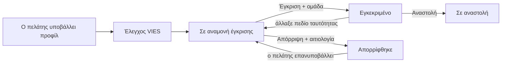

# Επιχειρηματικοί πελάτες

Πωλήσεις → Εταιρικοί Πελάτες

Το εταιρικό προφίλ είναι η επιχειρηματική ταυτότητα ενός πελάτη για το πρόγραμμα χονδρικής: επωνυμία, ΑΦΜ, ΔΟΥ, δραστηριότητα και διεύθυνση έδρας. Οι πελάτες κάνουν αίτηση από τον λογαριασμό τους· εσείς εξετάζετε, εγκρίνετε σε ομάδα πελατών, απορρίπτετε με αιτιολογία ή αναστέλλετε. Η έγκριση είναι αυτό που γυρίζει το καλάθι του πελάτη σε τιμές χονδρικής. Το πορτοκαλί σήμα δίπλα στο μενού μετρά τις αιτήσεις που περιμένουν εξέταση.

Το πρόγραμμα χονδρικής έρχεται απενεργοποιημένο. Λειτουργεί μόνο όταν η πλατφόρμα έχει ενεργοποιήσει το B2B για το κατάστημα και το `B2B_WHOLESALE_ENABLED` είναι ενεργό στις [Ρυθμίσεις καταστήματος](/el/admin/settings/store-settings). Το τιμολόγιο στο ταμείο είναι ξεχωριστό και διαθέσιμο σε κάθε αγοραστή· δείτε [Αποδείξεις και πιστωτικά παραστατικά](/el/admin/sales/receipts).

## Τι βλέπετε

### Η λίστα

| Στήλη | Σημασία |
|---|---|
| **Επωνυμία εταιρείας** | Όπως την έγραψε ο πελάτης. |
| **ΑΦΜ** | Εννέα ψηφία, αποθηκευμένα χωρίς το πρόθεμα EL. |
| **Χρήστης** | Ο λογαριασμός του πελάτη. Ένα προφίλ ανά λογαριασμό. |
| **Κατάσταση** | Βλ. πίνακα παρακάτω. |
| **Ομάδα πελατών** | Η βαθμίδα χονδρικής που ανατέθηκε κατά την έγκριση. |
| **VIES** | Το αποτέλεσμα του ευρωπαϊκού ελέγχου ΑΦΜ. |
| **Δημιουργήθηκε** | Πότε έγινε η αίτηση. |

Φίλτρα: κατάσταση, κατάσταση VIES, ομάδα πελατών, ημερομηνία δημιουργίας. Αναζήτηση με επωνυμία, ΑΦΜ ή email του πελάτη.

### Η σελίδα του προφίλ

- **Εταιρεία**: ο χρήστης, επωνυμία, ΑΦΜ, ΔΟΥ, δραστηριότητα και οδός, αριθμός, πόλη και Τ.Κ. τιμολόγησης. Επεξεργάσιμα, αλλά τα συντηρούν οι ίδιοι οι πελάτες· επεμβαίνετε μόνο για προφανές λάθος.
- **Εξέταση**: **Κατάσταση** (μόνο για ανάγνωση, αλλάζει μόνο από τις ενέργειες), **Ομάδα πελατών**, **Εξετάστηκε από**, **Εξετάστηκε στις**, **Αιτιολογία απόρριψης**.
- **VIES**: **Κατάσταση VIES**, **Έλεγχος VIES στις**, η επωνυμία και η διεύθυνση που επέστρεψε το VIES, και το τελευταίο **Σφάλμα VIES**. Όλα μόνο για ανάγνωση.

Ενέργειες κεφαλίδας: **Έγκριση**, **Απόρριψη**, **Αναστολή**, **Επανέλεγχος VIES**.

## Καταστάσεις

| Κατάσταση | Σημασία | Πώς φτάνει εκεί |
|---|---|---|
| **Σε αναμονή έγκρισης** | Περιμένει εσάς. | Νέα αίτηση, επανυποβολή μετά από απόρριψη, ή εγκεκριμένος πελάτης που άλλαξε πεδίο ταυτότητας (επωνυμία, ΑΦΜ, ΔΟΥ, δραστηριότητα). |
| **Εγκεκριμένο** | Ισχύουν τιμές χονδρικής. | **Έγκριση**. |
| **Απορρίφθηκε** | Χωρίς χονδρική· ο πελάτης έλαβε την αιτιολογία σας με email και μπορεί να επανυποβάλει. | **Απόρριψη**. |
| **Σε αναστολή** | Η χονδρική αφαιρέθηκε· ο πελάτης δεν μπορεί να την επαναφέρει με επεξεργασία. | **Αναστολή**. |

| Κατάσταση VIES | Σημασία |
|---|---|
| **Δεν έχει ελεγχθεί** | Δεν έχει τρέξει έλεγχος. |
| **Έγκυρο** | Η υπηρεσία VIES της ΕΕ επιβεβαίωσε τον ΑΦΜ· καταγράφηκαν επωνυμία και διεύθυνση. |
| **Μη έγκυρο** | Το VIES λέει ότι ο αριθμός δεν είναι καταχωρημένος για ενδοκοινοτικές συναλλαγές. |
| **Υπηρεσία μη διαθέσιμη** | Το VIES δεν απάντησε (λήξη χρόνου ή διακοπή). Δεν είναι κρίση· δοκιμάστε **Επανέλεγχος VIES** αργότερα. |

## Η ροή

1. Ο πελάτης συμπληρώνει τη φόρμα στον λογαριασμό του. Ο ΑΦΜ πρέπει να περνά τον έλεγχο ψηφίου ελέγχου του ελληνικού ΑΦΜ.
2. Η πλατφόρμα ρωτά την υπηρεσία VIES της ΕΕ (λήξη χρόνου πέντε δευτερόλεπτα) και αποθηκεύει το αποτέλεσμα. Σε διακοπή, το προφίλ μπαίνει παρ' όλα αυτά στην ουρά σας με **Υπηρεσία μη διαθέσιμη**· η απόφαση είναι δική σας ούτως ή άλλως.
3. Λαμβάνετε email στη διεύθυνση επικοινωνίας του καταστήματος για κάθε νέα αίτηση.
4. Η **Έγκριση** σάς ζητά την ομάδα πελατών και στέλνει email στον πελάτη ότι ο λογαριασμός του εγκρίθηκε. Η **Απόρριψη** ζητά αιτιολογία και τη στέλνει με email. Η **Αναστολή** είναι σκόπιμα σιωπηλή.
5. Επανυποβολές: απορριφθέν προφίλ γυρίζει σε αναμονή έγκρισης με οποιαδήποτε αλλαγή· εγκεκριμένο προφίλ γυρίζει μόνο όταν αλλάξει πεδίο ταυτότητας (αλλαγές διεύθυνσης κρατούν τη χονδρική)· προφίλ σε αναστολή μένει σε αναστολή.

## Εργασίες

### Εξέταση αίτησης
1. Φιλτράρετε **Κατάσταση → Σε αναμονή έγκρισης**, ή πατήστε το σήμα.
2. Ανοίξτε το προφίλ. Συγκρίνετε τα στοιχεία της εταιρείας με την καρτέλα **VIES**· αποτέλεσμα **Έγκυρο** με επωνυμία που ταιριάζει είναι ισχυρή ένδειξη. **Μη έγκυρο** ή **Υπηρεσία μη διαθέσιμη** σημαίνει έλεγχο του αριθμού με τον πελάτη ή νέο έλεγχο.
3. **Έγκριση** και επιλογή **Ομάδας πελατών**, ή **Απόρριψη** με αιτιολογία που θα διαβάσει ο πελάτης. Ο διάλογος της Έγκρισης δείχνει μόνο ενεργές ομάδες, οπότε δημιουργήστε ή ενεργοποιήστε πρώτα τη βαθμίδα αν δεν τη βλέπετε.

### Αλλαγή βαθμίδας πελάτη
1. Ανοίξτε το προφίλ και ορίστε **Ομάδα πελατών** στην καρτέλα **Εξέταση**, μετά αποθηκεύστε. Την επόμενη φορά που ο πελάτης φορτώσει το καλάθι του τιμολογείται με τη νέα ομάδα.

### Αφαίρεση πρόσβασης χονδρικής
1. **Αναστολή**. Δεν στέλνεται email. Η επόμενη φόρτωση καλαθιού του πελάτη τιμολογείται σε λιανική.
2. Για επαναφορά, **Έγκριση** ξανά με ομάδα.

### Νέος έλεγχος VIES
1. **Επανέλεγχος VIES** στην κεφαλίδα. Το αποτέλεσμα και ο χρόνος ενημερώνονται αμέσως.

## Καλό είναι να ξέρετε

- **Η πρόσβαση χονδρικής χρειάζεται τέσσερα πράγματα ταυτόχρονα**: τη λειτουργία ενεργή, το προφίλ **Εγκεκριμένο**, **Ομάδα πελατών** ανατεθειμένη και την ομάδα **Ενεργή**. Αν λείπει οποιοδήποτε, ο πελάτης τιμολογείται σε λιανική χωρίς σφάλμα. Δείτε [Ομάδες πελατών & τιμοκατάλογοι](/el/admin/b2b/groups-and-price-lists).
- **Οι τιμές δένονται σε κάθε φόρτωση καλαθιού**, όχι κατά την έγκριση. Η έγκριση, η αλλαγή ομάδας ή η αναστολή ισχύουν από το επόμενο αίτημα του πελάτη· οι παραγγελίες που ήδη καταχωρήθηκαν κρατούν την τιμολόγηση με την οποία έγιναν.
- **Τα στοιχεία τιμολόγησης του προφίλ είναι η ταυτότητα τιμολογίου του πελάτη.** Οι παραγγελίες κρατούν δικό τους στιγμιότυπο αυτών των πεδίων, οπότε μεταγενέστερη αλλαγή στο προφίλ δεν ξαναγράφει ποτέ υπάρχουσα παραγγελία ή τιμολόγιο.
- **Το VIES είναι συμβουλευτικό.** Η πλατφόρμα δεν εγκρίνει ούτε απορρίπτει μόνη της· το **Έγκυρο** δεν εγκρίνει αυτόματα και το **Μη έγκυρο** δεν σας εμποδίζει.
- **Ένα προφίλ ανά λογαριασμό.** Επιχείρηση με πολλούς αγοραστές χρειάζεται έναν λογαριασμό ανά αγοραστή, καθένας με δικό του προφίλ.
- **Οι παραγγελίες χονδρικής σημαίνονται.** Η λίστα παραγγελιών έχει φίλτρο **Χονδρική** και κάθε παραγγελία δείχνει την ομάδα και το ποσοστό με το οποίο τιμολογήθηκε. Δείτε [Παραγγελίες](/el/admin/sales/orders).

## Σχετικά

- [Ομάδες πελατών & τιμοκατάλογοι](/el/admin/b2b/groups-and-price-lists)
- [Αποδείξεις και πιστωτικά παραστατικά](/el/admin/sales/receipts)
- [Παραγγελίες](/el/admin/sales/orders)
- [Χρήστες & διευθύνσεις](/el/admin/customers/users-and-addresses)
- [Ρυθμίσεις καταστήματος](/el/admin/settings/store-settings)
