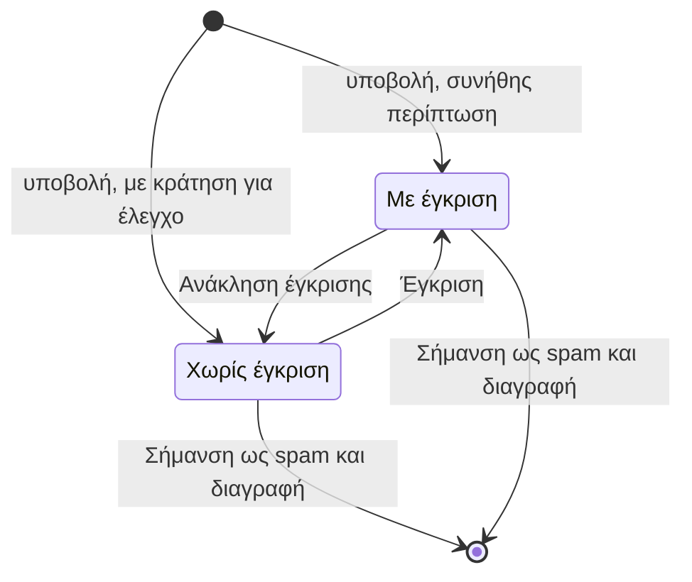

# Σχόλια

Blog → Σχόλια Blog

Οι πελάτες σχολιάζουν άρθρα και απαντούν ο ένας στον άλλο. Σε αυτή την οθόνη εγκρίνετε, κρύβετε και αφαιρείτε όσα γράφουν.

**Διαβάστε το πριν οργανώσετε ρουτίνα ελέγχου.** Τα νέα σχόλια κανονικά **εγκρίνονται τη στιγμή που υποβάλλονται** και εμφανίζονται αμέσως στο blog. Το να κρατιούνται πρώτα για έλεγχο είναι επιλογή σε επίπεδο πλατφόρμας, όχι ρύθμιση του καταστήματος, οπότε δεν ενεργοποιείται από το διαχειριστικό. Αν το δικό σας τα κρατά, το σήμα στο πλάγιο μενού ανεβαίνει καθώς φτάνουν· αν το σήμα μένει στο μηδέν ενώ τα σχόλια εμφανίζονται στα άρθρα σας, το δικό σας τα δημοσιεύει κατευθείαν και αυτή η οθόνη χρησιμεύει για να κατεβάζετε τα κακά εκ των υστέρων. Ζητήστε από την ομάδα της πλατφόρμας να αλλάξει τον τρόπο λειτουργίας.

Τα σχόλια απενεργοποιούνται εντελώς, για όλο το κατάστημα, με τη ρύθμιση **BLOG_COMMENTS_ENABLED** στο Ρυθμίσεις → Πρόσθετες Ρυθμίσεις. Πρέπει επίσης να είναι ενεργή η λειτουργία blog του πλάνου σας.

## Τι βλέπετε

Η επιλογή στο πλάγιο μενού έχει μπλε σήμα με τον αριθμό των μη εγκεκριμένων σχολίων. Η λίστα δείχνει 30 σχόλια ανά σελίδα με σειρά νήματος, και πλοήγηση ανά ημερομηνία δημιουργίας.

| Στήλη | Σημασία |
|---|---|
| **Περιεχόμενο** | Οι πρώτοι 50 χαρακτήρες. Οι γραμμές μπαίνουν με σειρά που βάζει κάθε απάντηση αμέσως μετά το γονικό της, αλλά χωρίς ορατή εσοχή, οπότε χρησιμοποιήστε τον σύνδεσμο **Άρθρο** και το ίδιο το κείμενο για να καταλάβετε τι απαντά σε τι. |
| **Χρήστης** | Όνομα και email του σχολιαστή, ή **Ανώνυμος** όταν ο λογαριασμός δεν υπάρχει πια. |
| **Άρθρο** | Τίτλος άρθρου με σύνδεσμο. |
| **Εγκεκριμένο** | Επεξεργάσιμο στη λίστα· τσεκάρετε και πατήστε **Αποθήκευση**. |
| **Συμμετοχή** | Επισημάνσεις και εγκεκριμένες απαντήσεις. |
| **Δημιουργήθηκε στις** | Χρονοσφραγίδα. |

Η **αναζήτηση** ψάχνει σε email, όνομα χρήστη, όνομα και επώνυμο του σχολιαστή, τίτλο και υπότιτλο άρθρου, και κείμενο σχολίου. **Φίλτρα**: Εγκεκριμένο, εύρος ημερομηνίας δημιουργίας, Άρθρο, Χρήστης.

**Μαζικές ενέργειες**:

| Ενέργεια | Αποτέλεσμα |
|---|---|
| **Έγκριση επιλεγμένων σχολίων** | Ενεργοποιεί το Εγκεκριμένο. |
| **Ανάκληση έγκρισης επιλεγμένων σχολίων** | Απενεργοποιεί το Εγκεκριμένο· το σχόλιο και οι απαντήσεις του εξαφανίζονται από το κατάστημα. |
| **Σήμανση ως spam και διαγραφή** | Διαγράφει τα σχόλια **οριστικά**, μαζί με κάθε απάντηση κάτω από αυτά, και επιδιορθώνει τη δομή του νήματος. Πουθενά δεν καταγράφεται τίποτα ως spam· παρά το όνομα, πρόκειται μόνο για διαγραφή. |

Η φόρμα: **Περιεχόμενο Σχολίου** (**Περιεχόμενο** ανά γλώσσα, έως 1000 χαρακτήρες), **Σχέσεις** (**Άρθρο**, **Χρήστης**, **Parent**), **Συντονισμός** (**Εγκεκριμένο**), συμπτυγμένη **Συμμετοχή**.

## Ροή ελέγχου

- Χωρίς έγκριση (το **Εγκεκριμένο** κλειστό): φεύγει από τη σελίδα του άρθρου για όλους, ακόμη και για τον ίδιο τον συντάκτη του. Ο συντάκτης το βρίσκει πάντως στον λογαριασμό του, στα δικά του σχόλια, οπότε δεν του φαίνεται χαμένο. Δεν μετρά στο πλήθος σχολίων του άρθρου.
- Με έγκριση (το **Εγκεκριμένο** τσεκαρισμένο): ορατό σε όλους στη σελίδα του άρθρου, μετριέται, και δέχεται επισημάνσεις και απαντήσεις.
- Μια απάντηση είναι ορατή μόνο όταν είναι εγκεκριμένη **και** το γονικό της σχόλιο είναι ορατό. Η ανάκληση έγκρισης ενός σχολίου κατεβάζει επομένως ολόκληρο το νήμα του.

## Εργασίες

### Επεξεργασία της ουράς
Χρήσιμο μόνο σε κατάστημα που κρατά τα σχόλια για έλεγχο. Όπου δημοσιεύονται με την άφιξη, αυτό το φίλτρο είναι κανονικά άδειο και η επόμενη ενότητα είναι αυτή που χρειάζεστε.

1. Ανοίξτε Blog → Σχόλια Blog και φιλτράρετε **Εγκεκριμένο** σε Όχι.
2. Διαβάστε το περιεχόμενο· ανοίξτε τον σύνδεσμο **Άρθρο** για πλαίσιο.
3. Τσεκάρετε **Εγκεκριμένο** στα καλά και πατήστε **Αποθήκευση**, ή επιλέξτε τα και τρέξτε **Έγκριση επιλεγμένων σχολίων**.
4. Επιλέξτε τα spam και τρέξτε **Σήμανση ως spam και διαγραφή**.

### Απόσυρση σχολίου που είναι ήδη δημόσιο
1. Βρείτε το με το πεδίο αναζήτησης, που ψάχνει και στο κείμενο του σχολίου, όχι μόνο στο όνομα, το email του συντάκτη και τον τίτλο του άρθρου.
2. Ξετσεκάρετε το **Εγκεκριμένο** και πατήστε **Αποθήκευση**, ή επιλέξτε το και τρέξτε **Ανάκληση έγκρισης επιλεγμένων σχολίων**. Φεύγει αμέσως από το άρθρο, μαζί με όποιες απαντήσεις κρέμονται από αυτό.
3. Καθαρίστε την επιφάνεια **Blog** στο εργαλείο [Cache](/el/admin/system/cache), αλλιώς ένα αποθηκευμένο αντίγραφο της σελίδας μπορεί να το δείχνει για λίγα λεπτά ακόμη.
4. Διαγράψτε το μόνο όταν είστε βέβαιοι. Η **Σήμανση ως spam και διαγραφή** δεν αναιρείται.

### Απάντηση σε σχόλιο ως κατάστημα
1. Πατήστε **Προσθήκη**.
2. Ορίστε **Άρθρο** το ίδιο άρθρο, **Parent** το σχόλιο που απαντάτε, **Χρήστη** τον δικό σας λογαριασμό, γράψτε **Περιεχόμενο**, τσεκάρετε **Εγκεκριμένο**, αποθηκεύστε.
3. Η απάντηση εμφανίζεται κάτω από το σχόλιο του πελάτη με το όνομα του λογαριασμού σας.

### Αφαίρεση ενός σχολίου χωρίς διαγραφή του νήματος
Ξετσεκάρετε το **Εγκεκριμένο**. Οι απαντήσεις του διατηρούνται αλλά κρύβονται μαζί του, και επανέρχονται αν το εγκρίνετε ξανά.

## Επισημάνσεις και ειδοποιήσεις

- Κάθε συνδεδεμένος πελάτης μπορεί να κάνει like σε σχόλιο άλλου στο κατάστημα· το admin δείχνει μόνο το πλήθος.
- Όταν ένα σχόλιο πάρει like, ο συντάκτης του λαμβάνει **ειδοποίηση μέσα στην εφαρμογή** («Το σχόλιό σου πήρε like!», στη γλώσσα του) που οδηγεί στα σχόλια του άρθρου. Τα like στον εαυτό σας δεν στέλνουν τίποτα. Φτάνει μέσα σε λίγα δευτερόλεπτα και όχι την ίδια στιγμή, και δεν είναι ποτέ email.
- Οι ειδοποιήσεις φαίνονται στις [Ειδοποιήσεις](/el/admin/sales/notifications).

## Καλό είναι να ξέρετε

- **Η διαγραφή ενός άρθρου δεν διαγράφει τα σχόλιά του.** Μένουν σε αυτή τη λίστα με κενή στήλη **Άρθρο**, και αυτός είναι ο συνήθης λόγος για γραμμές που μοιάζουν ορφανές. Διαγράψτε πρώτα τα σχόλια αν θέλετε να φύγουν μαζί με το άρθρο.
- Η διαγραφή λογαριασμού πελάτη κρατά τα σχόλιά του και τα δείχνει ως **Ανώνυμος**.
- Η **Σήμανση ως spam και διαγραφή** δεν αναιρείται. Χρησιμοποιήστε την **Ανάκληση έγκρισης** όταν αμφιβάλλετε.
- Η επεξεργασία του **Περιεχομένου** ξαναγράφει τα λόγια του πελάτη κάτω από το όνομά του· προτιμήστε την ανάκληση έγκρισης από την επεξεργασία.
- Το σήμα στο πλάγιο μενού ξαναϋπολογίζεται το πολύ μία φορά το λεπτό. Η ίδια η λίστα είναι πάντα ενημερωμένη.
- Οι σελίδες του blog κρατιούνται σε cache στο κατάστημα· ένα νεοεγκεκριμένο σχόλιο μπορεί να αργήσει λίγα λεπτά να φανεί, εκτός αν καθαρίσετε την επιφάνεια **Blog** στο εργαλείο [Cache](/el/admin/system/cache).

## Σχετικά

- [Άρθρα](/el/admin/blog/posts)
- [Κατηγορίες, συντάκτες & ετικέτες](/el/admin/blog/categories-authors-tags)
- [Ειδοποιήσεις](/el/admin/sales/notifications)
- [Ρυθμίσεις καταστήματος](/el/admin/settings/store-settings)
