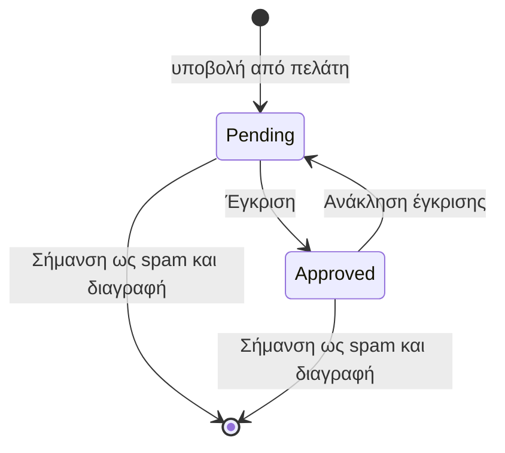

# Σχόλια

Blog → Σχόλια Blog

Οι πελάτες σχολιάζουν άρθρα και απαντούν ο ένας στον άλλο. Ένα νέο σχόλιο μένει κρυφό μέχρι να το εγκρίνει το προσωπικό εδώ. Τα σχόλια απενεργοποιούνται για όλο το κατάστημα με τη ρύθμιση `BLOG_COMMENTS_ENABLED` στο Ρυθμίσεις → Πρόσθετες Ρυθμίσεις· πρέπει επίσης να είναι ενεργή η σήμανση blog του πλάνου.

## Τι βλέπετε

Η επιλογή στο πλάγιο μενού έχει μπλε σήμα με τον αριθμό των μη εγκεκριμένων σχολίων. Η λίστα δείχνει 30 σχόλια ανά σελίδα με σειρά νήματος, και πλοήγηση ανά ημερομηνία δημιουργίας.

| Στήλη | Σημασία |
|---|---|
| **Περιεχόμενο** | Οι πρώτοι 50 χαρακτήρες, με εσοχή ανάλογα με το βάθος απάντησης ώστε τα νήματα να διαβάζονται από πάνω προς τα κάτω. |
| **Χρήστης** | Όνομα και email του σχολιαστή, ή **Ανώνυμος** όταν ο λογαριασμός δεν υπάρχει πια. |
| **Άρθρο** | Τίτλος άρθρου με σύνδεσμο. |
| **Εγκεκριμένο** | Επεξεργάσιμο στη λίστα· τσεκάρετε και πατήστε **Αποθήκευση**. |
| **Συμμετοχή** | Επισημάνσεις και εγκεκριμένες απαντήσεις. |
| **Created** | Χρονοσφραγίδα. |

Η **αναζήτηση** ψάχνει σε email, όνομα χρήστη, όνομα και επώνυμο του σχολιαστή, τίτλο και υπότιτλο άρθρου, και κείμενο σχολίου. **Φίλτρα**: Εγκεκριμένο, εύρος ημερομηνίας δημιουργίας, Άρθρο, Χρήστης.

**Μαζικές ενέργειες**:

| Ενέργεια | Αποτέλεσμα |
|---|---|
| **Έγκριση επιλεγμένων σχολίων** | Ενεργοποιεί το Εγκεκριμένο. |
| **Ανάκληση έγκρισης επιλεγμένων σχολίων** | Απενεργοποιεί το Εγκεκριμένο· το σχόλιο και οι απαντήσεις του εξαφανίζονται από το κατάστημα. |
| **Σήμανση ως spam και διαγραφή** | Διαγράφει τα σχόλια **οριστικά**, μαζί με κάθε απάντηση κάτω από αυτά, και επιδιορθώνει τη δομή του νήματος. |

Η φόρμα: **Περιεχόμενο Σχολίου** (**Περιεχόμενο** ανά γλώσσα, έως 1000 χαρακτήρες), **Σχέσεις** (**Άρθρο**, **Χρήστης**, **Parent**), **Συντονισμός** (**Εγκεκριμένο**), συμπτυγμένη **Συμμετοχή**.

## Ροή ελέγχου

- **Pending** (Εγκεκριμένο κλειστό): ορατό μόνο στον συντάκτη του και στο προσωπικό. Δεν μετρά στο πλήθος σχολίων του άρθρου.
- **Approved**: ορατό σε όλους στη σελίδα του άρθρου, μετριέται, και δέχεται επισημάνσεις και απαντήσεις.
- Μια απάντηση είναι ορατή μόνο όταν είναι εγκεκριμένη **και** το γονικό της σχόλιο είναι ορατό.

## Εργασίες

### Επεξεργασία της ουράς
1. Ανοίξτε Blog → Σχόλια Blog και φιλτράρετε **Εγκεκριμένο** σε Όχι.
2. Διαβάστε το περιεχόμενο· ανοίξτε τον σύνδεσμο **Άρθρο** για πλαίσιο.
3. Τσεκάρετε **Εγκεκριμένο** στα καλά και πατήστε **Αποθήκευση**, ή επιλέξτε τα και τρέξτε **Έγκριση επιλεγμένων σχολίων**.
4. Επιλέξτε τα spam και τρέξτε **Σήμανση ως spam και διαγραφή**.

### Απάντηση σε σχόλιο ως κατάστημα
1. Πατήστε **Προσθήκη**.
2. Ορίστε **Άρθρο** το ίδιο άρθρο, **Parent** το σχόλιο που απαντάτε, **Χρήστη** τον δικό σας λογαριασμό, γράψτε **Περιεχόμενο**, τσεκάρετε **Εγκεκριμένο**, αποθηκεύστε.
3. Η απάντηση εμφανίζεται κάτω από το σχόλιο του πελάτη με το όνομα του λογαριασμού σας.

### Αφαίρεση ενός σχολίου χωρίς διαγραφή του νήματος
Ξετσεκάρετε το **Εγκεκριμένο**. Οι απαντήσεις του μένουν στη βάση αλλά κρύβονται μαζί του.

## Επισημάνσεις και ειδοποιήσεις

- Κάθε συνδεδεμένος πελάτης μπορεί να κάνει like σε σχόλιο άλλου στο κατάστημα· το admin δείχνει μόνο το πλήθος.
- Όταν ένα σχόλιο πάρει like, ο συντάκτης του λαμβάνει **ειδοποίηση μέσα στην εφαρμογή** («Το σχόλιό σου πήρε like!», στη γλώσσα του) που οδηγεί στα σχόλια του άρθρου. Τα like στον εαυτό σας δεν στέλνουν τίποτα. Η ειδοποίηση δημιουργείται από εργασία παρασκηνίου, οπότε εμφανίζεται σε λίγα δευτερόλεπτα και όχι ακαριαία, και δεν είναι email.
- Οι ειδοποιήσεις φαίνονται στις [Ειδοποιήσεις](/el/admin/sales/notifications).

## Καλό είναι να ξέρετε

- Η διαγραφή άρθρου διαγράφει τα σχόλιά του· η διαγραφή λογαριασμού πελάτη κρατά τα σχόλιά του και τα δείχνει ως **Ανώνυμος**.
- Η **Σήμανση ως spam και διαγραφή** δεν αναιρείται. Χρησιμοποιήστε την **Ανάκληση έγκρισης** όταν αμφιβάλλετε.
- Η επεξεργασία του **Περιεχομένου** ξαναγράφει τα λόγια του πελάτη· προτιμήστε την ανάκληση έγκρισης από την επεξεργασία.
- Το σήμα και τα πλήθη ανανεώνονται μέσα σε ένα λεπτό.
- Οι σελίδες του blog κρατιούνται σε cache στο κατάστημα· ένα νεοεγκεκριμένο σχόλιο μπορεί να αργήσει λίγα λεπτά να φανεί, εκτός αν καθαρίσετε την επιφάνεια **Blog** στο εργαλείο [Cache](/el/admin/system/cache).

## Σχετικά

- [Άρθρα](/el/admin/blog/posts)
- [Κατηγορίες, συντάκτες & ετικέτες](/el/admin/blog/categories-authors-tags)
- [Ειδοποιήσεις](/el/admin/sales/notifications)
- [Ρυθμίσεις καταστήματος](/el/admin/settings/store-settings)
