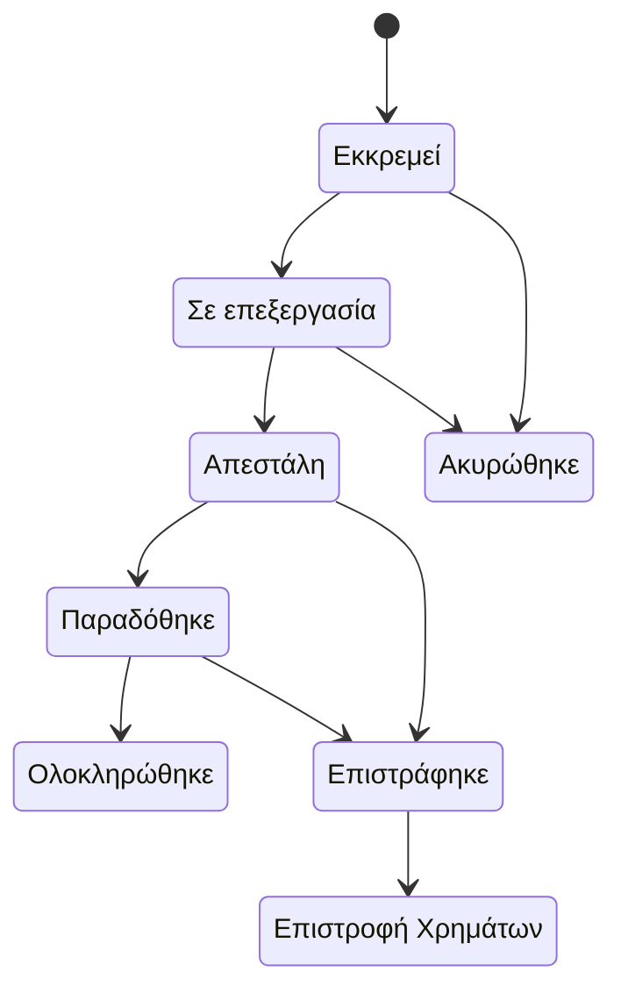

# Παραγγελίες

Πωλήσεις → Παραγγελίες

Κάθε αγορά, είτε έγινε από το κατάστημα, από επισκέπτη χωρίς λογαριασμό είτε μέσω AI agent, είναι μία παραγγελία. Αυτή είναι η οθόνη όπου ζει το προσωπικό του καταστήματος: απαντά στο «πού βρίσκεται η παραγγελία, έχει πληρωθεί και τι πρέπει να κάνω μετά». Το κόκκινο σήμα δίπλα στο μενού δείχνει πόσες παραγγελίες είναι ακόμη σε κατάσταση **Εκκρεμεί**.

## Τι βλέπετε

### Η λίστα

| Στήλη | Σημασία |
|---|---|
| **Κατάσταση** | Η κατάσταση διεκπεραίωσης (βλ. πίνακα παρακάτω). |
| **Πελάτης** | Το όνομα της παραγγελίας και το email με το οποίο έγινε. Οι παραγγελίες επισκεπτών εμφανίζουν τα ίδια, απλώς χωρίς συνδεδεμένο λογαριασμό. |
| **Παραγγελία** | Πλήθος γραμμών, συνολική ποσότητα και το ποσό που πραγματικά οφείλει ο πελάτης μετά τις εκπτώσεις, τους πόντους και τις δωροκάρτες. |
| **Πληρωμή** | Η οικονομική κατάσταση, ανεξάρτητη από τη διεκπεραίωση. |
| **Αποστολή** | Η κατάσταση του δέματος όπως την αναφέρει η μεταφορική (ACS ή BoxNow). Κενή όταν δεν έχει συνδεθεί ακόμη μεταφορική. |
| **Μεταφορικά** | Αριθμός παρακολούθησης, μεταφορική και πόλη, ή «No tracking» και η πόλη. |
| **Δημιουργήθηκε** | Ημερομηνία και ώρα, με σχετική ηλικία. |

Κάθε γραμμή έχει δύο γρήγορες ενέργειες: **Λήψη voucher αποστολής (PDF)** και **Παραγγελίες πελάτη**, που ξανανοίγει τη λίστα φιλτραρισμένη στον ίδιο λογαριασμό, ή στο ίδιο email για επισκέπτες.

### Φίλτρα

Το δεξί πλαίσιο προσφέρει, από πάνω προς τα κάτω: **Ομάδα κατάστασης** (Ενεργές, Σε διεκπεραίωση, Ολοκληρωμένες, Προβληματικές), **Κατάσταση πληρωμής** (κάθε κατάσταση συν το «Χρειάζεται προσοχή», δηλαδή Απέτυχε ή Εκκρεμεί), **Τύπος Εγγράφου** (Απόδειξη ή Τιμολόγιο και τα είδη ετικετών), **Χονδρική** (παραγγελίες με τιμές ομάδας B2B ή λιανικής), **Πρόσφατες Παραγγελίες** (Σήμερα, Αυτήν την εβδομάδα, Αυτόν τον μήνα, «Επείγουσες» δηλαδή σε εκκρεμότητα πάνω από 24 ώρες), έπειτα την απλή κατάσταση και κατάσταση πληρωμής, εύρος ημερομηνίας δημιουργίας και αλλαγής κατάστασης, χώρα, περιοχή, μέθοδο πληρωμής, την πύλη που επεξεργάστηκε τη χρέωση, πάροχο αποστολής, είδος αποστολής και, για παραγγελίες BoxNow, την κατάσταση δέματος. Πάνω από τον πίνακα υπάρχει πλοήγηση ανά ημερομηνία δημιουργίας.

### Αναζήτηση

Το πεδίο αναζήτησης βρίσκει με ID παραγγελίας, UUID, email πελάτη, όνομα και επώνυμο, τηλέφωνο, πόλη, αριθμό παρακολούθησης, ID πληρωμής και, για BoxNow, το ID δέματος, το ID αιτήματος παράδοσης και το ID του locker. Επικολλήστε έναν αριθμό voucher και η παραγγελία εμφανίζεται.

### Μαζικές ενέργειες

Επιλέξτε γραμμές και διαλέξτε μία από τις **Επισήμανση επιλεγμένων παραγγελιών ως «Σε επεξεργασία» / απεσταλμένων / «Παραδομένες» / «Ολοκληρωμένες»** ή **Ακύρωση επιλεγμένων παραγγελιών και επιστροφή στο απόθεμα**. Κάθε παραγγελία ελέγχεται ξεχωριστά ως προς τις επιτρεπόμενες μεταβάσεις. Όσες δεν μπορούν να μετακινηθούν παραλείπονται με προειδοποίηση που αναφέρει την παραγγελία και τον λόγο· οι υπόλοιπες προχωρούν.

### Η σελίδα της παραγγελίας

Η σελίδα χωρίζεται σε καρτέλες:

- **Στοιχεία Παραγγελίας**: UUID, η επεξεργάσιμη **Κατάσταση**, χρόνοι δημιουργίας, ενημέρωσης και αλλαγής κατάστασης.
- **Τιμολόγηση / Παραστατικό**: **Τύπος Εγγράφου** (Απόδειξη ή Τιμολόγιο) και, για τιμολόγια, επωνυμία, ΑΦΜ, ΔΟΥ, δραστηριότητα και διεύθυνση έδρας του αγοραστή. Το **Τιμολόγηση χονδρικής** δείχνει ποια ομάδα B2B τιμολόγησε την παραγγελία ή «Λιανική (χωρίς τιμές ομάδας)».
- **Στοιχεία Πελάτη**: συνδεδεμένος λογαριασμός (κενό για επισκέπτες), όνομα, email, τηλέφωνο.
- **Διεύθυνση Αποστολής**: χώρα, περιοχή, πόλη, οδός, αριθμός, Τ.Κ., όροφος, τύπος τοποθεσίας.
- **Πληροφορίες πληρωμής**: η μέθοδος πληρωμής που επέλεξε ο πελάτης, η επεξεργάσιμη **Κατάσταση πληρωμής**, η πύλη που επεξεργάστηκε τη χρέωση, το ID πληρωμής του παρόχου, το πληρωμένο ποσό και, μόνο για ανάγνωση, η έκπτωση προσφορών, η έκπτωση πόντων και το ποσό δωροκάρτας όπως καταγράφηκαν στο ταμείο.
- **Αποστολή & Παρακολούθηση**: πάροχος αποστολής, είδος αποστολής, κόστος αποστολής, αριθμός παρακολούθησης, όνομα μεταφορικής.
- **Πρόσθετες Πληροφορίες**: οι σημειώσεις του πελάτη από το ταμείο.

Κάτω από τις καρτέλες: τα **είδη της παραγγελίας** (προϊόν, ποσότητα, τιμή μονάδας, σύνολο γραμμής, κατάσταση επιστροφής), η γραμμή του **τιμολογίου** αν υπάρχει (αριθμός, ημερομηνία έκδοσης, σύνολο, **Λήψη PDF**), το **ιστορικό** (οι τελευταίες είκοσι εγγραφές: τύπος αλλαγής, περιγραφή, ποιος την έκανε ή «System», πότε) και, όταν υπάρχει μεταφορική, μια καρτέλα αποστολής **ACS** ή **BoxNow** με τα στοιχεία του voucher.

Η κεφαλίδα έχει το **Λήψη voucher αποστολής (PDF)** και ένα μενού **Τιμολόγηση & myDATA** με **Έκδοση τιμολογίου**, **Επανέκδοση τιμολογίου (ίδιος αριθμός)**, **Αποστολή στο myDATA** και **Ακύρωση στο myDATA**. Δείτε τα [Τιμολόγια](/el/admin/sales/invoices).

## Καταστάσεις παραγγελίας

| Κατάσταση | Σημασία | Ποιος τη θέτει |
|---|---|---|
| **Εκκρεμεί** | Καταχωρήθηκε, δεν έχει γίνει τίποτα ακόμη. Στις online πληρωμές τα χρήματα δεν έχουν μπει· στην αντικαταβολή δημιουργείται το voucher. | Το ταμείο. |
| **Σε επεξεργασία** | Επιβεβαιωμένη και προετοιμάζεται. | Αυτόματα όταν πετύχει η online πληρωμή ή όταν εκδοθεί το voucher της αντικαταβολής· ή η μαζική ενέργεια. |
| **Απεστάλη** | Η μεταφορική αναφέρει ότι το δέμα κινείται. | Αυτόματα από την ACS ή το webhook της BoxNow· ή η μαζική ενέργεια. |
| **Παραδόθηκε** | Η μεταφορική αναφέρει παράδοση. | Αυτόματα από τη μεταφορική· ή η μαζική ενέργεια. |
| **Ολοκληρώθηκε** | Παραδόθηκε και πληρώθηκε. Τελική. | Αυτόματα μόλις μια παραδομένη παραγγελία πληρωθεί (στην αντικαταβολή, όταν συμφωνηθεί η απόδοση της μεταφορικής)· ή η μαζική ενέργεια. |
| **Ακυρώθηκε** | Έκλεισε πριν την αποστολή. Το απόθεμα επιστράφηκε. Τελική. | Ο πελάτης από τον λογαριασμό του, η μαζική ενέργεια ακύρωσης ή η αυτόματη εκκαθάριση απλήρωτων online παραγγελιών. |
| **Επιστράφηκε** | Η μεταφορική επέστρεψε το δέμα ή ο πελάτης το επέστρεψε. | Αυτόματα από τη μεταφορική· αλλιώς εσείς, αλλάζοντας την **Κατάσταση** στη σελίδα της παραγγελίας (δεν υπάρχει μαζική ενέργεια). |
| **Επιστροφή Χρημάτων** | Επιστραμμένη παραγγελία της οποίας τα χρήματα επιστράφηκαν. Τελική. | Εσείς, αλλάζοντας την **Κατάσταση** σε παραγγελία που έχει Επιστραφεί. |

Ακύρωση επιτρέπεται μόνο από **Εκκρεμεί** και **Σε επεξεργασία**. Από **Ολοκληρώθηκε**, **Ακυρώθηκε** και **Επιστροφή Χρημάτων** δεν υπάρχει έξοδος.

## Καταστάσεις πληρωμής

| Κατάσταση πληρωμής | Σημασία | Ποιος τη θέτει |
|---|---|---|
| **Εκκρεμεί** | Δεν έχει εισπραχθεί τίποτα. Φυσιολογικό στην αντικαταβολή μέχρι να αποδώσει η μεταφορική, και στην τραπεζική μεταφορά μέχρι να την επιβεβαιώσετε. | Το ταμείο. |
| **Σε επεξεργασία** | Ο πάροχος επεξεργάζεται ακόμη τη χρέωση. | Webhook παρόχου. |
| **Ολοκληρώθηκε** | Εξοφλήθηκε. Ισχύει και όταν δωροκάρτες, πόντοι ή προσφορά 100% κάλυψαν όλο το ποσό. | Webhook Stripe ή Viva Wallet, η ημερήσια συμφωνία αντικαταβολών ACS, ή εσείς, αλλάζοντας το πεδίο. |
| **Απέτυχε** | Η online χρέωση απορρίφθηκε. Η παραγγελία μένει σε Εκκρεμεί και ακυρώνεται αυτόματα μετά την περίοδο χάριτος. | Webhook παρόχου. |
| **Επιστροφή Χρημάτων** | Πλήρης επιστροφή χρημάτων. | Πλήρης επιστροφή που είδε το webhook της Stripe. |
| **Μερική επιστροφή** | Μέρος των χρημάτων επιστράφηκε. | Μερική επιστροφή που είδε το webhook της Stripe. |
| **Ακυρώθηκε** | Ο πάροχος αντιλόγισε μια πληρωμή που δεν ολοκληρώθηκε ποτέ. | Webhook Viva Wallet. |

Μόλις μια πληρωμή γίνει Ολοκληρώθηκε, Επιστροφή Χρημάτων, Μερική επιστροφή ή Ακυρώθηκε, ένα καθυστερημένο ή διπλό μήνυμα του παρόχου δεν μπορεί ποτέ να τη γυρίσει σε Εκκρεμεί ή Απέτυχε.

## Εργασίες

### Εύρεση παραγγελίας
1. Πληκτρολογήστε τον αριθμό παραγγελίας, το email ή το τηλέφωνο του πελάτη, ή έναν αριθμό παρακολούθησης ή voucher στο πεδίο αναζήτησης.
2. Περιορίστε με **Ομάδα κατάστασης** ή **Πρόσφατες Παραγγελίες** αν ο πελάτης έχει πολλές παραγγελίες.
3. Ανοίξτε τη γραμμή. Από εκεί το **Παραγγελίες πελάτη** δείχνει ό,τι άλλο αγόρασε το ίδιο άτομο.

### Προώθηση παραγγελίας με το χέρι
1. Επιλέξτε την παραγγελία (ή περισσότερες) στη λίστα.
2. Διαλέξτε **Σήμανση επιλεγμένων παραγγελιών ως απεσταλμένων** (ή σε επεξεργασία, παραδομένες, ολοκληρωμένες) και επιβεβαιώστε.
3. Διαβάστε τα μηνύματα: μια γραμμή που παραλείφθηκε σας λέει γιατί, συνήθως επειδή η μετάβαση δεν επιτρέπεται από την τρέχουσα κατάστασή της.

Προτιμήστε τη μαζική ενέργεια αντί να αλλάξετε το πεδίο **Κατάσταση** στη σελίδα της παραγγελίας. Η μαζική ενέργεια ελέγχει τη μετάβαση· το πεδίο όχι.

### Ακύρωση παραγγελίας
1. Επιλέξτε την παραγγελία στη λίστα και εκτελέστε **Ακύρωση επιλεγμένων παραγγελιών και επιστροφή στο απόθεμα**.
2. Η πλατφόρμα επιστρέφει το απόθεμα, ελευθερώνει τυχόν κράτηση, καταγράφει την ακύρωση στο ιστορικό, ζητά από τη μεταφορική να ακυρώσει το voucher και στέλνει email στον πελάτη.
3. Αν η μεταφορική αρνηθεί (π.χ. το δέμα είναι ήδη σε λίστα παραλαβής), η παραγγελία ακυρώνεται παρ' όλα αυτά τοπικά και η άρνηση σημειώνεται στα δεδομένα της· τακτοποιήστε το δέμα με τη μεταφορική.

Η ενέργεια δεν επιστρέφει χρήματα. Δείτε «Επιστροφές χρημάτων» παρακάτω.

### Επιβεβαίωση τραπεζικής μεταφοράς ή άλλης offline πληρωμής
1. Ανοίξτε την παραγγελία και πηγαίνετε στις **Πληροφορίες πληρωμής**.
2. Ορίστε **Κατάσταση πληρωμής** σε **Ολοκληρώθηκε** και αποθηκεύστε.
3. Περάστε την παραγγελία σε **Σε επεξεργασία** με τη μαζική ενέργεια ώστε να ξεκινήσει η διεκπεραίωση.

### Εκτύπωση voucher ή τιμολογίου
- Το **Λήψη voucher αποστολής (PDF)** στη γραμμή ή στην κεφαλίδα της σελίδας κατεβάζει την ετικέτα από τη μεταφορική. Σας ενημερώνει αν δεν υπάρχει ακόμη αποστολή ή αν η μεταφορική δεν έχει δώσει voucher.
- Το PDF του τιμολογίου είναι ο σύνδεσμος **Λήψη PDF** στη γραμμή του τιμολογίου, ή το μενού **Τιμολόγηση & myDATA** για να το εκδώσετε πρώτα.

### Χειροκίνητη προσθήκη αριθμού παρακολούθησης
1. Ανοίξτε την παραγγελία, καρτέλα **Αποστολή & Παρακολούθηση**.
2. Συμπληρώστε **Αριθμός Παρακολούθησης** και **Εταιρεία μεταφοράς**, αποθηκεύστε.
3. Το email «η παραγγελία σας απεστάλη» φεύγει μόνο όταν η παραγγελία είναι και σε **Απεστάλη**· όποιο από τα δύο γίνει δεύτερο το πυροδοτεί.

## Τι γίνεται αυτόματα

- **Απόθεμα**: το ταμείο δεσμεύει απόθεμα για περιορισμένο χρόνο (ρύθμιση `STOCK_RESERVATION_TTL_MINUTES`, προεπιλογή 30 λεπτά). Η καταχώρηση της παραγγελίας καταναλώνει την κράτηση· οι ληγμένες κρατήσεις ελευθερώνονται κάθε ώρα. Μια αποτυχημένη online πληρωμή δεν ελευθερώνει απόθεμα από μόνη της: αυτό γίνεται όταν ακυρωθεί η παραγγελία, από εσάς ή από την εκκαθάριση παρακάτω.
- **Οι απλήρωτες online παραγγελίες ακυρώνονται για εσάς**: κάθε δεκαπέντε λεπτά η πλατφόρμα ακυρώνει παραγγελίες online πληρωμής με πληρωμή **Απέτυχε** παλαιότερη από `ORDER_AUTO_CANCEL_FAILED_PAYMENT_MINUTES` (30) και παραγγελίες ακόμη **Εκκρεμεί** με πληρωμή **Εκκρεμεί** παλαιότερες από `ORDER_AUTO_CANCEL_PENDING_HOURS` (24). Αντικαταβολή και τραπεζική μεταφορά δεν ακυρώνονται ποτέ αυτόματα. Παραγγελία που η Viva Wallet χρέωσε με διαφορετικό ποσό από το σύνολο παραλείπεται και μένει για άνθρωπο.
- **Υπενθυμίσεις**: οι online παραγγελίες που μένουν απλήρωτες παίρνουν έως τρία email υπενθύμισης, με απόσταση μίας, τριών και επτά ημερών (ρυθμίσεις `PENDING_ORDER_REMINDER_*`), με έλεγχο καθημερινά στις 07:00.
- **Voucher μεταφορικής**: δημιουργείται αμέσως μετά το ταμείο για αντικαταβολή, μετά την επιτυχή πληρωμή για online παραγγελίες. Η άφιξή του περνά την παραγγελία σε Σε επεξεργασία και ορίζει τον αριθμό παρακολούθησης.
- **Η παρακολούθηση της μεταφορικής** περνά την παραγγελία από Απεστάλη και Παραδόθηκε, και μια παραδομένη πληρωμένη παραγγελία σε Ολοκληρώθηκε.
- **Η αντικαταβολή μένει με πληρωμή Εκκρεμεί μέχρι να αποδώσει η μεταφορική.** Η ACS αποδίδει τα μετρητά μέρες αργότερα· μια νυχτερινή συμφωνία αντιστοιχίζει την αναφορά αποδόσεων με τις παραγγελίες και τις σημειώνει Ολοκληρώθηκε, χωρίς ειδοποίηση στον πελάτη. Είναι σχεδιασμένο έτσι, δεν είναι κολλημένη παραγγελία.
- **Τα τιμολόγια** εκδίδονται όταν παραγγελία με τύπο εγγράφου **Τιμολόγιο** φτάσει σε Ολοκληρώθηκε. Δείτε τα [Τιμολόγια](/el/admin/sales/invoices).
- **Email** προς τον πελάτη: λήψη παραγγελίας (αμέσως για αντικαταβολή, μετά την πληρωμή για online), αποτυχία πληρωμής, αποστολή (όταν πράγματι είναι καθ' οδόν), παράδοση, ακύρωση, ολοκλήρωση, επιστροφή χρημάτων, επιστροφή, τιμολόγιο, επιβεβαίωση επιστροφής χρημάτων. Οι καταστάσεις **Εκκρεμεί** και **Σε επεξεργασία** δεν στέλνουν ποτέ email στον πελάτη. Το κατάστημα λαμβάνει επίσης email νέας παραγγελίας. Τα πρότυπα βρίσκονται στα [Πρότυπα email](/el/admin/storefront/email-templates).
- **Οι ειδοποιήσεις στην εφαρμογή** αντικατοπτρίζουν τα ίδια ορόσημα για πελάτες με λογαριασμό· οι επισκέπτες λαμβάνουν μόνο email. Δείτε τις [Ειδοποιήσεις](/el/admin/sales/notifications).
- **Το ιστορικό** καταγράφει κάθε αλλαγή κατάστασης, ενημέρωση πληρωμής, ενημέρωση αποστολής, σημείωση και επιστροφή χρημάτων, με τον χρήστη που την έκανε ή «System».

## Επιστροφές χρημάτων

Δεν υπάρχει κουμπί επιστροφής χρημάτων στο admin. Μια επιστροφή που γίνεται από το dashboard της Stripe φτάνει στην παραγγελία μέσω webhook και θέτει την κατάσταση πληρωμής σε Επιστροφή Χρημάτων ή Μερική επιστροφή, στέλνει email στον πελάτη και γράφει εγγραφή στο ιστορικό. Η κατάσταση της παραγγελίας δεν αλλάζει αυτόματα: όταν επιστρέψουν τα προϊόντα, ορίστε την **Κατάσταση** σε Επιστράφηκε και έπειτα σε Επιστροφή Χρημάτων στη σελίδα της παραγγελίας (οι μόνες δύο καταστάσεις χωρίς μαζική ενέργεια). Χρήματα που πληρώθηκαν με δωροκάρτες επιστρέφουν αυτόματα στις κάρτες όταν μια παραγγελία ακυρωθεί ή επιστραφεί. Δείτε τις [Δωροκάρτες](/el/admin/sales/gift-cards).

## Παραγγελίες επισκεπτών

Μια παραγγελία επισκέπτη δεν έχει λογαριασμό στα **Στοιχεία Πελάτη**. Όλα τα άλλα λειτουργούν ίδια: ο πελάτης λαμβάνει κάθε email στη διεύθυνση της παραγγελίας και μπορεί να την ανοίξει από τον σύνδεσμο σε αυτά τα email. Οι επισκέπτες δεν λαμβάνουν ειδοποιήσεις στην εφαρμογή. Το **Παραγγελίες πελάτη** χρησιμοποιεί το email για να βρει τις υπόλοιπες αγορές τους.

## Καλό είναι να ξέρετε

- **Η αλλαγή της Κατάστασης στη σελίδα της παραγγελίας παρακάμπτει τους ελέγχους ασφαλείας.** Στέλνει μεν email στον πελάτη, καταγράφει ιστορικό και, για Ακυρώθηκε, ζητά ακύρωση από τη μεταφορική, αλλά δεν επιστρέφει το απόθεμα και σας αφήνει να πηδήξετε σε οποιαδήποτε κατάσταση. Χρησιμοποιήστε τις μαζικές ενέργειες.
- **Η αλλαγή χρηματικών πεδίων δεν μετακινεί χρήματα.** Αλλάζοντας το πληρωμένο ποσό, τις εκπτώσεις ή το ποσό δωροκάρτας αλλάζει μόνο ό,τι δείχνει η οθόνη· τίποτα δεν χρεώνεται ή επιστρέφεται. Τα πεδία εκπτώσεων είναι μόνο για ανάγνωση γι' αυτόν τον λόγο.
- **Κατάσταση πληρωμής Ολοκληρώθηκε με το χέρι** είναι σωστή για τραπεζικές μεταφορές και μετρητά που εισπράχθηκαν από κοντά. Μην τη χρησιμοποιείτε για πληρωμές με κάρτα που ακόμη περιμένετε από πάροχο.
- **Υπάρχουν δύο πεδία «μέθοδος πληρωμής».** Αυτό στις **Πληροφορίες πληρωμής** με την αναδιπλούμενη λίστα είναι ό,τι επέλεξε ο πελάτης. Το πεδίο της πύλης δίπλα του (stripe, viva_wallet, acs_cod) γράφεται από τον πάροχο και χρησιμεύει στην αντιστοίχιση των webhook· αφήστε το ως έχει.
- **Οι παραγγελίες χονδρικής** κρατούν το όνομα ομάδας και το ποσοστό έκπτωσης με το οποίο τιμολογήθηκαν· αλλαγή της ομάδας του πελάτη αργότερα δεν αγγίζει παλιές παραγγελίες. Δείτε [Ομάδες πελατών & τιμοκατάλογοι](/el/admin/b2b/groups-and-price-lists).
- **Στήλη Αποστολή χωρίς τιμή** σημαίνει ότι η εργασία της μεταφορικής δεν έχει τρέξει ή η παραγγελία προηγείται του μητρώου μεταφορικών. Το κουμπί του voucher θα το πει.
- Οι superusers βλέπουν επίσης το πλήρες **Ιστορικό Παραγγελιών** και τις **Καταχωρήσεις Αποθέματος** στο [Έλεγχος & αρχεία καταγραφής](/el/admin/system/audit-and-logs).

## Σχετικά

- [Τιμολόγια](/el/admin/sales/invoices)
- [Τρόποι πληρωμής](/el/admin/sales/payment-methods)
- [Καλάθια](/el/admin/sales/carts)
- [ACS Courier](/el/admin/shipping/acs)
- [BoxNow](/el/admin/shipping/boxnow)
- [Ειδοποιήσεις](/el/admin/sales/notifications)
