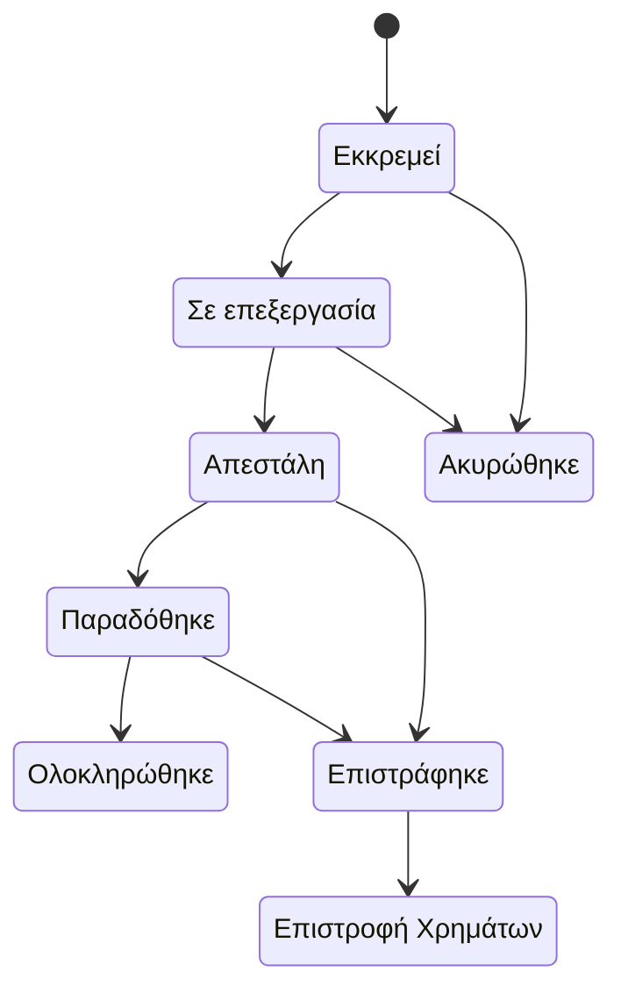

# Παραγγελίες

Πωλήσεις → Παραγγελίες

Κάθε αγορά, είτε έγινε από το κατάστημα, από επισκέπτη χωρίς λογαριασμό είτε μέσω AI agent, είναι μία παραγγελία. Αυτή είναι η οθόνη όπου ζει το προσωπικό του καταστήματος: απαντά στο «πού βρίσκεται η παραγγελία, έχει πληρωθεί και τι πρέπει να κάνω μετά». Το κόκκινο σήμα δίπλα στο μενού δείχνει πόσες παραγγελίες είναι ακόμη σε κατάσταση **Εκκρεμεί**.

## Τι βλέπετε

### Η λίστα

| Στήλη | Σημασία |
|---|---|
| **Κατάσταση** | Η κατάσταση διεκπεραίωσης (βλ. πίνακα παρακάτω). |
| **Πελάτης** | Το όνομα της παραγγελίας και το email με το οποίο έγινε. Οι παραγγελίες επισκεπτών εμφανίζουν τα ίδια, απλώς χωρίς συνδεδεμένο λογαριασμό. |
| **Παραγγελία** | Πλήθος γραμμών, συνολική ποσότητα και το ποσό που πραγματικά οφείλει ο πελάτης μετά τις εκπτώσεις, τους πόντους και τις δωροκάρτες. |
| **Πηγή παραγγελίας** | Από πού ήρθε ο πελάτης πριν κάνει την παραγγελία, ως χρωματιστό σήμα: το όνομα του καναλιού (Instagram, Google, ένας ιστότοπος που παρέπεμψε, «Πράκτορας AI (UCP)») με χρώμα ανάλογα με το είδος του (βλ. [Πηγή παραγγελίας](#πηγη-παραγγελιας) παρακάτω). Κενή για παραγγελίες από την εποχή πριν το κατάστημα αρχίσει να την καταγράφει. |
| **Πληρωμή** | Η οικονομική κατάσταση, ανεξάρτητη από τη διεκπεραίωση. |
| **Μέθοδος πληρωμής** | Πώς πληρώνεται η παραγγελία: το όνομα του παρόχου πληρωμών (Viva Wallet, Stripe) για online πληρωμή, αλλιώς ο τρόπος που διάλεξε ο πελάτης, όπως αντικαταβολή ή τραπεζική μεταφορά. |
| **Αποστολή** | Η κατάσταση του δέματος όπως την αναφέρει η μεταφορική (ACS ή BoxNow). Κενή όταν δεν έχει συνδεθεί ακόμη μεταφορική. |
| **Μεταφορικά** | Αριθμός παρακολούθησης, μεταφορική και πόλη, ή «Χωρίς παρακολούθηση» και η πόλη. |
| **Δημιουργήθηκε** | Ημερομηνία και ώρα, με σχετική ηλικία. |

Κάθε γραμμή έχει δύο γρήγορες ενέργειες: **Λήψη voucher αποστολής (PDF)** και **Παραγγελίες πελάτη**, που ξανανοίγει τη λίστα φιλτραρισμένη στον ίδιο λογαριασμό, ή στο ίδιο email για επισκέπτες.

### Φίλτρα

Το πλαίσιο **Φίλτρα** προσφέρει, από πάνω προς τα κάτω: **Κατάσταση** και **Κατάσταση πληρωμής**, όπου μπορείτε να επιλέξετε πολλές τιμές μαζί (Εκκρεμεί και Σε επεξεργασία μαζί είναι οι παραγγελίες που μένουν να διεκπεραιωθούν· Απέτυχε και Εκκρεμεί μαζί είναι οι πληρωμές που χρειάζονται προσοχή), **Τύπος Εγγράφου**, **Χονδρική** (παραγγελίες με τιμές ομάδας πελατών B2B, ή λιανικής), **Πρόσφατες Παραγγελίες** (Σήμερα, Αυτήν την εβδομάδα, Αυτόν τον μήνα, «Επείγουσες (Σε εκκρεμότητα 24ω+)», δηλαδή σε κατάσταση Εκκρεμεί πάνω από 24 ώρες), **Τύπος πηγής** και **Πηγή παραγγελίας** (βλ. [Πηγή παραγγελίας](#πηγη-παραγγελιας)), εύρος ημερομηνίας δημιουργίας και αλλαγής κατάστασης, **Country** και **Region** (πληκτρολογήστε για αναζήτηση), το pay way, την πύλη που επεξεργάστηκε τη χρέωση, πάροχο αποστολής, **Τρόπος αποστολής** και, για παραγγελίες BoxNow, την κατάσταση δέματος. Επιλέξτε όσα θέλετε και πατήστε μία φορά **Εφαρμογή φίλτρων**. Πάνω από τον πίνακα υπάρχει πλοήγηση ανά ημερομηνία δημιουργίας.

### Αναζήτηση

Το πεδίο αναζήτησης βρίσκει με ID παραγγελίας, UUID, email πελάτη, όνομα και επώνυμο, τηλέφωνο, πόλη, αριθμό παρακολούθησης, ID πληρωμής και, για BoxNow, το ID δέματος, το ID αιτήματος παράδοσης και το ID του locker. Επικολλήστε έναν αριθμό voucher και η παραγγελία εμφανίζεται.

### Μαζικές ενέργειες

Επιλέξτε γραμμές και διαλέξτε μία από τις **Επισήμανση επιλεγμένων παραγγελιών ως «Σε επεξεργασία» / απεσταλμένων / «Παραδομένες» / «Ολοκληρωμένες»**, **Σήμανση επιλεγμένων παραγγελιών ως επιστραμμένων**, **Σήμανση επιλεγμένων παραγγελιών ως επιστραφέντων χρημάτων** ή **Ακύρωση επιλεγμένων παραγγελιών και επιστροφή στο απόθεμα**. Κάθε παραγγελία ελέγχεται ξεχωριστά ως προς τις επιτρεπόμενες μεταβάσεις. Όσες δεν μπορούν να μετακινηθούν παραλείπονται με προειδοποίηση που αναφέρει την παραγγελία και τον λόγο· οι υπόλοιπες προχωρούν. Αυτές οι ενέργειες είναι ο μόνος τρόπος να αλλάξει η κατάσταση μιας παραγγελίας: αυτές επιστρέφουν το απόθεμα σε μια ακύρωση και αρνούνται μια μετάβαση που δεν επιτρέπεται.

### Η σελίδα της παραγγελίας

Μια σειρά από κάρτες στην κορυφή δίνει την παραγγελία με μια ματιά: **Κατάσταση** (και πριν από πόσο άλλαξε τελευταία φορά), **Πληρωμή** (και η μέθοδος), **Σύνολο** (και το πλήθος των ειδών), **Πελάτης** (με σύνδεσμο προς τον λογαριασμό), **Αποστολή** (και ο αριθμός παρακολούθησης) και **Τιμολόγιο** (ο αριθμός του και η κατάσταση στο myDATA).

Κάτω από αυτές η σελίδα χωρίζεται σε καρτέλες:

- **Στοιχεία Παραγγελίας**: UUID, η **Κατάσταση** (μόνο για ανάγνωση εδώ· αλλάζει με τις παραπάνω ενέργειες), χρόνοι δημιουργίας, ενημέρωσης και αλλαγής κατάστασης.
- **Τιμολόγηση / Παραστατικό**: **Τύπος Εγγράφου** (Απόδειξη ή Τιμολόγιο) και, για τιμολόγια, επωνυμία, ΑΦΜ, ΔΟΥ, δραστηριότητα και διεύθυνση έδρας του αγοραστή. Το **Τιμολόγηση χονδρικής** δείχνει ποια ομάδα B2B τιμολόγησε την παραγγελία ή «Λιανική (χωρίς τιμές ομάδας)».
- **Στοιχεία Πελάτη**: συνδεδεμένος λογαριασμός (κενό για επισκέπτες), όνομα, email, τηλέφωνο.
- **Διεύθυνση Αποστολής**: χώρα, περιοχή, πόλη, οδός, αριθμός, Τ.Κ., όροφος, τύπος τοποθεσίας και **Τόπος**, ένα παλιό πεδίο που τα νέα ταμεία αφήνουν κενό. Όταν αποθηκεύετε αλλαγή στη χώρα, την περιοχή, την οδό, τον αριθμό ή τον Τ.Κ., η διεύθυνση ελέγχεται όπως στο ταμείο: ο Τ.Κ. πρέπει να ταιριάζει με τη μορφή της χώρας, σε χώρα με περιοχές η περιοχή είναι υποχρεωτική και πρέπει να ανήκει σε αυτήν, η οδός πρέπει να περιέχει γράμμα και ο αριθμός δεν πρέπει να είναι ταχυδρομικός κώδικας. Μια παλιά παραγγελία με διεύθυνση που δεν περνά τον έλεγχο δεν μπλοκάρεται σε άλλες αλλαγές· ο έλεγχος γίνεται μόνο όταν αλλάζετε τη διεύθυνση.
- **Πληροφορίες πληρωμής**: η **Μέθοδος πληρωμής** (τι επέλεξε ο πελάτης), η επεξεργάσιμη **Κατάσταση πληρωμής**, η **Πύλη πληρωμής** (η πύλη που πήρε τη χρέωση), το **ID πληρωμής**, το **Πληρωμένο ποσό** και, μόνο για ανάγνωση, η **Έκπτωση προσφορών**, η **Έκπτωση πόντων** και το **Ποσό δωροκάρτας**, όπως καταγράφηκαν στο ταμείο.
- **Αποστολή & Παρακολούθηση**: πάροχος αποστολής, είδος αποστολής, κόστος αποστολής, αριθμός παρακολούθησης, όνομα μεταφορικής.
- **Πρόσθετες Πληροφορίες**: οι σημειώσεις του πελάτη από το ταμείο και, μόνο για ανάγνωση, τα στοιχεία προέλευσης: **Τύπος πηγής**, **Πηγή παραγγελίας**, **Μέσο επισκεψιμότητας**, **Όνομα καμπάνιας**, **Ιστότοπος παραπομπής** και **Σελίδα προσγείωσης**. Σε παραγγελία από την εποχή πριν το κατάστημα αρχίσει να τα καταγράφει, όλα δείχνουν «-».

Κάτω από τις καρτέλες: τα **είδη της παραγγελίας** (προϊόν, ποσότητα, τιμή μονάδας, σύνολο γραμμής, κατάσταση επιστροφής), η γραμμή του **τιμολογίου** αν υπάρχει (αριθμός, ημερομηνία έκδοσης, σύνολο, **Λήψη PDF**), το **ιστορικό** (ολόκληρο, με τα νεότερα πρώτα, δεκαπέντε γραμμές ανά σελίδα: τύπος αλλαγής, περιγραφή, ποιος την έκανε ή «Σύστημα», πότε) και, όταν υπάρχει μεταφορική, μια καρτέλα αποστολής **ACS** ή **BoxNow** με τα στοιχεία του voucher.

Η κεφαλίδα έχει το **Λήψη voucher αποστολής (PDF)** και ένα μενού **Τιμολόγηση & myDATA** με **Έκδοση τιμολογίου**, **Επανέκδοση τιμολογίου (ίδιος αριθμός)**, **Αποστολή στο myDATA** και **Ακύρωση στο myDATA**. Δείτε τα [Τιμολόγια](/el/admin/sales/invoices).

## Καταστάσεις παραγγελίας

| Κατάσταση | Σημασία | Ποιος τη θέτει |
|---|---|---|
| **Εκκρεμεί** | Καταχωρήθηκε, δεν έχει γίνει τίποτα ακόμη. Στις online πληρωμές τα χρήματα δεν έχουν μπει· στην αντικαταβολή δημιουργείται το voucher. | Το ταμείο. |
| **Σε επεξεργασία** | Επιβεβαιωμένη και προετοιμάζεται. | Αυτόματα όταν πετύχει η online πληρωμή ή όταν εκδοθεί το voucher της αντικαταβολής· ή η μαζική ενέργεια. |
| **Απεστάλη** | Η μεταφορική αναφέρει ότι το δέμα κινείται. | Αυτόματα, από τους τακτικούς ελέγχους παρακολούθησης της ACS ή από τις ενημερώσεις δέματος της BoxNow· ή η μαζική ενέργεια. |
| **Παραδόθηκε** | Η μεταφορική αναφέρει παράδοση. | Αυτόματα από τη μεταφορική· ή η μαζική ενέργεια. |
| **Ολοκληρώθηκε** | Παραδόθηκε και πληρώθηκε. Τελική. | Αυτόματα μόλις μια παραδομένη παραγγελία πληρωθεί (στην αντικαταβολή, όταν συμφωνηθεί η απόδοση της μεταφορικής)· ή η μαζική ενέργεια. |
| **Ακυρώθηκε** | Έκλεισε πριν την αποστολή. Το απόθεμα επιστράφηκε. Τελική. | Ο πελάτης από τον λογαριασμό του (μόνο όσο η μεταφορική μπορεί ακόμη να ακυρώσει το δέμα), η μαζική ενέργεια ακύρωσης ή η αυτόματη εκκαθάριση απλήρωτων παραγγελιών. |
| **Επιστράφηκε** | Η μεταφορική επέστρεψε το δέμα ή ο πελάτης το επέστρεψε. Σε παραγγελία με αντικαταβολή δεν εισπράχθηκε τίποτα, οπότε η κατάσταση πληρωμής γίνεται ταυτόχρονα **Ακυρώθηκε** και η παραγγελία κλείνει· μια πληρωμένη παραγγελία κρατά την πληρωμή της μέχρι να κάνετε επιστροφή χρημάτων. Το απόθεμα δεν επανέρχεται μόνο του: καταχωρίστε τα είδη ξανά όταν έχετε το δέμα στα χέρια σας. | Αυτόματα από τη μεταφορική· αλλιώς εσείς, με το **Σήμανση επιλεγμένων παραγγελιών ως επιστραμμένων**. |
| **Επιστροφή Χρημάτων** | Επιστραμμένη παραγγελία της οποίας τα χρήματα επιστράφηκαν. Τελική. | Εσείς, με το **Σήμανση επιλεγμένων παραγγελιών ως επιστραφέντων χρημάτων** σε παραγγελία που έχει Επιστραφεί. |

Ακύρωση επιτρέπεται μόνο από **Εκκρεμεί** και **Σε επεξεργασία**. Για τον πελάτη υπάρχει μία προϋπόθεση ακόμη: η μεταφορική πρέπει να μπορεί ακόμη να ακυρώσει το δέμα (δείτε [Ακυρώσεις από τον πελάτη](#ακυρωσεις-απο-τον-πελατη)). Από **Ολοκληρώθηκε**, **Ακυρώθηκε** και **Επιστροφή Χρημάτων** δεν υπάρχει έξοδος.

## Καταστάσεις πληρωμής

| Κατάσταση πληρωμής | Σημασία | Ποιος τη θέτει |
|---|---|---|
| **Εκκρεμεί** | Δεν έχει εισπραχθεί τίποτα. Φυσιολογικό στην αντικαταβολή μέχρι να αποδώσει η μεταφορική, και στην τραπεζική μεταφορά μέχρι να την επιβεβαιώσετε. | Το ταμείο. |
| **Σε επεξεργασία** | Ο πάροχος επεξεργάζεται ακόμη τη χρέωση. | Ο πάροχος, όταν απαντήσει. |
| **Ολοκληρώθηκε** | Εξοφλήθηκε. Ισχύει και όταν δωροκάρτες, πόντοι ή προσφορά 100% κάλυψαν όλο το ποσό. | Η Viva Wallet ή η Stripe όταν επιβεβαιώσουν τη χρέωση, η νυχτερινή συμφωνία με την κατάσταση αποδόσεων αντικαταβολής της ACS, η BoxNow όταν αναφέρει παραδομένο πληρωμένο δέμα, ή εσείς, αλλάζοντας το πεδίο. |
| **Απέτυχε** | Η online χρέωση απορρίφθηκε. Η παραγγελία μένει σε Εκκρεμεί και ακυρώνεται αυτόματα μετά την περίοδο χάριτος. | Ο πάροχος, όταν αναφέρει την απόρριψη. |
| **Επιστροφή Χρημάτων** | Πλήρης επιστροφή χρημάτων: δεν μένει τίποτα να επιστραφεί. | Η ακύρωση πληρωμένης παραγγελίας, ή επιστροφές στο dashboard της Viva Wallet ή της Stripe που καλύπτουν όλη την πληρωμή, με μία φορά ή τμηματικά. |
| **Μερική επιστροφή** | Μέρος των χρημάτων επιστράφηκε. | Μερική επιστροφή που έγινε στο dashboard της Viva Wallet ή της Stripe. |
| **Ακυρώθηκε** | Δεν εισπράχθηκε τίποτα και δεν οφείλεται τίποτα. Τίθεται όταν μια απλήρωτη παραγγελία ακυρώνεται ή γίνεται **Επιστράφηκε** (αντικαταβολή που ο πελάτης αρνήθηκε ή δεν παρέλαβε, ή online πληρωμή που δεν ολοκληρώθηκε ποτέ), ή όταν η Viva Wallet αντιλογίσει μια πληρωμή που δεν ολοκληρώθηκε ποτέ. | Η ίδια η ακύρωση ή η επιστροφή, ή η Viva Wallet. |

Μόλις μια πληρωμή γίνει Ολοκληρώθηκε, Επιστροφή Χρημάτων, Μερική επιστροφή ή Ακυρώθηκε, ένα καθυστερημένο ή διπλό μήνυμα του παρόχου δεν μπορεί ποτέ να τη γυρίσει σε Εκκρεμεί ή Απέτυχε.

## Πηγή παραγγελίας

Κάθε νέα παραγγελία καταγράφει από πού ήρθε ο πελάτης: τη διαφήμιση, την ανάρτηση, το αποτέλεσμα αναζήτησης ή τον ιστότοπο που τον έφερε στο κατάστημα, στην καρτέλα του browser από την οποία παρήγγειλε. Υπολογίζεται μία φορά, τη στιγμή της παραγγελίας, και δεν αλλάζει ποτέ μετά.

| Τύπος πηγής | Σημασία |
|---|---|
| **Απευθείας** | Δεν υπάρχει ίχνος για το από πού ήρθε η επίσκεψη: πληκτρολογημένη διεύθυνση, σελιδοδείκτης, ή εφαρμογή που κρύβει τον σύνδεσμο που άνοιξε. |
| **Καμπάνια** | Σύνδεσμος που σημάνατε με `utm_source` (newsletter, σύνδεσμος influencer, QR code) χωρίς να δηλώνεται ως πληρωμένος. |
| **Διαφήμιση** | Κλικ σε πληρωμένη διαφήμιση: ο σύνδεσμος είχε το δικό σήμα κλικ του διαφημιστικού δικτύου (διαφημίσεις Google, Microsoft, TikTok, X, LinkedIn, Pinterest), ή ήταν σημασμένος με `utm_medium` που δηλώνει πληρωμή (`cpc`, `ppc`, `paid_social` και παρόμοια). Το Facebook και το Instagram σημαδεύουν τους απλούς κοινοποιημένους συνδέσμους όπως και τις διαφημίσεις τους, οπότε μια διαφήμιση της Meta φαίνεται ως **Διαφήμιση** μόνο όταν ο σύνδεσμός της είναι σημασμένος έτσι. |
| **Κοινωνικά δίκτυα** | Instagram, Facebook, TikTok, Pinterest, YouTube, X, LinkedIn ή Reddit, είτε από σύνδεσμο στον ιστότοπό τους είτε από τον ενσωματωμένο browser της εφαρμογής τους. |
| **Αναζήτηση** | Αποτελέσματα αναζήτησης Google, Bing, DuckDuckGo ή Yahoo. |
| **Παραπομπή** | Οποιοσδήποτε άλλος ιστότοπος έδωσε σύνδεσμο προς το κατάστημα, με τη διεύθυνσή του, καθώς και βοηθοί AI όπως το ChatGPT και το Perplexity. |
| **Πράκτορας AI** | Την παραγγελία την έκανε πράκτορας AI μέσω του ταμείου για πράκτορες (UCP ή ACP), όχι άνθρωπος στο κατάστημα. |

Η **Πηγή παραγγελίας** είναι το όνομα του καναλιού (Instagram, Google, ο ιστότοπος που παρέπεμψε) και είναι αυτό που δείχνει η στήλη της λίστας. Το **Μέσο επισκεψιμότητας** και το **Όνομα καμπάνιας** είναι τα `utm_medium` και `utm_campaign` ενός σημασμένου συνδέσμου. Ο **Ιστότοπος παραπομπής** είναι ο ιστότοπος από τον οποίο ήρθε ο πελάτης, χωρίς τη σελίδα, και η **Σελίδα προσγείωσης** η πρώτη σελίδα που είδε, χωρίς τις παραμέτρους της.

Το γράφημα **Παραγγελίες ανά πηγή** στον πίνακα ελέγχου μετρά τις παραγγελίες των τελευταίων 30 ημερών με την ίδια πηγή. Δείτε τον [Πίνακα ελέγχου](/el/admin/getting-started/dashboard).

### Σήμανση συνδέσμου ώστε να αναγνωρίζονται οι παραγγελίες του
1. Προσθέστε `utm_source`, `utm_medium` και `utm_campaign` στον σύνδεσμο που μοιράζεστε, π.χ. `?utm_source=newsletter&utm_medium=email&utm_campaign=fthinoporines-prosfores`.
2. Οι παραγγελίες από εκείνη την επίσκεψη δείχνουν πηγή `newsletter` με τύπο **Καμπάνια**, και το όνομα της καμπάνιας στη σελίδα της παραγγελίας.
3. Για διαφήμιση, βάλτε `utm_medium` ίσο με `cpc` ή `paid_social` ώστε οι παραγγελίες να φαίνονται ως **Διαφήμιση**. Οι διαφημίσεις Google και Microsoft που προσθέτουν το δικό τους σήμα κλικ αναγνωρίζονται ως πληρωμένες και χωρίς αυτό.

### Οι παραγγελίες ενός καναλιού
1. Ανοίξτε **Πωλήσεις → Παραγγελίες**.
2. Διαλέξτε το κανάλι στο **Πηγή παραγγελίας**, ή ένα ολόκληρο είδος στο **Τύπος πηγής** (για παράδειγμα όλες τις παραγγελίες από **Κοινωνικά δίκτυα**).
3. Οι απευθείας παραγγελίες δεν έχουν όνομα πηγής, οπότε τις βρίσκετε από το **Τύπος πηγής → Απευθείας**.

## Εργασίες

### Εύρεση παραγγελίας
1. Πληκτρολογήστε τον αριθμό παραγγελίας, το email ή το τηλέφωνο του πελάτη, ή έναν αριθμό παρακολούθησης ή voucher στο πεδίο αναζήτησης.
2. Περιορίστε με **Κατάσταση** ή **Πρόσφατες Παραγγελίες** αν ο πελάτης έχει πολλές παραγγελίες.
3. Ανοίξτε τη γραμμή. Από εκεί το **Παραγγελίες πελάτη** δείχνει ό,τι άλλο αγόρασε το ίδιο άτομο.

### Προώθηση παραγγελίας με το χέρι
1. Επιλέξτε την παραγγελία (ή περισσότερες) στη λίστα.
2. Διαλέξτε **Σήμανση επιλεγμένων παραγγελιών ως απεσταλμένων** (ή σε επεξεργασία, παραδομένες, ολοκληρωμένες) και επιβεβαιώστε.
3. Διαβάστε τα μηνύματα: μια γραμμή που παραλείφθηκε σας λέει γιατί, συνήθως επειδή η μετάβαση δεν επιτρέπεται από την τρέχουσα κατάστασή της.

Άλλος τρόπος δεν υπάρχει: η **Κατάσταση** είναι μόνο για ανάγνωση στη σελίδα της παραγγελίας.

### Ακύρωση παραγγελίας
1. Επιλέξτε την παραγγελία στη λίστα και εκτελέστε **Ακύρωση επιλεγμένων παραγγελιών και επιστροφή στο απόθεμα**.
2. Η πλατφόρμα επιστρέφει το απόθεμα, ελευθερώνει τυχόν κράτηση, καταγράφει την ακύρωση στο ιστορικό, ζητά από τη μεταφορική να ακυρώσει το voucher και στέλνει email στον πελάτη.
3. Αν η μεταφορική αρνηθεί (π.χ. το voucher είναι ήδη σε λίστα παραλαβής) ή δεν απαντήσει, η παραγγελία ακυρώνεται κανονικά. Ένα μήνυμα σφάλματος στην κορυφή της λίστας αναφέρει την παραγγελία και την απάντηση της μεταφορικής, και το ίδιο γράφεται ως σημείωση στο ιστορικό της παραγγελίας: το δέμα μπορεί να παραδοθεί κανονικά, οπότε κανονίστε την επιστροφή του με τη μεταφορική.

**Η ενέργεια επιστρέφει και τα χρήματα**, όταν υπάρχουν χρήματα προς επιστροφή: παραγγελία με κατάσταση πληρωμής Ολοκληρώθηκε που χρεώθηκε από Viva Wallet ή Stripe παίρνει πλήρη επιστροφή από τον πάροχο μαζί με την ακύρωση, και η κατάσταση πληρωμής γίνεται Επιστροφή Χρημάτων. Αντικαταβολή, τραπεζική μεταφορά και παραγγελίες που εξοφλήθηκαν εξ ολοκλήρου με δωροκάρτα δεν έχουν κάτι να επιστρέψει ο πάροχος· το μέρος της δωροκάρτας επιστρέφει έτσι κι αλλιώς. Αν ο πάροχος αρνηθεί την επιστροφή, η παραγγελία ακυρώνεται παρ' όλα αυτά, η κατάσταση πληρωμής μένει Ολοκληρώθηκε, ένα μήνυμα σφάλματος λέει ότι τα χρήματα δεν επιστράφηκαν και ο λόγος του παρόχου σημειώνεται στο ιστορικό της παραγγελίας.

### Επιβεβαίωση τραπεζικής μεταφοράς ή άλλης offline πληρωμής
1. Ανοίξτε την παραγγελία και πηγαίνετε στις **Πληροφορίες πληρωμής**.
2. Ορίστε **Κατάσταση πληρωμής** σε **Ολοκληρώθηκε** και αποθηκεύστε.
3. Περάστε την παραγγελία σε **Σε επεξεργασία** με τη μαζική ενέργεια ώστε να ξεκινήσει η διεκπεραίωση.

### Εκτύπωση voucher ή τιμολογίου
- Το **Λήψη voucher αποστολής (PDF)** στη γραμμή ή στην κεφαλίδα της σελίδας κατεβάζει την ετικέτα από τη μεταφορική. Σας ενημερώνει αν δεν υπάρχει ακόμη αποστολή ή αν η μεταφορική δεν έχει δώσει voucher.
- Το PDF του τιμολογίου είναι ο σύνδεσμος **Λήψη PDF** στη γραμμή του τιμολογίου, ή το μενού **Τιμολόγηση & myDATA** για να το εκδώσετε πρώτα.

### Χειροκίνητη προσθήκη αριθμού παρακολούθησης
1. Ανοίξτε την παραγγελία, καρτέλα **Αποστολή & Παρακολούθηση**.
2. Συμπληρώστε **Αριθμός Παρακολούθησης** και **Εταιρεία μεταφοράς**, αποθηκεύστε.
3. Το email «η παραγγελία σας απεστάλη» φεύγει μόνο όταν η παραγγελία είναι και σε **Απεστάλη**· όποιο από τα δύο γίνει δεύτερο το πυροδοτεί.

## Τι γίνεται αυτόματα

- **Απόθεμα**: το ταμείο δεσμεύει απόθεμα για περιορισμένο χρόνο (`STOCK_RESERVATION_TTL_MINUTES`, προεπιλογή 30 λεπτά). Η καταχώρηση της παραγγελίας καταναλώνει την κράτηση· οι ληγμένες κρατήσεις ελευθερώνονται κάθε ώρα. Μια αποτυχημένη online πληρωμή δεν ελευθερώνει απόθεμα από μόνη της: αυτό γίνεται όταν ακυρωθεί η παραγγελία, από εσάς ή από την εκκαθάριση παρακάτω.
- **Οι απλήρωτες παραγγελίες ακυρώνονται για εσάς**: κάθε δεκαπέντε λεπτά η πλατφόρμα εφαρμόζει δύο κανόνες. Κάθε παραγγελία που είναι ακόμη **Εκκρεμεί** και έχει πληρωμή **Απέτυχε** χωρίς καμία μεταβολή για `ORDER_AUTO_CANCEL_FAILED_PAYMENT_MINUTES` (30) ακυρώνεται. Χωριστά, παραγγελία ακόμη **Εκκρεμεί** με πληρωμή **Εκκρεμεί**, που καταχωρήθηκε πριν από `ORDER_AUTO_CANCEL_PENDING_HOURS` (24), ακυρώνεται μόνο αν προοριζόταν για online πληρωμή: η αντικαταβολή και η τραπεζική μεταφορά μένουν απλήρωτες από σχεδιασμό και ο δεύτερος κανόνας δεν τις αγγίζει ποτέ. Κανένας από τους δύο δεν επιστρέφει χρήματα. Παραγγελία που η Viva Wallet χρέωσε με διαφορετικό ποσό από το σύνολο παραλείπεται και μένει για άνθρωπο.
- **Υπενθυμίσεις**: οι παραγγελίες που προορίζονταν για online πληρωμή και μένουν απλήρωτες πάνω από μία ημέρα παίρνουν έως τρία email υπενθύμισης, με απόσταση μίας, τριών και επτά ημερών, με έλεγχο καθημερινά στις 07:00. Το πλήθος τους είναι το `PENDING_ORDER_REMINDER_MAX_COUNT` και τα τρία διαστήματα είναι τα κλειδιά που ξεκινούν με `PENDING_ORDER_REMINDER_INTERVAL_DAYS_`, όλα στις [Ρυθμίσεις καταστήματος](/el/admin/settings/store-settings). Οι παραγγελίες με αντικαταβολή δεν κυνηγιούνται ποτέ.
- **Voucher μεταφορικής**: δημιουργείται αμέσως μετά το ταμείο για αντικαταβολή, μετά την επιτυχή πληρωμή για online παραγγελίες. Η άφιξή του περνά την παραγγελία σε Σε επεξεργασία και ορίζει τον αριθμό παρακολούθησης.
- **Η παρακολούθηση της μεταφορικής** περνά την παραγγελία από Απεστάλη και Παραδόθηκε, και μια παραδομένη πληρωμένη παραγγελία σε Ολοκληρώθηκε.
- **Η αντικαταβολή μένει με πληρωμή Εκκρεμεί μέχρι να αποδώσει η μεταφορική.** Η ACS αποδίδει τα μετρητά μέρες αργότερα· μια νυχτερινή συμφωνία αντιστοιχίζει την αναφορά αποδόσεων με τις παραγγελίες και τις σημειώνει Ολοκληρώθηκε, χωρίς ειδοποίηση στον πελάτη. Είναι σχεδιασμένο έτσι, δεν είναι κολλημένη παραγγελία.
- **Τα τιμολόγια** εκδίδονται όταν παραγγελία με τύπο εγγράφου **Τιμολόγιο** φτάσει σε Ολοκληρώθηκε. Δείτε τα [Τιμολόγια](/el/admin/sales/invoices).
- **Email** προς τον πελάτη: λήψη παραγγελίας (αμέσως για αντικαταβολή, μετά την πληρωμή για online), αποτυχία πληρωμής, αποστολή (όταν πράγματι είναι καθ' οδόν), παράδοση, ακύρωση, ολοκλήρωση, επιστροφή χρημάτων, επιστροφή, τιμολόγιο, επιβεβαίωση επιστροφής χρημάτων. Οι καταστάσεις **Εκκρεμεί** και **Σε επεξεργασία** δεν στέλνουν ποτέ email στον πελάτη, ούτε και το αυτόματο πέρασμα σε **Ολοκληρώθηκε**: ο πελάτης μόλις έλαβε το μήνυμα παράδοσης, οπότε email φεύγει μόνο για Ολοκληρώθηκε που θέτετε εσείς. Το κατάστημα λαμβάνει επίσης email νέας παραγγελίας. Τα πρότυπα βρίσκονται στα [Πρότυπα email](/el/admin/storefront/email-templates).
- **Οι ειδοποιήσεις στην εφαρμογή** αντικατοπτρίζουν τα ίδια ορόσημα για πελάτες με λογαριασμό· οι επισκέπτες λαμβάνουν μόνο email. Δείτε τις [Ειδοποιήσεις](/el/admin/sales/notifications).
- **Το ιστορικό** καταγράφει κάθε αλλαγή κατάστασης, ενημέρωση πληρωμής, ενημέρωση αποστολής, σημείωση και επιστροφή χρημάτων, με τον χρήστη που την έκανε ή «Σύστημα».

## Ακυρώσεις από τον πελάτη

Ο πελάτης βλέπει το κουμπί **Ακύρωση παραγγελίας** στην παραγγελία του, μέσα στον λογαριασμό του, όσο εκείνη είναι **Εκκρεμεί** ή **Σε επεξεργασία** και η μεταφορική μπορεί ακόμη να πάρει πίσω το δέμα: δεν έχει εκδοθεί voucher, το voucher της ACS δεν έχει μπει ακόμη σε λίστα παραλαβής, ή το δέμα της BoxNow είναι ακόμη σε κατάσταση **Νέο**.

Όταν το πατήσει, η πλατφόρμα ζητά **πρώτα** από τη μεταφορική να ακυρώσει το δέμα:

- **Η μεταφορική συμφωνεί**, ή δεν υπάρχει ακόμη δέμα: η παραγγελία ακυρώνεται ακριβώς όπως με τη δική σας ακύρωση, με επιστροφή αποθέματος και χρημάτων.
- **Η μεταφορική αρνείται**, επειδή έχει ήδη το δέμα: δεν αλλάζει τίποτα. Ο πελάτης ενημερώνεται ότι η παραγγελία δεν ακυρώνεται πια· περιμένετε να επικοινωνήσει μαζί σας για επιστροφή.
- **Η μεταφορική δεν απαντά**: δεν αλλάζει τίποτα ούτε τότε. Ο πελάτης καλείται να δοκιμάσει ξανά.

Η δική σας ακύρωση από τη λίστα δεν περιμένει την έγκριση της μεταφορικής: ακυρώνει την παραγγελία ό,τι κι αν απαντήσει εκείνη (δείτε [Ακύρωση παραγγελίας](#ακυρωση-παραγγελιας)).

Σπάνια, η παραγγελία προχωρά όσο η μεταφορική απαντά, για παράδειγμα επειδή τη σημειώσατε ως απεσταλμένη εκείνη ακριβώς τη στιγμή. Τότε το δέμα ακυρώνεται αλλά η παραγγελία όχι, και στο ιστορικό της παραγγελίας γράφεται σημείωση ότι η αποστολή δεν έχει πια voucher. Αν η παραγγελία πρέπει ακόμη να σταλεί, εκδώστε νέο voucher· για την ACS, δείτε [ACS Courier](/el/admin/shipping/acs).

## Επιστροφές χρημάτων

Δεν υπάρχει κουμπί επιστροφής χρημάτων στο admin: τίποτα στη σελίδα της παραγγελίας ή στις μαζικές ενέργειες δεν επιστρέφει χρήματα από μόνο του. Υπάρχουν ακριβώς δύο δρόμοι για να γυρίσουν τα χρήματα.

- **Ακυρώστε την παραγγελία** όσο είναι ακόμη σε Εκκρεμεί ή Σε επεξεργασία. Αν είχε πληρωθεί online, η ακύρωση περιλαμβάνει πλήρη επιστροφή από τον πάροχο, όπως περιγράφεται παραπάνω.
- **Κάντε την επιστροφή στο dashboard του παρόχου** (Viva Wallet ή Stripe). Η επιστροφή φτάνει μόνη της στην παραγγελία: η κατάσταση πληρωμής γίνεται **Μερική επιστροφή** όσο μέρος της πληρωμής μένει σε εσάς και **Επιστροφή Χρημάτων** μόλις επιστραφεί όλη, με τις μερικές επιστροφές να αθροίζονται. Κάθε επιστροφή γράφει εγγραφή στο ιστορικό. Ο πελάτης λαμβάνει ένα email επιστροφής: με την πρώτη επιστροφή της Viva Wallet, ή με πλήρη επιστροφή της Stripe (η μερική επιστροφή της Stripe δεν στέλνει email). Αν μια επιστροφή της Viva Wallet δεν εμφανιστεί στην παραγγελία, ζητήστε από την ομάδα της πλατφόρμας να ελέγξει ότι ο λογαριασμός Viva του καταστήματος στέλνει ειδοποιήσεις επιστροφών.

Και στις δύο περιπτώσεις η κατάσταση της παραγγελίας δεν αλλάζει για εσάς: όταν επιστρέψουν τα προϊόντα, εκτελέστε **Σήμανση επιλεγμένων παραγγελιών ως επιστραμμένων** και έπειτα **Σήμανση επιλεγμένων παραγγελιών ως επιστραφέντων χρημάτων**.

Δωροκάρτες και πόντοι πιστότητας επιστρέφουν μόνο όταν επιστραφούν **όλα** τα χρήματα ή όταν η παραγγελία ακυρωθεί. Τότε κάθε κάρτα παίρνει πίσω ακριβώς ό,τι πλήρωσε· οι πόντοι που ξοδεύτηκαν στην παραγγελία επιστρέφονται και οι πόντοι που κερδήθηκαν από αυτήν αφαιρούνται. Μια μερική επιστροφή δεν τα αγγίζει· επιστρέφουν ολόκληρα με την επιστροφή που καλύπτει το υπόλοιπο. Δείτε τις [Δωροκάρτες](/el/admin/sales/gift-cards) και τις [Βαθμίδες & πόντοι](/el/admin/loyalty/tiers-and-points).

## Παραγγελίες επισκεπτών

Μια παραγγελία επισκέπτη δεν έχει λογαριασμό στα **Στοιχεία Πελάτη**. Όλα τα άλλα λειτουργούν ίδια: ο πελάτης λαμβάνει κάθε email στη διεύθυνση της παραγγελίας και μπορεί να την ανοίξει από τον σύνδεσμο σε αυτά τα email. Οι επισκέπτες δεν λαμβάνουν ειδοποιήσεις στην εφαρμογή. Το **Παραγγελίες πελάτη** χρησιμοποιεί το email για να βρει τις υπόλοιπες αγορές τους.

## Καλό είναι να ξέρετε

- **Η Κατάσταση δεν αλλάζει από τη σελίδα της παραγγελίας.** Κάθε αλλαγή γίνεται με τις μαζικές ενέργειες, που ελέγχουν ότι η μετάβαση επιτρέπεται, επιστρέφουν το απόθεμα σε μια ακύρωση και επιστρέφουν τα χρήματα πληρωμένης παραγγελίας.
- **Η αλλαγή χρηματικών πεδίων δεν μετακινεί χρήματα.** Αλλάζοντας το **Πληρωμένο ποσό** αλλάζει μόνο ό,τι δείχνει η οθόνη· τίποτα δεν χρεώνεται ή επιστρέφεται. Οι **Προσφορές**, η **Εφαρμογή Έκπτωσης** πόντων και το ποσό δωροκάρτας είναι μόνο για ανάγνωση γι' αυτόν ακριβώς τον λόγο: καταγράφηκαν στο ταμείο και οι αντίστοιχες εγγραφές κουπονιού, πόντων και δωροκάρτας υπάρχουν ήδη.
- **Κατάσταση πληρωμής Ολοκληρώθηκε με το χέρι** είναι σωστή για τραπεζικές μεταφορές και μετρητά που εισπράχθηκαν από κοντά. Μην τη χρησιμοποιείτε για πληρωμές με κάρτα που ακόμη περιμένετε από πάροχο.
- **Η Μέθοδος πληρωμής και η Πύλη πληρωμής είναι διαφορετικά πεδία.** Η **Μέθοδος πληρωμής** είναι η αναδιπλούμενη λίστα και κρατά ό,τι επέλεξε ο πελάτης στο ταμείο. Η **Πύλη πληρωμής** δίπλα της γράφεται από την πλατφόρμα και καταγράφει ποια πύλη πήρε τα χρήματα (`stripe`, `viva_wallet`, `acs_cod`, `boxnow_cod`)· χρησιμεύει στην αντιστοίχιση των μηνυμάτων του παρόχου, οπότε αφήστε το ως έχει.
- **Οι παραγγελίες χονδρικής** κρατούν το όνομα ομάδας και το ποσοστό έκπτωσης με το οποίο τιμολογήθηκαν· αλλαγή της ομάδας του πελάτη αργότερα δεν αγγίζει παλιές παραγγελίες. Δείτε [Ομάδες πελατών & τιμοκατάλογοι](/el/admin/b2b/groups-and-price-lists).
- **Στήλη Αποστολή χωρίς τιμή** σημαίνει ότι δεν έχει ζητηθεί ακόμη voucher, ή ότι η παραγγελία είναι παλαιότερη από τη σημερινή ρύθμιση μεταφορικών. Το κουμπί του voucher θα το πει.
- **Η πηγή παραγγελίας είναι ένδειξη, όχι απόδειξη.** Οποιοσδήποτε μπορεί να γράψει τις σημάνσεις σε έναν σύνδεσμο, και κάποιες εφαρμογές κρύβουν από πού ήρθε μια επίσκεψη, οπότε μια πραγματική επίσκεψη από το Instagram μπορεί να φανεί ως **Απευθείας**. Μετράει για την καρτέλα του browser όπου έγινε η παραγγελία: την ορίζει η πρώτη σελίδα που άνοιξε ο πελάτης σε εκείνη την καρτέλα, και την αντικαθιστά μόνο ένας μεταγενέστερος σημασμένος σύνδεσμος ή σύνδεσμος διαφήμισης. Η επιστροφή από τη σελίδα πληρωμής με κάρτα δεν την αλλάζει ποτέ.
- Οι superusers βλέπουν επίσης το πλήρες **Ιστορικό Παραγγελιών** και τις **Καταχωρήσεις Αποθέματος** στο [Έλεγχος & αρχεία καταγραφής](/el/admin/system/audit-and-logs).

## Σχετικά

- [Τιμολόγια](/el/admin/sales/invoices)
- [Τρόποι πληρωμής](/el/admin/sales/payment-methods)
- [Καλάθια](/el/admin/sales/carts)
- [ACS Courier](/el/admin/shipping/acs)
- [BoxNow](/el/admin/shipping/boxnow)
- [Ειδοποιήσεις](/el/admin/sales/notifications)
