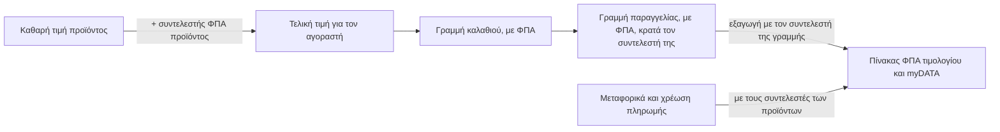

# Συντελεστές ΦΠΑ

Ρυθμίσεις → Συντελεστές ΦΠΑ

Ο συντελεστής ΦΠΑ είναι ένα ποσοστό. Κάθε προϊόν δείχνει σε έναν συντελεστή· ο συντελεστής μετατρέπει την καθαρή τιμή του προϊόντος στην τιμή που βλέπει ο αγοραστής και είναι αυτό που το τιμολόγιο αναφέρει ανά κατηγορία. Τα περισσότερα καταστήματα χρειάζονται δύο ή τρεις γραμμές: τον κανονικό συντελεστή, έναν μειωμένο για βιβλία ή τρόφιμα, και το μηδέν.

## Τι βλέπετε

### Η λίστα

| Στήλη | Σημασία |
|---|---|
| **Συντελεστής ΦΠΑ** | Το ποσοστό. |
| **Κατηγορία** | Χρωματική ζώνη ανά μέγεθος: **Απαλλαγή ΦΠΑ** (0), **Μειωμένος συντελεστής** (έως 5), **Χαμηλός συντελεστής** (έως 15), **Κανονικός συντελεστής** (έως 25), **Υψηλός συντελεστής**, **Αυξημένος συντελεστής**. Μόνο οπτικό. |
| **Χρήση** | Πόσα προϊόντα τον χρησιμοποιούν. |
| **Παραδείγματα τιμών** | Τι γίνονται τα 10, 50 και 100 € καθαρά με αυτόν τον συντελεστή. |
| **Δημιουργήθηκε** / **Ενημερώθηκε** | Χρόνοι. |

Φίλτρα: **Κατάσταση χρήσης** (Σε χρήση, Δεν χρησιμοποιείται, Δημοφιλές με 5+ προϊόντα, Σπάνια σε χρήση με 1 ή 2), εύρος τιμής, ημερομηνίες. Αναζήτηση με τιμή ή ID.

### Η σελίδα του συντελεστή

**Διαμόρφωση ΦΠΑ** με το μοναδικό πεδίο **Τιμή**· ένα συμπτυγμένο μπλοκ **Χρήση** που λέει πόσα προϊόντα χρησιμοποιούν τον συντελεστή· πληροφορίες συστήματος.

## Αποδεκτές τιμές

Το πεδίο δέχεται ένα δεκαδικό από 0 έως 100, αλλά η αποθήκευση απορρίπτεται για κάθε συντελεστή που δεν αναγνωρίζει η πλατφόρμα myDATA της ΑΑΔΕ. Οι αποδεκτοί συντελεστές είναι 24, 17, 13, 9, 6, 4, 3 και 0: οι συντελεστές ηπειρωτικής χώρας, οι μειωμένοι νησιωτικοί και ο ειδικός 3 %. Προϊόν με οποιονδήποτε άλλο συντελεστή θα παρήγαγε τιμολόγιο που το myDATA απορρίπτει, οπότε ο έλεγχος γίνεται εδώ, κατά την αποθήκευση, αντί εβδομάδες αργότερα σε μια υποβολή.

## Πώς εφαρμόζεται ο ΦΠΑ

- Το προϊόν αποθηκεύει **καθαρή** τιμή και σύνδεσμο σε συντελεστή ΦΠΑ. Το κατάστημα, το καλάθι και η παραγγελία δουλεύουν με την τελική τιμή με ΦΠΑ.
- Προϊόν χωρίς συντελεστή ΦΠΑ αντιμετωπίζεται ως 0 %.
- **Κάθε γραμμή παραγγελίας καταγράφει τον συντελεστή με τον οποίο πουλήθηκε.** Η απόδειξη και το myDATA χρησιμοποιούν αυτόν, ποτέ τον τρέχοντα συντελεστή του προϊόντος.
- Η απόδειξη ομαδοποιεί τις γραμμές ανά συντελεστή και εξάγει τον ΦΠΑ από κάθε γραμμή. Οι εκπτώσεις επιπέδου παραγγελίας κατανέμονται πρώτα στις γραμμές, ώστε ο ΦΠΑ να υπολογίζεται επί του ποσού που πράγματι πληρώθηκε. Τα ποσά δωροκάρτας είναι πληρωμή και δεν αγγίζουν τον ΦΠΑ. Δείτε [Αποδείξεις και πιστωτικά παραστατικά](/el/admin/sales/receipts).
- Τα μεταφορικά και οι χρεώσεις μεθόδου πληρωμής εισάγονται ως ποσά με ΦΠΑ και φορολογούνται με τον συντελεστή των προϊόντων που συνοδεύουν. Όταν η παραγγελία έχει προϊόντα με διαφορετικούς συντελεστές, κάθε χρέωση μοιράζεται στους συντελεστές ανάλογα με την αξία των προϊόντων σε καθέναν.
- Οι τιμές χονδρικής για εταιρικούς πελάτες είναι επίσης καθαρές τιμές· ο συντελεστής του προϊόντος εφαρμόζεται από πάνω. Δείτε [Ομάδες πελατών & τιμοκατάλογοι](/el/admin/b2b/groups-and-price-lists).

Δεν υπάρχει ΦΠΑ ανά χώρα. Ένας συντελεστής ανά προϊόν ισχύει όποιος κι αν είναι ο προορισμός. Η χώρα του αγοραστή επηρεάζει μόνο το πώς δηλώνεται το παραστατικό στο myDATA: τιμολόγιο προς επιχείρηση στη δική σας χώρα δηλώνεται ως πώληση χονδρικής, και οτιδήποτε άλλο ως απόδειξη λιανικής. Η διασυνοριακή τιμολόγηση επιχειρήσεων, με τον χειρισμό της αντίστροφης επιβάρυνσης, δεν έχει υλοποιηθεί ακόμη.

Δεν υπάρχει ρύθμιση «προεπιλεγμένου συντελεστή». Ένα νέο προϊόν δεν έχει συντελεστή μέχρι να επιλέξετε έναν στη σελίδα του.

## Εργασίες

### Προσθήκη συντελεστή
1. **Προσθήκη ΦΠΑ**, εισάγετε την **Τιμή** (π.χ. 13), αποθηκεύστε.
2. Αναθέστε τον σε προϊόντα στα [Προϊόντα](/el/admin/catalog/products).

### Αλλαγή συντελεστή σε πολλά προϊόντα
1. Μην αλλάζετε την τιμή συντελεστή που είναι σε χρήση εκτός αν άλλαξε ο νόμος: κάθε προϊόν που δείχνει σε αυτόν αλλάζει τιμή αμέσως, παντού.
2. Αντ' αυτού, δημιουργήστε τον νέο συντελεστή και στρέψτε τα προϊόντα σε αυτόν.
3. Όταν ο παλιός συντελεστής δείξει **Δεν χρησιμοποιείται**, διαγράψτε τον.

### Μετάβαση σε νέο νόμιμο συντελεστή
1. Προσθέστε τον νέο συντελεστή. Στρέψτε τα προϊόντα.
2. Διαγράψτε την παλιά γραμμή όταν δεν χρησιμοποιείται. Οι υπάρχουσες παραγγελίες κρατούν τις τιμές γραμμών τους και τον συντελεστή με τον οποίο πουλήθηκε κάθε γραμμή, οπότε τα τιμολόγιά τους δεν αλλάζουν.

### Διόρθωση του συντελεστή μίας γραμμής παραγγελίας
Αν μια παραγγελία καταχωρήθηκε με λάθος συντελεστή σε κάποια γραμμή, διορθώστε τον στην ίδια τη γραμμή, όχι εδώ. Δείτε [Αποδείξεις και πιστωτικά παραστατικά](/el/admin/sales/receipts), «Διόρθωση του συντελεστή ΦΠΑ μιας γραμμής παραγγελίας».

## Καλό είναι να ξέρετε

- **Η αλλαγή τιμής αλλάζει τιμές πώλησης, όχι μόνο ετικέτες.** Οι τελικές τιμές υπολογίζονται ζωντανά από την καθαρή τιμή και τον συντελεστή, οπότε αλλαγή συντελεστή σημαίνει αλλαγή τιμής για κάθε προϊόν που τον χρησιμοποιεί, και η cache του καταστήματος πρέπει να καθαριστεί μετά στο [Cache](/el/admin/system/cache).
- **Η διαγραφή συντελεστή σε χρήση** δεν διαγράφει προϊόντα· μένουν χωρίς συντελεστή, δηλαδή με 0 % ΦΠΑ και χαμηλότερη τελική τιμή στις νέες πωλήσεις. Οι παραγγελίες που έχουν ήδη γίνει κρατούν τον συντελεστή τους. Ελέγξτε τη **Χρήση** πριν διαγράψετε.
- **Οι παραγγελίες κρατούν τις τιμές και τους συντελεστές τους.** Η γραμμή παραγγελίας αποθηκεύει την τιμή με ΦΠΑ και τον συντελεστή ΦΠΑ τη στιγμή της αγοράς· μεταγενέστερες αλλαγές συντελεστή δεν ξαναγράφουν κανένα από τα δύο, και η επανέκδοση τιμολογίου χρησιμοποιεί τον συντελεστή της γραμμής.
- **Τα μεταφορικά και οι χρεώσεις πληρωμής δεν έχουν δικό τους συντελεστή.** Ακολουθούν τους συντελεστές των προϊόντων της παραγγελίας, όπως περιγράφεται παραπάνω.

## Σχετικά

- [Προϊόντα](/el/admin/catalog/products)
- [Αποδείξεις και πιστωτικά παραστατικά](/el/admin/sales/receipts)
- [Ομάδες πελατών & τιμοκατάλογοι](/el/admin/b2b/groups-and-price-lists)
- [Cache](/el/admin/system/cache)
