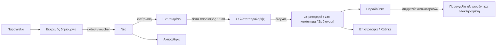

# ACS Courier

Μεταφορικά → Αποστολές ACS

Κάθε παραγγελία που αποστέλλεται με ACS έχει μία εγγραφή αποστολής ACS. Η εγγραφή δημιουργείται στο checkout, παίρνει το voucher της από την ACS λίγα δευτερόλεπτα αργότερα, εκτυπώνεται και παραλαμβάνεται, και μετά παρακολουθείται με ερώτηση προς την ACS κάθε δεκαπέντε λεπτά μέχρι να φτάσει σε τελική κατάσταση. Το προσωπικό δουλεύει κυρίως από αυτή τη λίστα και από τη σελίδα της παραγγελίας. Οι υπερχρήστες βλέπουν επιπλέον τις λίστες παραλαβής, τις αποδόσεις αντικαταβολών και τα ακατέργαστα συμβάντα παρακολούθησης στο Σύστημα.

## Ο κύκλος ζωής με μια ματιά

Τι κάνει αυτόματα η πλατφόρμα:

1. **Στο checkout** δημιουργείται η εγγραφή αποστολής σε κατάσταση **Εκκρεμής δημιουργία**, με τον τρόπο παράδοσης, το επιλεγμένο Smartpoint (αν υπάρχει), το βάρος του καλαθιού, ένα δέμα και τον τύπο χρέωσης.
2. **Το voucher** ζητείται στο παρασκήνιο: αμέσως για αντικαταβολή, τραπεζική κατάθεση και παραγγελίες που πληρώθηκαν εξ ολοκλήρου με δωροκάρτα, και μόνο μετά την επιτυχή πληρωμή για παραγγελίες με κάρτα. Με την επιτυχία η εγγραφή παίρνει **Αριθμό voucher**, περνά σε **Νέο**, ο αριθμός παρακολούθησης της παραγγελίας συμπληρώνεται και η παραγγελία περνά από Εκκρεμεί σε Σε επεξεργασία.
3. **Η εκτύπωση** της ετικέτας συμπληρώνει στην εγγραφή το πεδίο **Εκτύπωση ετικέτας στις**.
4. **Η λίστα παραλαβής** (manifest) εκδίδεται Δευτέρα έως Παρασκευή στις 16:30 ώρα Ελλάδας, ή όποτε θέλετε με το κουμπί αυτής της σελίδας. Η ACS δεν παραλαμβάνει δέματα που δεν βρίσκονται σε λίστα παραλαβής.
5. **Η παρακολούθηση** ελέγχεται κάθε δεκαπέντε λεπτά για κάθε μη τελική αποστολή. Η κατάσταση της αποστολής ακολουθεί την ACS και η κατάσταση της παραγγελίας ακολουθεί την αποστολή.
6. **Η αντικαταβολή** εξοφλείται μέρες αργότερα: μια νυχτερινή διαδικασία κατεβάζει την αναφορά αποδόσεων της ACS και μαρκάρει τις αντίστοιχες παραγγελίες ως πληρωμένες.

## Τι βλέπετε

Στήλες της λίστας:

| Στήλη | Σημασία |
|---|---|
| **Αριθμός voucher** | Το 10ψήφιο voucher της ACS. Κενό όσο η αποστολή είναι σε Εκκρεμή δημιουργία. |
| **Παραγγελία** | Σύνδεσμος προς την παραγγελία. |
| **Κατάσταση** | Δείτε τον πίνακα καταστάσεων παρακάτω. |
| **Τρόπος παράδοσης** | Κατ' οίκον παράδοση ή Σημείο παραλαβής / locker. |
| **Λίστα παραλαβής** | Το manifest στο οποίο εκδόθηκε το voucher. Κενό μέχρι να τρέξει η ημερήσια λίστα. |
| **Εκτύπωση ετικέτας στις** | Πότε κατέβηκε **πρώτη** φορά η ετικέτα μέσω της πλατφόρμας. Οι επόμενες λήψεις δεν το αλλάζουν. Κενό σημαίνει ότι η ACS θα απορρίψει τη λίστα παραλαβής. |
| **Τελευταία ανάκτηση** | Πότε ανανεώθηκε τελευταία φορά η παρακολούθηση. |

Φίλτρα: **Κατάσταση αποστολής**, **Τρόπος παράδοσης**, **Ετικέτα** (**Εκτυπώθηκε** ή **Δεν εκτυπώθηκε**), εύρος ημερομηνίας δημιουργίας. Η αναζήτηση ψάχνει σε αριθμό voucher, αριθμό παραγγελίας και email πελάτη.

Καταστάσεις αποστολής:

| Κατάσταση | Σημασία | Κατάσταση παραγγελίας που θέτει |
|---|---|---|
| Εκκρεμής δημιουργία | Υπάρχει εγγραφή, όχι ακόμη voucher. | καμία |
| Νέο | Εκδόθηκε voucher, το δέμα είναι ακόμη σε εσάς. | καμία (ήδη Σε επεξεργασία) |
| Σε μεταφορά | Η ACS φόρτωσε το δέμα. | Απεστάλη |
| Στο κατάστημα παράδοσης | Το δέμα έφτασε στο κατάστημα παράδοσης. | Απεστάλη |
| Σε διανομή | Στο όχημα του διανομέα. Ο πελάτης ειδοποιείται με email μία φορά. | Απεστάλη |
| Απόπειρα παράδοσης | Η ACS δεν μπόρεσε να παραδώσει και κατέγραψε τον λόγο: ο πελάτης απουσίαζε, η διεύθυνση ήταν λανθασμένη, ή το δέμα περιμένει στο κατάστημα ή σε Smartpoint για να το παραλάβει ο πελάτης. Η ACS στέλνει SMS στον πελάτη και κρατά το δέμα περίπου δέκα ημέρες· μετά το επιστρέφει σε εσάς. Καλέστε τον πελάτη όσο το δέμα κρατείται. | Απεστάλη |
| Παραδόθηκε | Υπογράφηκε η παραλαβή. | Παραδόθηκε, μετά Ολοκληρώθηκε αν η παραγγελία είναι πληρωμένη |
| Επιστράφηκε | Επέστρεψε στον αποστολέα. | Επιστράφηκε |
| Ακυρώθηκε | Το voucher ακυρώθηκε στην ACS ή αποσύρθηκε τοπικά. | Ακυρώθηκε |
| Χάθηκε | Δηλώθηκε απολεσθέν. | Επιστράφηκε |

Οι καταστάσεις Παραδόθηκε, Επιστράφηκε, Ακυρώθηκε και Χάθηκε είναι τελικές: κανένας μεταγενέστερος «θορυβώδης» έλεγχος δεν βγάζει την αποστολή από αυτές.

Η σελίδα της αποστολής δείχνει τα πεδία voucher και παρακολούθησης μόνο για ανάγνωση, τον προορισμό (τρόπος παράδοσης, κατάστημα), το δέμα (βάρος σε γραμμάρια, ποσότητα ειδών, τύπος χρέωσης, ποσό αντικαταβολής, τρόπος πληρωμής αντικαταβολής, προϊόντα παράδοσης) και μια καρτέλα με κάθε συμβάν παρακολούθησης: **Ώρα συμβάντος**, **Ενέργεια σημείου ελέγχου**, **Σημείο ελέγχου**, **Σημειώσεις**, **Παραλήφθηκε στις**. Η ίδια αποστολή εμφανίζεται ως καρτέλα **Αποστολή ACS** στη σελίδα της παραγγελίας στη διαδρομή Πωλήσεις → Παραγγελίες.

Κουμπιά σε αυτή τη σελίδα:

| Πού | Κουμπί | Τι κάνει |
|---|---|---|
| Πάνω από τη λίστα | **Έκδοση λίστας παραλαβής ACS τώρα** | Τρέχει αμέσως το ημερήσιο manifest για τα σημερινά voucher. |
| Σε κάθε γραμμή | **Επανέλεγχος παρακολούθησης ACS** | Βάζει στην ουρά μία ανανέωση παρακολούθησης για τη συγκεκριμένη αποστολή. |
| Σε κάθε γραμμή | **Έκδοση voucher ACS τώρα** | Βάζει στην ουρά την έκδοση voucher. Σε ακυρωμένη αποστολή καθαρίζει πρώτα το παλιό voucher ώστε να εκδοθεί νέο. |
| Μαζική ενέργεια | **Εκτύπωση ετικετών για τις επιλεγμένες αποστολές** | Κατεβάζει ένα PDF που περιέχει όλες τις επιλεγμένες ετικέτες, με σειρά αριθμού παραγγελίας. Συνδυάστε το με το φίλτρο **Ετικέτα: Δεν εκτυπώθηκε** για να τυπώσετε ό,τι εκκρεμεί με μία εργασία εκτύπωσης. |
| Μαζική ενέργεια | **Επανέλεγχος παρακολούθησης για τις επιλεγμένες αποστολές** | Μία ανανέωση για κάθε επιλεγμένη γραμμή. |
| Μαζική ενέργεια | **Απόσυρση επιλεγμένων αποστολών (σήμανση ως CANCELED, διακοπή παρακολούθησης)** | Μόνο τοπική τακτοποίηση. Μαρκάρει τις γραμμές ως Ακυρώθηκε ώστε να σταματήσουν ο έλεγχος και οι ειδοποιήσεις αδράνειας. Δεν καλεί την ACS και δεν αλλάζει την παραγγελία. Οι γραμμές που είναι ήδη σε τελική κατάσταση παραλείπονται. |

## Εργασίες

### Έκδοση voucher για παραγγελία

Στη συνηθισμένη περίπτωση δεν κάνετε τίποτα: το voucher εκδίδεται αυτόματα. Αν μια παραγγελία μένει σε **Εκκρεμής δημιουργία** για πάνω από ένα λεπτό:

1. Ανοίξτε την παραγγελία στη διαδρομή Πωλήσεις → Παραγγελίες και δείτε το email που λάβατε για την αποτυχία, ή την ενότητα **Μεταδεδομένα** της αποστολής, όπου αποθηκεύονται το τελευταίο σφάλμα της ACS και το αίτημα που απέτυχε.
2. Διορθώστε την αιτία στην παραγγελία. Το ταμείο πλέον απαιτεί Τ.Κ. στη μορφή της χώρας, οδό που περιέχει γράμμα και αριθμό οδού που δεν είναι ταχυδρομικός κώδικας, οπότε μια λάθος διεύθυνση σπάνια φτάνει στην ACS· η πλατφόρμα αφαιρεί το κενό από έναν Τ.Κ. όπως «703 00» πριν τον στείλει. Παραγγελίες που έγιναν πριν από αυτόν τον έλεγχο μπορεί ακόμη να έχουν λάθος διεύθυνση: διορθώστε τη στην ενότητα **Διεύθυνση Αποστολής** της παραγγελίας, όπου ισχύει ο ίδιος έλεγχος. Η ACS απορρίπτει επίσης ένα τηλέφωνο που δεν είναι σκέτος 10ψήφιος ελληνικός αριθμός, μια διεύθυνση που δεν μπορεί να εντοπίσει και ένα Smartpoint που δεν αναγνωρίζει.
3. Πίσω στη διαδρομή Μεταφορικά → Αποστολές ACS, πατήστε **Έκδοση voucher ACS τώρα** στη γραμμή. Απορρίπτεται για παραγγελία της οποίας η online πληρωμή εκκρεμεί ακόμη, ώστε μια απλήρωτη παραγγελία να μην πάρει ποτέ voucher· αυτό εκδίδεται αυτόματα μόλις επιβεβαιωθεί η πληρωμή. Η αποτυχία καταγράφεται επίσης ως σημείωση στο ιστορικό της παραγγελίας.

Τα διαπιστευτήρια ACS που λείπουν είναι άλλη περίπτωση. Δεν γίνεται καμία επανάληψη, γιατί τα διαπιστευτήρια δεν εμφανίζονται από μόνα τους: οι διαχειριστές του καταστήματος ειδοποιούνται αμέσως με email και η παραγγελία περιμένει. Ενημερώστε την ομάδα της πλατφόρμας.

### Εκτύπωση του voucher

Ένα δέμα τη φορά, το voucher εκτυπώνεται από την **παραγγελία**:

1. Στη διαδρομή Πωλήσεις → Παραγγελίες, πατήστε **Λήψη voucher αποστολής (PDF)** στη γραμμή της παραγγελίας ή στο πάνω μέρος της σελίδας της.
2. Εκτυπώστε το PDF στον θερμικό εκτυπωτή ρολού. Η διάταξη είναι η θερμική (ένα voucher ανά σελίδα), εκτός αν στα μεταδεδομένα του παρόχου ACS το `print_type` έχει οριστεί σε `2` για laser, τέσσερα ανά Α4. Δείτε [Πάροχοι αποστολών](/el/admin/shipping/providers).
3. Το πεδίο **Εκτύπωση ετικέτας στις** έχει πλέον συμπληρωθεί. Εκτυπώστε κάθε voucher πριν τις 16:30· η ACS απορρίπτει ολόκληρη τη λίστα παραλαβής της ημέρας αν έστω ένα voucher της είναι ανεκτύπωτο.

**Εκτύπωση όλων όσων εκκρεμούν με μια κίνηση.** Στη διαδρομή Μεταφορικά → Αποστολές ACS, φιλτράρετε με **Ετικέτα: Δεν εκτυπώθηκε**, επιλέξτε τις γραμμές και διαλέξτε τη μαζική ενέργεια **Εκτύπωση ετικετών για τις επιλεγμένες αποστολές**. Η ACS δεν έχει δική της μαζική εκτύπωση, οπότε η πλατφόρμα κατεβάζει κάθε ετικέτα και τις ενώνει σε ένα μόνο PDF με σειρά αριθμού παραγγελίας: ένα αρχείο, μία εργασία στον θερμικό εκτυπωτή, αντί για μία σελίδα παραγγελίας ανά δέμα. Το ένα voucher που θα σας ξεφύγει κρατά πίσω όλα τα υπόλοιπα δέματα της ημέρας, οπότε προτιμήστε το από το να τα ανοίγετε ένα ένα.

Η λήψη του ενωμένου αρχείου συμπληρώνει το πεδίο **Εκτύπωση ετικέτας στις** ακριβώς από την ίδια διαδρομή με το κουμπί της μεμονωμένης παραγγελίας, οπότε η προειδοποίηση των 15:45 και η λίστα παραλαβής των 16:30 βλέπουν και στις δύο περιπτώσεις την ίδια εικόνα.

Αν κάποιο voucher δεν μπορεί να κατέβει — δεν έχει εκδοθεί ακόμη, ή η ACS το αρνείται — αναφέρεται στην οθόνη μαζί με τον αριθμό παραγγελίας του και **τα υπόλοιπα εκτυπώνονται κανονικά**. Μόνο όταν αποτύχουν όλα τα επιλεγμένα voucher δεν γίνεται καμία λήψη: παίρνετε τα μηνύματα σφάλματος αντί για ένα κενό PDF, που θα έμοιαζε με επιτυχημένη εκτύπωση του τίποτα.

Μια ετικέτα που εκτυπώθηκε από το portal της ACS δεν είναι ορατή στην πλατφόρμα, οπότε η στήλη μένει κενή. Τίποτα δεν μπλοκάρει από τη στήλη· είναι προληπτικός έλεγχος.

### Έκδοση της λίστας παραλαβής

Αυτόματη τις εργάσιμες μέρες στις 16:30. Στις 15:45 λαμβάνετε προειδοποιητικό email με τα voucher που δεν έχουν ακόμη εκτυπωμένη ετικέτα.

Για να την εκδώσετε νωρίτερα, ή ξανά μετά από διόρθωση απόρριψης:

1. Φιλτράρετε τη λίστα με **Ετικέτα: Δεν εκτυπώθηκε**, επιλέξτε όλες τις γραμμές που εμφανίζονται, τρέξτε **Εκτύπωση ετικετών για τις επιλεγμένες αποστολές** και εκτυπώστε το PDF που κατεβαίνει.
2. Πατήστε **Έκδοση λίστας παραλαβής ACS τώρα**.
3. Διαβάστε το μήνυμα. Το «Η λίστα παραλαβής … εκδόθηκε για N vouchers.» είναι επιτυχία. Το «Η ACS δεν εξέδωσε τη λίστα παραλαβής: …» παραθέτει τον λόγο της ίδιας της ACS, συνήθως με τα ανεκτύπωτα voucher. Το «Δεν υπάρχουν vouchers σε αναμονή για λίστα παραλαβής.» σημαίνει ότι δεν υπήρχε τίποτα προς παραλαβή: είτε όλα τα voucher ανήκουν ήδη σε λίστα, είτε τα μόνα που απομένουν είναι voucher που η ACS δεν πρόκειται να παραλάβει — δείτε «Μια άδεια μέρα δεν είναι αποτυχία» παρακάτω.

Αν η εκτέλεση των 16:30 απορριφθεί επειδή λείπει μια ετικέτα, οι διαχειριστές του καταστήματος λαμβάνουν ένα δεύτερο email, **«Η λίστα παραλαβής ACS ΔΕΝ εκδόθηκε — N vouchers πρέπει να εκτυπωθούν»**. Αναφέρει τα ίδια voucher και τις ίδιες παραγγελίες με την προειδοποίηση των 15:45 και παραθέτει την απάντηση της ACS. Και τα δύο email διορθώνονται με τον ίδιο τρόπο, και θέλει ένα λεπτό: στη διαδρομή Μεταφορικά → Αποστολές ACS επιλέξτε τις γραμμές που αναφέρει, τρέξτε **Εκτύπωση ετικετών για τις επιλεγμένες αποστολές**, εκτυπώστε το ένα PDF που κατεβαίνει και μετά πατήστε **Έκδοση λίστας παραλαβής ACS τώρα**. Η μέρα δεν χάνεται μέχρι να φύγει ο οδηγός. Αυτά τα δύο είναι τα μόνα email που στέλνει ποτέ η λίστα παραλαβής· οτιδήποτε άλλο πάει στραβά καταγράφεται για την ομάδα της πλατφόρμας και δεν σας αποστέλλεται.

**Μια άδεια μέρα δεν είναι αποτυχία.** Η ACS φτιάχνει κάθε λίστα για μία ημερομηνία παραλαβής και διαλέγει η ίδια τα voucher, οπότε σε μια μέρα χωρίς νέα δέματα απαντά σωστά ότι δεν υπάρχει τίποτα κατάλληλο. Όταν τα μόνα voucher που περιμένουν ακόμη είναι voucher που η ACS δεν σάρωσε ποτέ — συνήθως δέμα που δεν παραδόθηκε ποτέ στον courier — η εκτέλεση τελειώνει αθόρυβα, χωρίς λίστα και χωρίς email, και το κουμπί εμφανίζει «Δεν υπάρχουν vouchers σε αναμονή για λίστα παραλαβής.». Αυτές οι γραμμές αναφέρονται στο email των 09:00 για τις στάσιμες αποστολές, και η απόσυρσή τους είναι που τις ξεκαθαρίζει.

Γιατί έχει σημασία:

- Η ACS παραλαμβάνει μόνο voucher που βρίσκονται σε εκδομένη λίστα παραλαβής. Το να δώσετε ένα δέμα στον διανομέα χωρίς λίστα δεν το κάνει να παραληφθεί.
- Ένα voucher σε λίστα δεν μπορεί πλέον να ακυρωθεί μέσω της πλατφόρμας ούτε να επανεκτυπωθεί μέσω ACS.
- **Μια λίστα που χάθηκε δεν καλύπτεται αργότερα.** Η ACS φτιάχνει κάθε λίστα για μία και μόνο ημερομηνία παραλαβής. Ένα voucher που έχασε τη λίστα της δικής του μέρας μένει εκτός λίστας: η αυριανή λίστα καλύπτει τα αυριανά voucher, όχι τα χθεσινά. Η στήλη **Λίστα παραλαβής** μένει κενή σε αυτές τις γραμμές, και έτσι τις εντοπίζετε. Ζητήστε από την ACS να τα παραλάβει με βάση τους αριθμούς voucher.

Οι εκδομένες λίστες είναι ορατές στους υπερχρήστες στη διαδρομή Σύστημα → Συμφωνίες → Λίστες Παραλαβής ACS με **Αριθμό λίστας παραλαβής**, **Εκδόθηκε στις**, **Πλήθος vouchers** και **Εκδόθηκε από** (κενό όταν την εξέδωσε η αυτόματη έκδοση των 16:30). Η αναζήτηση ψάχνει στον αριθμό λίστας παραλαβής. Οι γραμμές είναι μόνο για ανάγνωση και δεν υπάρχει εδώ κουμπί για επανεκτύπωση του manifest σε PDF: αν το ζητήσει ο οδηγός, τυπώστε το από το portal της ACS. Δείτε [Συμφωνία (reconciliation)](/el/admin/system/reconciliation).

### Ακύρωση voucher

- Η ακύρωση της παραγγελίας στη διαδρομή Πωλήσεις → Παραγγελίες ζητά και από την ACS τη διαγραφή του voucher, όταν επιτρέπεται ακόμη. Δείτε [Παραγγελίες](/el/admin/sales/orders).
- Η ACS αρνείται να διαγράψει voucher που βρίσκεται ήδη σε λίστα παραλαβής. Επικοινωνήστε με την ACS για χειροκίνητη επιστροφή.
- Ένα ακυρωμένο voucher μπορεί να επανεκδοθεί: πατήστε **Έκδοση voucher ACS τώρα** στη γραμμή με κατάσταση Ακυρώθηκε. Ο παλιός αριθμός voucher κρατιέται στο ιστορικό των μεταδεδομένων.

### Αποστολή που σταμάτησε να κινείται

Ένας ημερήσιος έλεγχος στις 09:00 στέλνει email στους δικούς σας διαχειριστές καταστήματος για αποστολές χωρίς κίνηση παρακολούθησης για τρεις μέρες, και για εγγραφές που έμειναν σε Εκκρεμή δημιουργία πάνω από μία μέρα. Κάθε αποστολή αναφέρεται μία φορά· ένα νέο συμβάν παρακολούθησης επανοπλίζει την ειδοποίηση. Η ειδοποίηση δεν σταματά τον έλεγχο παρακολούθησης· αυτό γίνεται μόνο όταν η γραμμή πάρει τελική κατάσταση.

Αυτό το email είναι επίσης το μόνο σημείο όπου αναφέρεται ένα voucher που δεν παρέλαβε ποτέ η ACS. Μέχρι να το αποσύρετε, παραμένει ανάμεσα στα voucher που προσφέρονται στην ACS κάθε εργάσιμη μέρα — και σε μια μέρα χωρίς άλλα δέματα, αυτό είναι που κάνει τη λίστα παραλαβής να γυρίζει άδεια.

1. Αναζητήστε το voucher στο portal της ACS ή τηλεφωνήστε στην ACS.
2. Αν το δέμα δεν παραδόθηκε ποτέ στον courier και δεν πρόκειται να παραδοθεί, επιλέξτε τη γραμμή και τρέξτε **Απόσυρση επιλεγμένων αποστολών**. Η παραγγελία δεν αλλάζει· ακυρώστε τη χωριστά αν χρειάζεται.
3. Αν το δέμα όντως κινείται, πατήστε **Επανέλεγχος παρακολούθησης ACS**.

### Αντικαταβολή

Η σύμβαση του καταστήματος με την ACS είναι αποκλειστικά αντικαταβολής. Η ACS απορρίπτει εξαρχής προπληρωμένο voucher, οπότε ο **Τύπος χρέωσης** δεν είναι πραγματική επιλογή: κάθε voucher φεύγει ως Αντικαταβολή. Το **Ποσό αντικαταβολής** είναι το πληρωτέο ποσό της παραγγελίας για παραγγελίες με μέθοδο πληρωμής αντικαταβολή στον courier, και 0,00 για παραγγελίες που πληρώθηκαν online ή με κατάθεση, ώστε ο διανομέας να μην εισπράξει τίποτα. Ο τρόπος πληρωμής στέλνεται μόνο όταν υπάρχει ποσό προς είσπραξη, ώστε να μην ζητηθεί ποτέ από τον οδηγό να εισπράξει μηδέν.

Πώς πληρώνεται μια παραγγελία με αντικαταβολή:

1. Ο πελάτης πληρώνει τον διανομέα. Η αποστολή φτάνει σε Παραδόθηκε, η παραγγελία γίνεται Παραδόθηκε και η κατάσταση πληρωμής της μένει Εκκρεμεί.
2. Η ACS αποδίδει τα εισπραχθέντα στο κατάστημα κάποιες μέρες αργότερα. Μια μετρημένη καθυστέρηση απόδοσης είναι περίπου τέσσερις μέρες.
3. Κάθε βράδυ στις 02:30 η πλατφόρμα κατεβάζει τις χθεσινές αποδόσεις από την ACS και αποθηκεύει μία γραμμή ανά voucher και ημερομηνία απόδοσης στη διαδρομή Σύστημα → Συμφωνίες → Αποδόσεις COD ACS.
4. Κάθε απόδοση που ταιριάζει με αποστολή γυρίζει την κατάσταση πληρωμής της παραγγελίας σε Ολοκληρώθηκε και την παραγγελία σε Ολοκληρώθηκε. Οι πελάτες δεν λαμβάνουν email για αυτό το βήμα· ειδοποιήθηκαν ήδη στην παράδοση.

Η οθόνη αποδόσεων (υπερχρήστες) δείχνει **Αριθμό voucher**, **Ημερομηνία παράδοσης δέματος**, **Συνολικό ποσό αντικαταβολής**, **Ημερομηνία πληρωμής αντικαταβολής**, **Αποστολή** και **Αναφορά πελάτη 1** (ο αριθμός παραγγελίας που στάλθηκε στην ACS). Φίλτρα: εύρη **Ημερομηνίας πληρωμής αντικαταβολής** και **Ημερομηνίας παράδοσης δέματος**. Η αναζήτηση ψάχνει σε voucher, στις δύο αναφορές πελάτη και στο όνομα παραλήπτη. Οι γραμμές είναι μόνο για ανάγνωση. Το κουμπί γραμμής **Εκτέλεση συμφωνίας αντικαταβολής τώρα** ξανατρέχει τη νυχτερινή λήψη για τη χθεσινή ημερομηνία· μπορείτε να το πατήσετε και δεύτερη φορά, καθώς μια απόδοση που έχει ήδη καταγραφεί απλώς ενημερώνεται.

Ειδοποιήσεις που μπορεί να λάβετε:

| Θέμα email | Σημασία | Τι κάνετε |
|---|---|---|
| «ACS COD reconcile: N unattributable payout row(s)» | Η ACS απέδωσε χρήματα για voucher που η πλατφόρμα δεν γνωρίζει, συνήθως ένα που δημιουργήθηκε χειροκίνητα στο portal της ACS. Η γραμμή αποθηκεύεται· δεν αποδίδεται σε παραγγελία. | Συμφωνήστε την ως πώληση εκτός πλατφόρμας με την αναφορά δικαιούχου της ACS. |
| «ACS COD: N delivered parcel(s) never remitted» | Παραδομένα δέματα αντικαταβολής παλαιότερα από δέκα μέρες χωρίς γραμμή απόδοσης. | Δώστε στην ACS τους αριθμούς voucher και ζητήστε την κατάσταση της απόδοσης. Αν η ACS πλήρωσε σε ημερομηνία που η νυχτερινή λήψη δεν ρώτησε ποτέ, η ομάδα της πλατφόρμας μπορεί να επαναλάβει τη λήψη για εκείνη την ημερομηνία. |

Για τη λογιστική όψη δείτε [Συμφωνία (reconciliation)](/el/admin/system/reconciliation).

### Καταστήματα Smartpoint

Η διαδρομή Μεταφορικά → Καταστήματα ACS είναι τοπικό αντίγραφο των καταστημάτων ACS και των lockers Smartpoint, που ανανεώνεται καθημερινά στις 03:00. Στήλες: **Εξωτερικό ID** (ο κωδικός σταθμού της περιοχής), **Όνομα**, **Είδος καταστήματος**, **Πόλη**, **Ταχυδρομικός κώδικας**, **Κωδικός χώρας**, **Ενεργό**. Φίλτρα: **Είδος καταστήματος**, **Κωδικός χώρας**, **Ενεργό**. Η αναζήτηση ψάχνει σε ID, όνομα, πόλη και ταχυδρομικό κώδικα. Ο **Τελευταίος συγχρονισμός** είναι μόνο για ανάγνωση. Σε αυτή την οθόνη δεν υπάρχει κουμπί συγχρονισμού· η νυχτερινή ανανέωση είναι ο μόνος τρόπος με τον οποίο αλλάζει η λίστα. Καλύπτει ακριβώς τις χώρες για τις οποίες η εγγραφή της ACS έχει ενεργή τιμή αποστολής: σε ποιες χώρες εξυπηρετεί η ACS το κατάστημά σας το αποφασίζουν αυτές οι τιμές, όχι κάποια ξεχωριστή ρύθμιση.

Σημειώσεις:

- Η ταυτότητα ενός locker είναι το ζεύγος **Εξωτερικό ID** και κωδικός υποκαταστήματος. Πολλά lockers μοιράζονται τον ίδιο κωδικό περιοχής.
- Στους πελάτες προσφέρονται ως σημεία παραλαβής μόνο τα είδη **Smartpoint (χωρίς locker)** και **Smartpoint locker**. Οι εγγραφές είδους **Κατάστημα** ανανεώνονται αλλά δεν εμφανίζονται.
- Τα lockers Smartpoint έχουν όριο 6 kg ανά δέμα.
- Ο επιλογέας εμφανίζεται στο checkout μόνο όταν η εγγραφή της ACS έχει ενεργό το **Υποστηρίζει σημείο παραλαβής** και η ρύθμιση **ACS_SMARTPOINT_ENABLED** είναι ενεργή. Δείτε [Πάροχοι αποστολών](/el/admin/shipping/providers).
- Ένα κατάστημα που εξαφανίζεται από τη λίστα της ACS μαρκάρεται ανενεργό, δεν διαγράφεται. Οι αποστολές κρατούν τον κωδικό καταστήματος με τον οποίο δημιουργήθηκαν.

### Συμβάντα παρακολούθησης

Η διαδρομή Σύστημα → Καταχωρήσεις & Logs → Συμβάντα Παρακολούθησης ACS (υπερχρήστες) απαριθμεί κάθε σημείο ελέγχου που έχουν καταγράψει οι έλεγχοι παρακολούθησης: **Αποστολή**, **Ώρα συμβάντος**, **Ενέργεια σημείου ελέγχου**, **Σημείο ελέγχου**, **Παραλήφθηκε στις**. Φίλτρα: **Ενέργεια σημείου ελέγχου**, εύρος **Παραλήφθηκε στις**. Οι γραμμές είναι μόνο για ανάγνωση και είναι τα ίδια συμβάντα που βλέπετε στην καρτέλα της αποστολής. Δείτε [Έλεγχος & αρχεία καταγραφής](/el/admin/system/audit-and-logs).

## Καλό είναι να ξέρετε

- **Παροδικά σφάλματα 403 και 406.** Η ACS απαντά σποραδικά σε έλεγχο παρακολούθησης ή αίτημα voucher με HTTP 403 ή 406 και στην επόμενη προσπάθεια πετυχαίνει. Η πλατφόρμα ξαναπροσπαθεί αυτόματα με αυξανόμενη αναμονή. Μόνο μια επίμονη απόρριψη σημαίνει λάθος κλειδί API ή διεύθυνση IP που η ACS δεν έχει εγκρίνει· τότε απευθυνθείτε στην ομάδα της πλατφόρμας.
- **Τα επιχειρησιακά σφάλματα δεν επαναλαμβάνονται.** Μια απορριφθείσα διεύθυνση ή κατάστημα αναφέρεται αμέσως με email και αποθηκεύεται στην αποστολή. Διορθώστε τα στοιχεία και πατήστε **Έκδοση voucher ACS τώρα**.
- **Δέματα ανά voucher.** Η ποσότητα ειδών της ACS είναι ο αριθμός φυσικών δεμάτων, όχι οι γραμμές του καλαθιού. Η πλατφόρμα στέλνει ένα. Η παραλαβή από Smartpoint απαιτεί ακριβώς ένα.
- **Το βάρος** αποθηκεύεται σε γραμμάρια και στέλνεται σε κιλά με ελάχιστο 0,5 kg. Τα όρια προέρχονται από τα μεταδεδομένα του παρόχου.
- **Η σημείωση του πελάτη στο checkout** εκτυπώνεται στη γραμμή παρατηρήσεων του voucher, περικομμένη σε μία παράγραφο.
- **Το «Σε διανομή»** στέλνεται με email στον πελάτη μία φορά ανά αποστολή, ακόμη κι αν το στιγμιότυπο της ACS εναλλάσσεται μεταξύ «στο όχημα» και «στο κατάστημα» για μέρες.
- **Η κατάσταση παραγγελίας κινείται μόνο προς τα εμπρός.** Όταν η ACS αναφέρει Παραδόθηκε ή Επιστράφηκε ενώ η παραγγελία είναι ακόμη Σε επεξεργασία, η πλατφόρμα περνά πρώτα από Απεστάλη· το βήμα Απεστάλη είναι σιωπηλό για τον πελάτη στη διαδρομή της επιστροφής.
- **Επεξεργασία της φόρμας αποστολής.** Βάρος, ποσότητα ειδών, τύπος χρέωσης και πεδία αντικαταβολής είναι επεξεργάσιμα, αλλά διαβάζονται μόνο τη στιγμή της έκδοσης voucher. Η αλλαγή τους μετά την έκδοση δεν έχει καμία επίδραση στην ACS.

## Σχετικά

- [Πάροχοι αποστολών](/el/admin/shipping/providers)
- [Παραγγελίες](/el/admin/sales/orders)
- [Συμφωνία (reconciliation)](/el/admin/system/reconciliation)
- [Έλεγχος & αρχεία καταγραφής](/el/admin/system/audit-and-logs)
- [Εργασίες παρασκηνίου](/el/admin/system/background-jobs)
